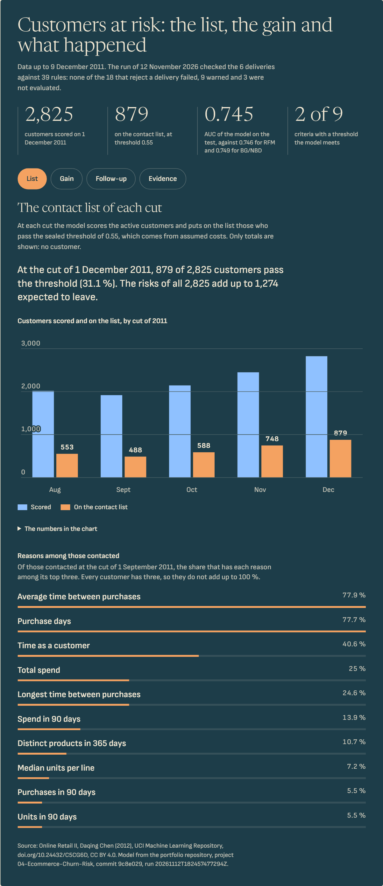
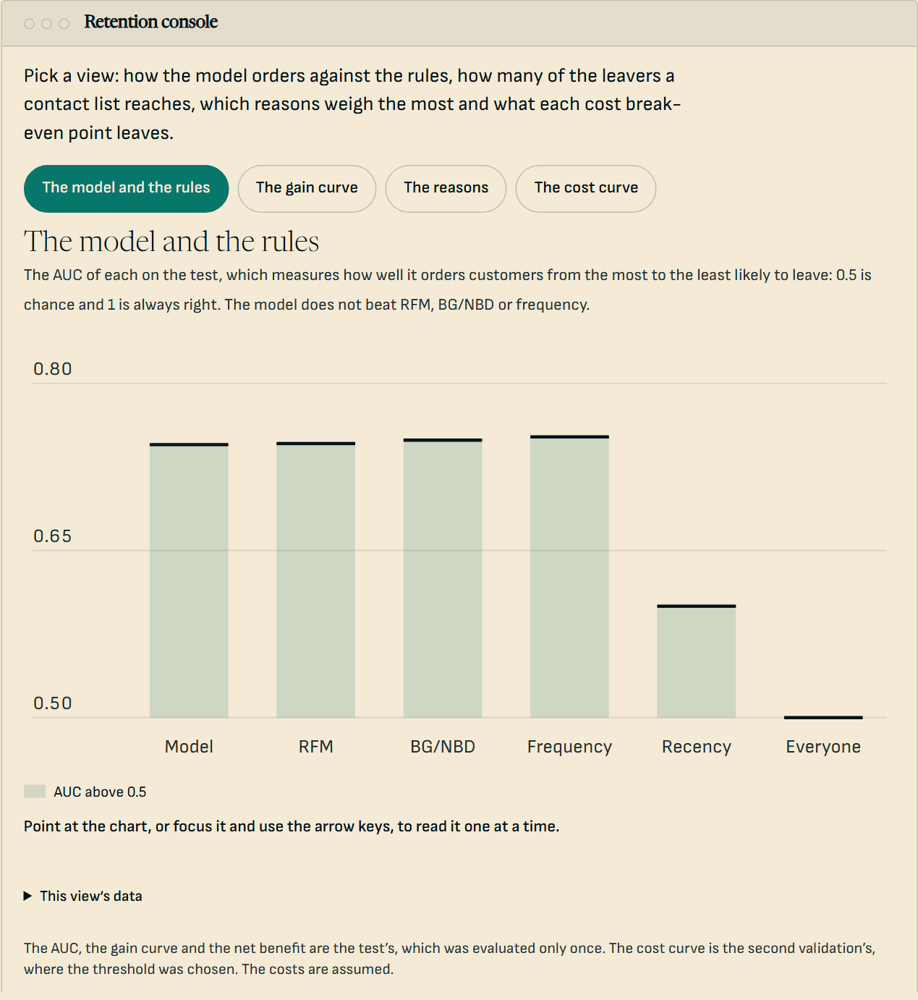
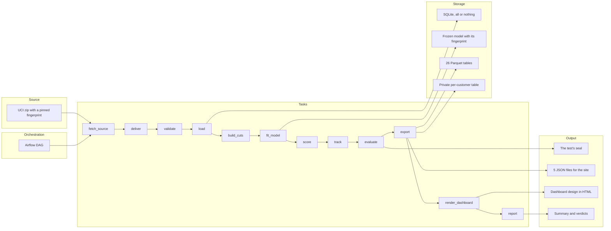

# Gradient boosting and SHAP for customer churn prediction

**English** · [Español](README.es.md)

A monthly list of customers at risk of leaving, with their three reasons.



|  |  |
| --- | --- |
| **Result** | 2 of 9 success criteria met |
| **Tech stack** | Python, pandas, scikit-learn, SHAP, SciPy, SQLite, Parquet, Apache Airflow, Docker |
| **Techniques** | Binary classification, Gradient boosting, SHAP, BG/NBD, RFM, Isotonic calibration, Cost-based threshold |
| **To audit** (in Spanish) | [Model card](docs/model-card.md) · [Independent evaluation](docs/evaluation.md) · [Latest run: validation](reports/validation/latest.md) · [Latest run: results](reports/evaluation_summary.md) · [Decision log](docs/decisions.md) |

## 1. Executive summary

### 1.1 Business problem and solution

**Business problem and target audience.** Built for the retention and CRM teams of an online shop, with management watching what each offer costs. The shop sees who bought and when, but nobody marks who stopped buying: by the time it shows, the customer is gone. The project takes the public invoices of an online retailer, mostly from the UK (1,067,371 lines and 5,942 customers from 41 countries), and answers each month whom it pays to contact, and why.

**Proposed solution.** A monthly flow that, at each cut-off date, gives each active customer three things:

- **Risk of leaving:** the probability of not buying again in the next 90 days, calibrated in validation.
- **Three reasons:** the variables that push their risk the most according to SHAP, which add up exactly to their risk on the model’s scale.
- **Contact list:** they go on it if their risk passes the threshold of 0.55, which comes from assumed and declared costs; each month who came back and who left is followed.

### 1.2 Success criteria and impact

**Criteria set before measuring.** Before the code was written, ten criteria were fixed, nine with a threshold: that the model beat RFM and validation’s strongest rule on AUC, also beyond the noise; that it capture more leavers in the 10 % at highest risk; that it leave more net benefit than that rule at its own threshold and more than contacting everyone or no one; that it be calibrated on the test (a calibration error of 0.03 or less and a bias of 0.02 or less); that its Brier be lower than that rule’s; and that it leave at least that rule’s benefit at every cost break-even point, from 0.10 to 0.90. What was expected was written down too: that it would not meet the two beyond the noise nor the calibration one.

**Impact and main result.** The model does not beat the simple rules: its AUC on the test is 0.745, against 0.746 for RFM, 0.749 for BG/NBD and 0.752 for frequency. It meets 2 of the 9 criteria with a threshold: acting with it pays better than contacting everyone or no one, with 209.7 units of net benefit per 1,000 customers against −1,559.1 and 0, and its Brier is lower than BG/NBD’s. What it adds is each customer’s probability and reasons, not a better order.



## 2. Datasets and preparation

### 2.1 Sources, scope and granularity

- Online Retail II. Daqing Chen (2012), on the UCI Machine Learning Repository, doi.org/10.24432/C5CG6D. https://doi.org/10.24432/C5CG6D (CC BY 4.0)

| Attribute | Specification |
| --- | --- |
| Original volume (M × N) | 1,067,371 rows × 8 columns, in a two-sheet Excel workbook inside a 45,622,418-byte zip |
| Project scope | 1,044,848 lines without the 22,523 copies between the two sheets; 5,942 customers with at least one purchase, from 41 countries |
| Period covered | Invoices from December 2009 to 9 December 2011 |
| Granularity and integrity | One row per invoice line; the model’s unit is the customer at a cut-off date, the 1st of each month: 19 cuts, from June 2010 to December 2011 |
| Label | It is not in the data: a customer who bought in the 90 days before the cut has left if they do not buy in the next 90 |

<details>
<summary>Fields available in the dataset (8)</summary>

| Column | Content | Unit | Data type |
| --- | --- | --- | --- |
| `Invoice` | Invoice number; those starting with “C” are cancellations | — | Text |
| `StockCode` | Product or service code | — | Text |
| `Description` | Product name, free text | — | Text |
| `Quantity` | Units of the line, negative in a cancellation | units | Integer |
| `InvoiceDate` | Invoice date and time, no zone | date and time | Date and time (text) |
| `Price` | Unit price | £ per unit | Decimal |
| `Customer ID` | Customer number; empty in a guest purchase | — | Integer |
| `Country` | Customer’s country on the line | — | Text |

</details>

The flow reads all 8 columns. Description is stored but does not reach the model; Customer ID never reaches a published file; Country enters only the F2 feature set, which is not the one chosen.

### 2.2 Cleaning and quality rules

- **Copies between the two sheets.** The 22,523 identical rows where the sheets overlap are removed on reading the file; the 11,812 lines identical to an earlier one on the same sheet are kept and flagged.
- **Guests set aside.** The 235,287 lines with no customer number, 22.5 % of the lines and 15.1 % of the value, are set aside: they cannot be followed in time.
- **Cancellations netted, with what is known on the date.** The 17,641 cancellation lines are taken off the purchase they cancel, by customer and product, with what is known on each date; the 1,706 with no purchase to cancel are discarded and counted.
- **Lines that are not sales.** Lines with a zero or negative price (70 rows), service codes such as postage, fees or samples (3,663), gift vouchers and bad-debt adjustments are set aside.
- **Kept with a flag.** Very large quantities on one line (43 rows), customers with more than one country, who take the one of their last line before the cut (1,646), and the unspecified country, which goes to “Others” (756), are kept and flagged.
- **Empty is not zero.** A cut whose window has not closed has no churn rate, and a cell of fewer than 10 customers is published hidden, its values null.

## 3. Architecture and methodology

The system runs as a flow of twelve tasks, always in the same order and with the same functions from the command line (python -m churnrisk run) and from Apache Airflow’s churnrisk_monthly DAG in Docker: fetch_source → deliver → validate → load → build_cuts → fit_model → score → track → evaluate → export → render_dashboard → report.

### 3.1 Source and ingestion

- **Hardened download (fetch_source).** The zip arrives over HTTPS from archive.ics.uci.edu; every hop must go to a listed host, with at most 3 redirects, 64 MiB and 900 s, and the file is accepted only if its SHA-256 fingerprint is the one pinned in the configuration. In Airflow, the task has 3 retries, 10 minutes apart.
- **A workbook not treated as trusted.** The zip must hold exactly the expected workbook, with no paths, under an uncompressed cap of 100 MiB and with its own fingerprint; the workbook, its two sheets with the exact 8 columns in order, and each value, its type. If not, the delivery is rejected without touching anything.
- **Monthly deliveries on a historical file (deliver).** The second task plays the source system: it splits the file into a launch with the invoices to 31 July 2011, four monthly deliveries, from August to November 2011, and a close with the days of December 2011. With no delivery pending, the run ends there.
- **Quality gate (validate).** It applies 39 rules in three levels: 18 blocking ones reject the delivery without touching what is already loaded, 13 fix, set aside or flag and warn, and 8 only report.

### 3.2 Orchestration and transformation

- **Flow control (Apache Airflow).** The churnrisk_monthly DAG runs once a month, with one run and one task active at a time, and with each task’s retries and time limit. Each task also takes a lock on the data folder, and a second process is turned away without writing anything.
- **Loading and transformation (load, build_cuts).** load writes the delivery to SQLite in a single transaction, all or nothing. build_cuts takes each cancellation off the purchase it cancels with what is known on the date and builds, at each cut, the population of active customers, their 16 variables from what came before the cut and their label, which enters only once its 90-day window has closed.
- **Frozen model and scoring (fit_model, score, track).** fit_model trains once, at the launch, and leaves the model frozen: its file is loaded only if its SHA-256 matches the recorded one. score scores each cut’s active customers once, never changing a score already issued, and track follows each month who came back and who left.
- **What was tested in Docker.** The DAG’s end-to-end test in Docker, in quick mode on synthetic data, passed 2 of 2 in 147.6 s during the independent evaluation. The real run was made from the command line; Airflow’s scheduled run on the real file has not been run.



### 3.3 Storage and data modelling

- **Transactional and audit database (SQLite).** It holds each delivery’s lines, the cuts with their variables and labels, the scores with their reasons, the follow-up, the runs and the result of each validation rule. Beside it sit the frozen model and the test’s seal, which is never rewritten.
- **Star-schema analytical layer (Parquet).** The export task writes 26 Parquet tables with a manifest of fingerprints, with unique keys and referential integrity checked before writing. The fact per customer and cut, the only one with the customer number, goes to a private folder that is not versioned.

<details>
<summary>Data model (27 tables)</summary>

| Table | Kind | Columns | Joins |
| --- | --- | --- | --- |
| `Calendar` | dimension | 7 | — |
| `Cuts` | dimension | 8 | — |
| `Country` | dimension | 4 | — |
| `Risk band` | dimension | 4 | — |
| `Reason` | dimension | 4 | — |
| `Method` | dimension | 3 | — |
| `Frozen model` | dimension | 13 | — |
| `Run` | dimension | 11 | — |
| `Calculation date` | dimension | 3 | — |
| `Customers by cut and band` | fact | 8 | Cuts (`cut_key`); Risk band (`band_key`) |
| `Customers by cut and country` | fact | 6 | Cuts (`cut_key`); Country (`country_key`) |
| `Reasons by cut` | fact | 5 | Cuts (`cut_key`); Reason (`reason_key`) |
| `Follow-up` | fact | 11 | Cuts (`cut_key`); Calculation date (`as_of_key`) |
| `Metrics by method` | fact | 17 | Method (`method_key`) |
| `Criteria` | fact | 12 | — |
| `Gain curve` | fact | 7 | Method (`method_key`) |
| `ROC curve` | fact | 6 | Method (`method_key`) |
| `Calibration` | fact | 7 | Method (`method_key`) |
| `Cost curve` | fact | 7 | Method (`method_key`) |
| `Sensitivities` | fact | 11 | — |
| `Churn definition` | fact | 4 | — |
| `Silences that come back` | fact | 3 | — |
| `Feature importance` | fact | 4 | Reason (`reason_key`) |
| `Grid candidates` | fact | 6 | — |
| `Leak demonstration` | fact | 4 | — |
| `Validation rules` | fact | 10 | Run (`run_key`) |
| `Risk list, private` | fact | 19 | Cuts (`cut_key`); Country (`country_key`); Risk band (`band_key`) |

</details>

### 3.4 Experimentation and machine learning

- **Rigour and traceability protocol.** The ten success criteria, and what was expected of each, were written and committed to Git before the first line of code, in docs/requirements.md and in decision D18. Hyperparameters, seeds, costs and windows live in config/pipeline.toml, and a SHA-256 fingerprint over the part of the configuration that can change a sealed value detects any change: with another configuration, what is computed is reported apart, as after the seal. Every technical decision is in the decision log, with its options, its reason and its status.

#### 3.4.1 Feature engineering and baseline

The model reads 16 variables per customer, computed only from what came before the cut: how long ago they bought, their tenure, their purchase days (in total, in 90 and in 365 days), their spend (in total, in 90 and in 365 days) and per purchase day, their units in 90 days, the average and the longest time between purchases, the distinct products and the median units per line in 365 days, and their cancellations and their value in 365 days. An allow list, a dedicated error (LeakageError) and truncation and perturbation tests keep the label, the customer number and the calendar out of the matrix, and a tripwire stops the launch if the chosen model’s AUC reaches 0.95 in V1. To show what a leak sounds like, the project tries on purpose a variable that looks at the label’s window: it takes the second validation’s AUC from 0.762 to 1.000. The baseline is the rules a manager would write, with their parameters from training: contact everyone, recency, RFM, BG/NBD, 365-day frequency and 1 − P(alive), informative only; the strongest in validation, BG/NBD, is the baseline to beat.

**Approach: the model alone, the model against a manager’s rules, or rules alone?** (D01)

- **Selected alternative:** A classifier against the rules a manager would use (recency, RFM, frequency and BG/NBD), with criteria fixed before building that may not be met and the expected result written before measuring. An AUC with no rule beside it does not say whether the model adds anything, and the research already showed it might add nothing over a one-variable rule: that comparison is the result.
- **Rejected alternatives:** The model alone, with its AUC: It would repeat the tutorials’ mistake of high AUCs with no cuts in time.
- **Rejected alternatives:** Rules alone, no model: It would leave out each customer’s reasons, which a rule does not give.

#### 3.4.2 Modelling decisions and ablation (ADR)

<details>
<summary>4 decisions, each with what was rejected</summary>

**Choosing the algorithm** (D13)

- **Selected alternative:** scikit-learn’s HistGradientBoostingClassifier, with the country one-hot encoded explicitly, a fixed grid of 24 candidates and 300 iterations with no early stopping, seed 0. scikit-learn was already in the portfolio’s stack and with it SHAP was checked to add up exactly; at this volume there is no performance reason to change it.
- **Rejected alternatives:** LightGBM: It would swap a tested dependency for an untested one to save another.
- **Rejected alternatives:** Logistic regression: The interactions between variables would have to be written by hand.
- **Rejected alternatives:** Early stopping: It would use a random split inside training, which breaks the order in time.

**Each customer’s reasons** (D15)

- **Selected alternative:** SHAP (TreeExplainer) on the uncalibrated classifier’s log-odds, with additivity checked on every row: if the reasons do not add up to the customer’s risk, the task fails. It is the only verified way to give exact reasons per customer, and checking it on every row turns the condition into a guard rather than a convention.
- **Rejected alternatives:** Permutation importance: It gives no reasons per customer.
- **Rejected alternatives:** An in-house TreeSHAP: It is another project.

**BG/NBD: which implementation?** (D17)

- **Selected alternative:** Project 02’s BG/NBD in SciPy, copied and fitted once on the training history, with lifetimes only as a reference in the tests. It works, measured on this same problem: its expected purchases and their order are practically lifetimes’.
- **Rejected alternatives:** lifetimes in production: It would put an unmaintained library in production.
- **Rejected alternatives:** Importing project 02’s package: It would couple two projects that are published separately.

**Costs and the contact threshold** (D22)

- **Selected alternative:** Assumed and declared costs, in generic units: an offer of 5, a save rate of 0.2 and a retained customer worth 50, a break-even point of 0.5; the threshold maximises net benefit in validation, and the choice is repeated at 17 break-even points, from 0.10 to 0.90. There is no defensible public source for the cost of an offer or the value of a customer; 0.5 says “contact when leaving is more likely than staying”, a choice with no source that is declared.
- **Rejected alternatives:** The research’s illustrative values: Their break-even point would contact almost everyone, and then no order helps.
- **Rejected alternatives:** A value per customer from their spend: Wholesalers would dominate the list, and the comparison with the rules would be mixed up.
- **Rejected alternatives:** A fixed share of contacts: It ignores the costs.

</details>

#### 3.4.3 Validation protocol (time split and sealed test)

A split in time, by cut-off date, with at least 90 days between the last training cut and the first validation cut, and between the last validation cut and the first test cut, so that no block’s label window reaches the next: training, with 7 cuts from June to December 2010 (15,297 rows); V1, with those of March and April 2011, to choose among the 24 candidates by log loss and calibrate with isotonic regression; V2, with May’s, to choose the threshold; and the test, with those of August and September 2011 (3,935 rows), evaluated once under a seal that is never rewritten. The rules are calibrated the same way, so they can decide by cost too. The 95 % intervals come from 1,000 resamples paired by customer, seed 0. There is no random cross-validation: each block comes after the one before.

### 3.5 Consumption and governance

- **Consumption interfaces.** The Parquet tables feed the full design of a dashboard in HTML, with the model, three what-if parameters for the assumed costs and five pages; five small JSON files, with their manifest, feed this page and its dashboard.
- **Privacy.** No published file carries the customer number; cells of fewer than 10 customers are hidden, and a secondary rule keeps them from being recovered by subtraction.
- **Governance artefacts.** The report task writes the evaluation summary with each criterion’s verdict, the one the README copies; with it come the model card (intended and unintended use, limits), the decision log and the last run’s validation report.
- **Full lineage.** Every site file carries the run key, the SHA-256 fingerprint of the source zip and the CC BY licence attribution.

## 4. Final product

### 4.1 Operational deliverables

- **Automation.** A monthly flow was set up that loads the invoices of each delivery and checks them against 39 rules: 18 reject the delivery if they fail, 13 fix, set aside or flag, and 8 only report. Then it moves the cut-off date, recalculates the variables from what came before and scores each active customer with the model, which was trained once and sealed. Since the file is historical, the flow splits it into 6 deliveries: the launch, four monthly ones and the close on 9 December 2011. It is built for Airflow, where it was tested in Docker.
- **Model in use.** Each active customer gets, at each cut, a risk and its three main reasons, and goes on the contact list if the risk passes the threshold of 0.55, which comes from the assumed costs. Among those contacted at the 1 September 2011 cut, the average time between purchases is among the three reasons of 77.9 %. In the 5 cuts from August to December 2011 there were 11,353 scorings and 3,256 went on the list. In the two test cuts, whose 90-day window has closed, the model expected 875.0 and 825.2 to leave and 739 and 615 did; of the 553 and the 488 on the list, 337 and 266 left. The other three cuts are still open on 9 December 2011.
- **Dashboard.** Everything ends in the tables of a star schema and in the dashboard shown at the top, drawn from the run’s real numbers: four views, from the list of customers at risk to the gain, the follow-up and the evidence, with the assumed costs in view and totals only, no customer. With each delivery the tables and the dashboard’s design in HTML are renewed, and both are delivered with the project.

### 4.2 Reading the current results

Last validated run: 20261112T182457477294Z, of 12 November 2026, with data to 9 December 2011; 6 deliveries loaded and 0 rejected.

- **Customers scored.** In the 5 cuts from August 2011 to December 2011 there were 11,353 scorings, and 3,256 went on the contact list at the threshold of 0.55.
- **Test cuts, with the window closed.** At the cuts of 1 August 2011 and 1 September 2011 the model expected 875.0 and 825.2 to leave, and 739 and 615 did: it overestimates churn.
- **The contact list at those cuts.** Of the 553 and the 488 customers contacted, 337 and 266 left.
- **Open cuts.** The 3 cuts that follow are scored and followed; their 90-day window ends after the data, so they are not evaluated yet.
- **Most frequent reason.** Among those contacted at the cut of 1 September 2011, “average time between purchases” is among the three reasons of 77.9 %.

## 5. Conclusion

### 5.1 Evaluation against the success criteria

**Status:** 2 of 9 success criteria met.

**Not met:**

- Discrimination against RFM: AUC 0.745 against 0.746.
- Improvement beyond the noise against RFM: the AUC difference is −0.0017, with a 95 % interval of −0.0145 to 0.0110.
- Improvement beyond the noise against BG/NBD, validation’s strongest rule: −0.0043, with an interval of −0.0166 to 0.0078.
- Capture in the 10 % at highest risk: 253 leavers, against 268 for BG/NBD.
- Net benefit against BG/NBD at its own threshold: 209.7 against 238.9 units per 1,000 customers.
- Calibration on the test: a calibration error of 0.089 and a bias of 0.088, against limits of 0.03 and 0.02.
- Sensitivity to costs: it leaves at least BG/NBD’s benefit at 9 of the 17 break-even points, not at all of them.

The two criteria that are met, and the informative one:

- **Acting with the model pays.** At the assumed costs it leaves 209.7 units of net benefit per 1,000 customers, against 0 for contacting no one and −1,559.1 for contacting everyone.
- **Brier against the strongest rule.** Its Brier, 0.1976, is lower than BG/NBD’s, 0.2030, though higher than RFM’s, 0.1956.
- **By cut and with other definitions (informative).** With 60 or 120 days without buying as churn, looking back 180 days or without the December cut in training, the interval of the difference with BG/NBD always holds zero or lies below it: no variant comes out of the noise in the model’s favour.

**Comparison on the test**

| Method evaluated | AUC · net benefit per 1,000 customers | Role in the system |
| --- | --- | --- |
| Model (gradient boosting) | 0.745 · 209.7 | Risk and three reasons per customer; does not order better than the rules |
| 365-day frequency | 0.752 · 106.7 | Orders best on the test; anyone can write it |
| BG/NBD | 0.749 · 238.9 | Validation’s strongest rule and the one that leaves the most benefit |
| RFM | 0.746 · 209.7 | The reference rule of the first two criteria |
| Recency | 0.600 · −47.0 | Alone it orders little: how long ago they bought is not enough |
| Contact everyone | 0.500 · −1,559.1 | Loses at the assumed costs |

### 5.2 Methodological limits

The result holds for one shop’s file, from 2009 to 2011. Churn is a 90-day silence the project defines, not a fact in the data, and almost a third of those silences buy again; there is no retention experiment, so what an offer would achieve was not measured. The costs are assumptions: another break-even point gives another threshold and another list. The test was evaluated once, with two cuts of about 2,000 customers each, which do not separate AUC differences below about 0.01. The probability was calibrated in spring and overestimates late-summer churn. With these data, a frequency or RFM rule is the honest place to begin: it orders as well as the model and anyone can write it.

### 5.3 Future work

- **A scheduled run on the real file.** The real repeat ran from the command line, and the Airflow DAG in Docker only in quick mode, on synthetic data; it still has to run on the real file.
- **Real costs and a retention experiment.** With the real cost of an offer and a test with a control group, the save rate and the value of a customer would stop being assumptions.
- **Recalibrate on a recent period.** In use, the probability would have to be recalibrated on the latest cuts, because the spring calibration overestimates churn when the rate drops.

## Run it

Python 3.11, on PowerShell, from the repository folder:

```powershell
py -3.11 -m venv .venv
.venv\Scripts\python -m pip install -r requirements-dev.txt
$env:PYTHONPATH = "src"

# Tests, without the ones that need the real file or Docker
.venv\Scripts\python -m pytest

# Quick end-to-end run on synthetic data; everything stays in data\quick\, which is not versioned
.venv\Scripts\python -m churnrisk make-fixture data\quick\online_retail_fixture.zip
.venv\Scripts\python -m churnrisk replay --config config\pipeline.quick.toml

# Real run: downloads the zip (46 MB) if it is missing and runs the six deliveries, then the run without one
.venv\Scripts\python -m churnrisk replay
.venv\Scripts\python -m churnrisk run

# Tests with the real file
.venv\Scripts\python -m pytest -m real_data

# Documentation figures and the results block of README.es.md
.venv\Scripts\python -m churnrisk figures
.venv\Scripts\python -m churnrisk docs-sync
```

Every operation, with its failures and how to recover, is in the [runbook](docs/runbook.md) (in Spanish).

## Source and licence

Data source: Chen, D. (2012). Online Retail II [Dataset]. UCI Machine Learning Repository. https://doi.org/10.24432/C5CG6D, CC BY 4.0 (https://creativecommons.org/licenses/by/4.0/). Changes: the copies of the overlap between the sheets removed, lines without a customer and service codes set aside, cancellations discounted from the purchases they cancel, the history split into monthly deliveries, and cuts, labels, variables, risks, reasons, metrics and criteria calculated.

The raw data is not versioned: the flow downloads the file and checks its hash. No published output carries a customer number.

The code is under the [MIT licence](LICENSE); the source data keeps the licence given above.
