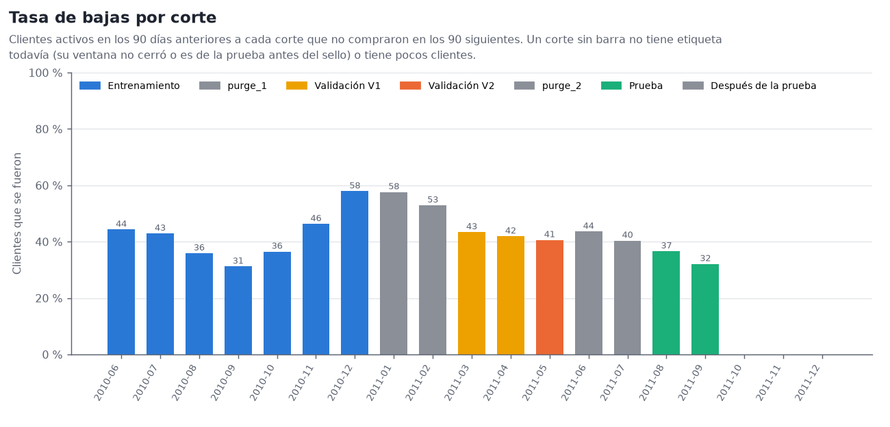
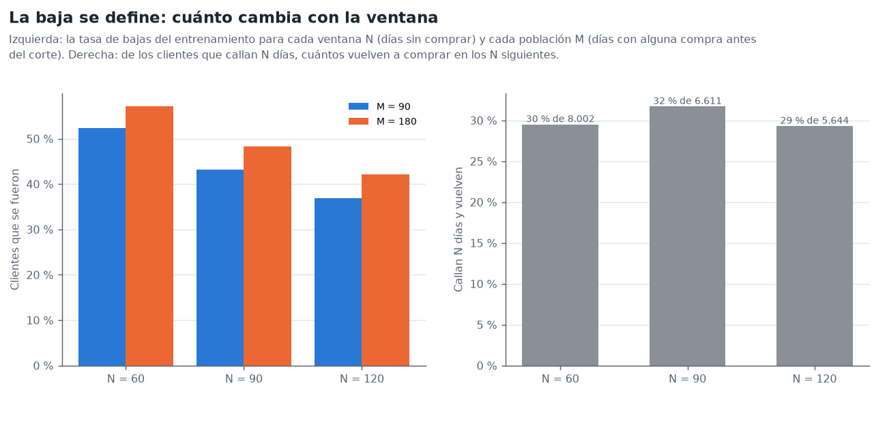
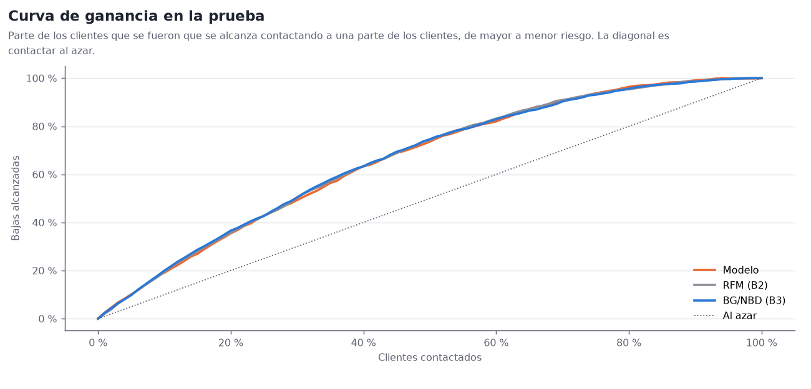
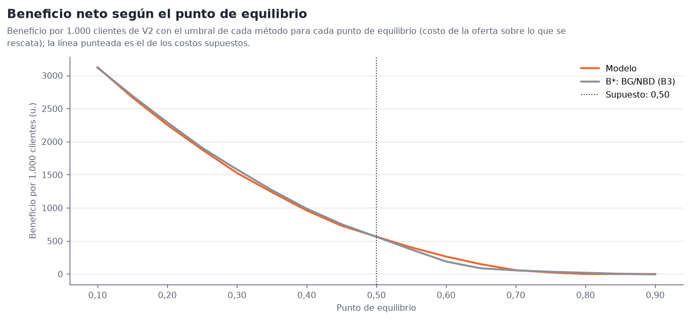
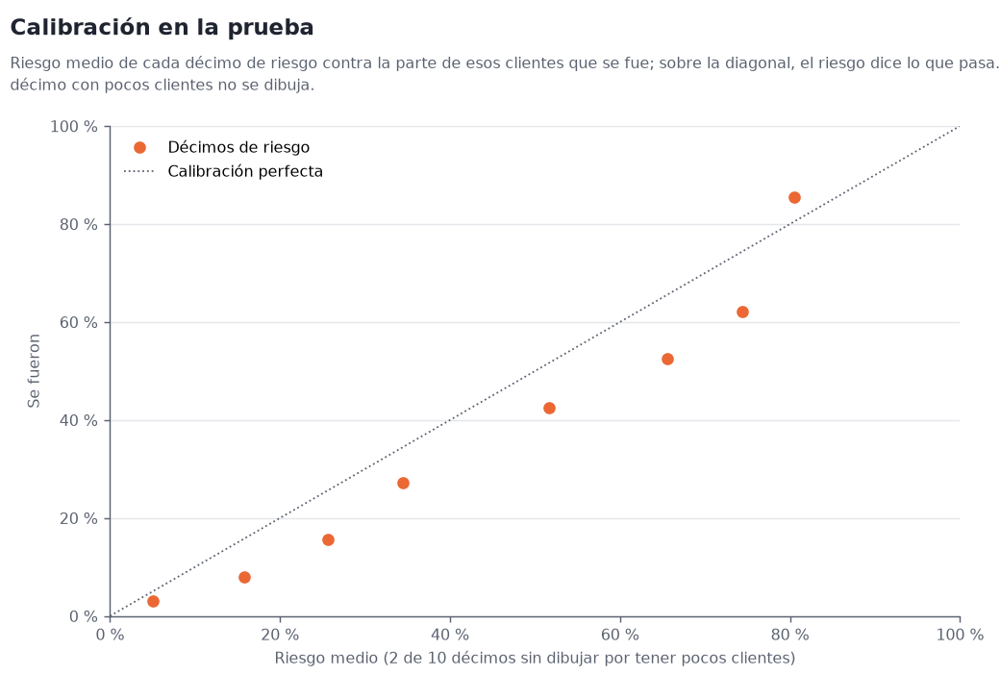
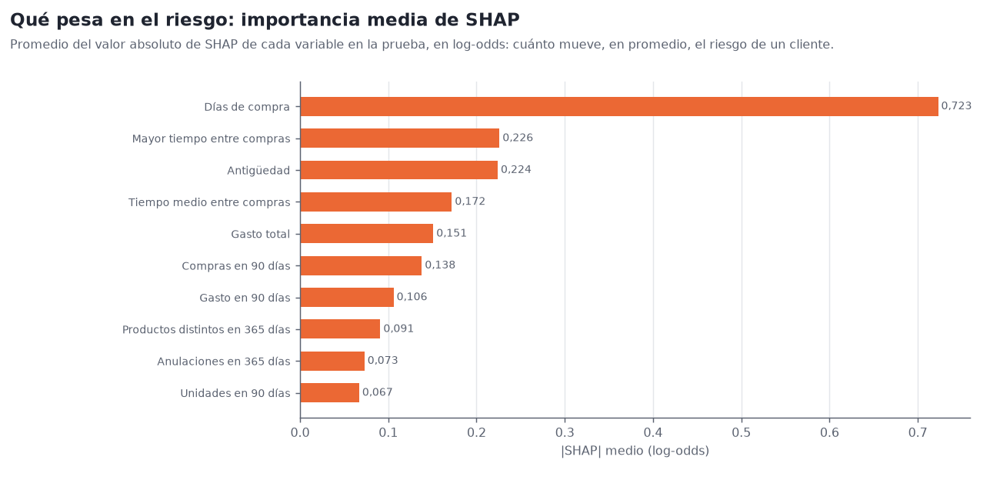
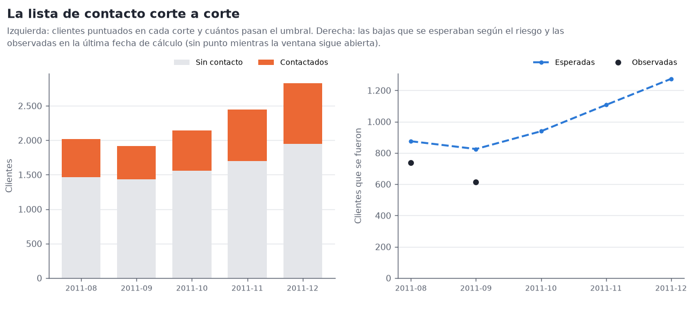

# Clientes que están por irse, antes de que se vayan

Un flujo mensual que carga las facturas de una tienda en línea, las valida, descuenta las anulaciones con lo que se sabe en cada fecha y, en cada fecha de corte, da a cada cliente activo la probabilidad calibrada de no volver a comprar en los 90 días siguientes, con sus tres motivos principales, y la lista de los que conviene contactar según costos supuestos y declarados. Y mide, contra criterios fijados antes de escribir el código, si el modelo ordena a los clientes mejor que las reglas que usaría un gerente: no las supera.

## El problema

Una tienda que vende en línea ve quién compró y cuándo, pero ningún sistema marca quién dejó de comprar: cuando alguien lo nota, el cliente ya se fue. No hay un contrato que se cancele ni un aviso de baja, solo un silencio que se confunde con una pausa normal. Retención y marketing no saben a quién llamar ni cuándo; atención al cliente no sabe a quién cuidar; dirección no sabe cuánto rinde una oferta de retención ni si un modelo agrega algo a una regla que cualquiera puede escribir con las facturas.

El dato de este proyecto es el archivo público «Online Retail II» de UCI (CC BY 4.0): las facturas de un minorista en línea, sobre todo del Reino Unido, del 2009-12-01 al 2011-12-09, 1.067.371 filas en dos hojas. El archivo no dice quién se fue: la baja hay que definirla, y la definición es ruidosa, porque parte de los clientes que callan 90 días vuelve a comprar después. En los siete cortes de entrenamiento, el 43,2 % de los clientes activos no volvió a comprar en los 90 días siguientes, entre el 31,2 % y el 57,9 % según el mes.

Lo que el proyecto encontró es la respuesta honesta a la pregunta de dirección: **el modelo no supera a las reglas simples.** En la prueba, una regla de frecuencia (cuántos días compró el cliente en el último año) ordena a los clientes mejor que el modelo, y BG/NBD, la base más fuerte elegida en la validación, deja más beneficio con los mismos costos supuestos.

## La solución

Un flujo mensual que toma cada entrega de facturas, la valida con 39 reglas (18 bloquean la entrega, 13 advierten y 8 informan), la carga en SQLite de forma todo o nada, descuenta cada anulación de la compra que anula con lo que se sabe en la fecha, arma en cada corte la población de clientes activos y su etiqueta, entrena una sola vez un clasificador de árboles en el lanzamiento y lo deja congelado, puntúa cada mes a los clientes activos con sus tres motivos (SHAP), elige a quién contactar con un umbral por beneficio neto y sigue mes a mes quién volvió y quién no. Escribe las tablas de un tablero de Power BI en modelo estrella, el diseño del tablero en HTML y cinco archivos pequeños para el sitio, sin ningún número de cliente en lo publicado.

El resultado central no es el modelo sino una medición: el clasificador se compara con la recencia, RFM, la frecuencia y BG/NBD, con diez criterios fijados antes de construir. **El modelo no supera a RFM (C01, C02) ni a la base más fuerte (C03, C04, C05), no queda calibrado en la prueba (C07) y no deja al menos el beneficio de la base más fuerte en todos los puntos de equilibrio de costo (C09); cumple C06 (conviene actuar con él antes que contactar a todos o a nadie) y C08 (su Brier es menor que el de la base más fuerte).** Lo que el proyecto deja, aunque el modelo no gane:

- **La etiqueta y su ruido**, medidos y escritos: la baja como ninguna compra neta en 90 días, la tasa de cada corte, qué pasa con 60 y 120 días, y cuántos silencios vuelven.
- **El flujo y el sello**: seis entregas mensuales sobre un archivo histórico, validadas y cargadas todo o nada, y una prueba evaluada una sola vez bajo un sello que no se reescribe.
- **El tablero**: las 26 tablas en estrella y el diseño de cinco páginas, con el panel de los costos supuestos.
- **Los motivos de cada cliente**: SHAP sobre el log-odds del modelo, comprobado fila por fila.
- **La curva de costo**: cuánto cambia la decisión de contactar si cambian el costo de la oferta, la tasa de rescate o el valor de un cliente.
- **La evidencia de que una regla de frecuencia o RFM es el punto de partida honesto**: con estos datos, cualquiera de las dos ordena a los clientes como el modelo, y es más fácil de explicar.

## Los resultados

Corrida real del 2026-11-12 sobre el zip de UCI (huella SHA-256 `572e3627…7bfb`): el lanzamiento al 2011-07-31, cuatro entregas mensuales (2011-08 a 2011-11), el cierre con los 9 días de 2011-12 y una corrida sin entrega. El modelo se entrenó con siete cortes de 2010, se eligió y calibró con los de marzo y abril de 2011 (V1) y eligió su umbral con el de mayo (V2); la prueba, los cortes del 2011-08-01 y del 2011-09-01 (3.935 filas de 2.017 y 1.918 clientes, 34,4 % de bajas), se evaluó una sola vez y quedó en el sello `reports/model_seal.json`, que no se reescribe. Los criterios se fijaron y se confirmaron en Git antes del primer código (`docs/requirements.md`, sección 8.1; `docs/decisions.md`, D18), junto con lo que se esperaba: que el modelo no cumpliera C02, C03 ni C07. **Así salió, y peor: el modelo no supera ningún criterio de orden ni de beneficio (C01-C05, C09), no cumple el de calibración (C07) y cumple solo C06 y C08.** El bloque siguiente no se escribe a mano: lo copia `python -m churnrisk docs-sync` de `reports/evaluation_summary.md`, que escribe el propio flujo, con sus títulos un nivel más abajo.

<!-- results:start -->
### Resultados

Criterios fijados antes de construir, evaluados una vez sobre la prueba.

| Criterio | Umbral | Valor | Cumple | Veredicto |
| --- | --- | ---: | --- | --- |
| C01 Discriminación frente a RFM | AUC(modelo) > AUC(B2) | 0,745 | no | El modelo no supera a RFM en AUC: 0,745 frente a 0,746. |
| C02 Mejora fuera del ruido frente a RFM | límite inferior del intervalo del 95 % de AUC(modelo) − AUC(B2) > 0 | −0,002 | no | El modelo no supera a RFM fuera del ruido: la diferencia de AUC es −0,00, con un intervalo del 95 % de −0,01 a 0,01. |
| C03 Mejora fuera del ruido frente a la base más fuerte | límite inferior del intervalo del 95 % de AUC(modelo) − AUC(B*) > 0 | −0,004 | no | El modelo no supera a la base más fuerte fuera del ruido: la diferencia de AUC es −0,00, con un intervalo del 95 % de −0,02 a 0,01. |
| C04 Captura en el 10 % superior | bajas en el 10 % de mayor riesgo del modelo > las del 10 % de B* | 253,000 | no | En el 10 % de mayor riesgo, el modelo no capta más bajas que la base más fuerte: 253 frente a 268. |
| C05 Beneficio neto frente a la base más fuerte | BN(modelo, t*) > BN(B*, t*_B*) | 209,657 | no | Con los costos supuestos, el modelo no deja más beneficio neto que la base más fuerte con su propio umbral: 209,7 u. frente a 238,9 u. por cada 1.000 clientes. |
| C06 Conviene actuar con el modelo | BN(modelo, t*) > máx(BN(contactar a todos), 0) | 209,657 | sí | El modelo supera a contactar a todos y a no contactar a nadie: 209,7 u. por cada 1.000 clientes frente a 0,0. |
| C07 Calibración en la prueba | ECE ≤ 0,03 y \|sesgo\| ≤ 0,02 | 0,089 | no | La calibración en la prueba no cumple: ECE 0,089 y sesgo 0,088. |
| C08 Brier frente a la base más fuerte | Brier(modelo) < Brier(B*) | 0,198 | sí | El Brier del modelo es menor que el de la base más fuerte: 0,1976 frente a 0,2030. |
| C09 Sensibilidad a los costos | BN(modelo) ≥ BN(B*) en cada punto de equilibrio de 0,10 a 0,90 | 9,000 | no | El modelo no deja al menos el beneficio de la base más fuerte en cada punto de equilibrio: en 9 de los 17 de 0,10 a 0,90. Es decir: lo deja en 9 de los 17 puntos de equilibrio y no lo deja en 8. |
| C10 Por corte y sensibilidades (informativo) | sin umbral: que esté escrito y sea consistente | sin dato | informativo | Por corte de prueba: 2011-08-01: AUC 0,744, tasa de bajas 0,366, diferencia con B2 −0,00 y con B* −0,00; 2011-09-01: AUC 0,746, tasa de bajas 0,321, diferencia con B2 −0,00 y con B* −0,01. Sensibilidades: N = 60 días (2011-08-01, 2011-09-01): AUC del modelo 0,737, de RFM 0,729 y de B* 0,744, intervalo de la diferencia con B* de −0,02 a 0,00; N = 120 días (2011-08-01): AUC del modelo 0,756, de RFM 0,766 y de B* 0,754, intervalo de la diferencia con B* de −0,02 a 0,02; M = 180 días (2011-08-01, 2011-09-01): AUC del modelo 0,750, de RFM 0,766 y de B* 0,760, intervalo de la diferencia con B* de −0,02 a −0,00; sin el corte de diciembre en el entrenamiento (2011-08-01, 2011-09-01): AUC del modelo 0,744, de RFM 0,746 y de B* 0,749, intervalo de la diferencia con B* de −0,02 a 0,01. |

Estado: sealed. Corrida 20261112T182457477294Z del 2011-12-09.
<!-- results:end -->

**Cómo leerlo.**

- **El orden de los clientes: el modelo no supera a las reglas.** Su AUC en la prueba es 0,745; el de RFM 0,746, el de BG/NBD (B*, la base más fuerte elegida en la validación) 0,749 y el de la frecuencia de 365 días 0,752, la más alta de todas. La recencia sola da 0,600. Frente a RFM la diferencia es −0,0017, con un intervalo del 95 % de −0,0145 a 0,0110 (C01 y C02 no se cumplen); frente a B*, −0,0043, de −0,0166 a 0,0078 (C03 no se cumple). Ninguna diferencia sale del ruido: con unos 2.000 clientes por corte, la prueba no separa diferencias de menos de unas 0,01 de AUC. **El modelo no supera a RFM ni a B*, y la frecuencia sola ordena mejor que los tres.**
- **El beneficio con los costos supuestos: tampoco.** Con una oferta de 5 u., una tasa de rescate de 0,2 y un cliente retenido que vale 50 u. (punto de equilibrio 0,5), el modelo contacta al 26,5 % de los clientes con su umbral de 0,55 y deja 209,7 u. por cada 1.000 clientes; B* deja 238,9 con su propio umbral (C05 no se cumple), RFM 209,7 y la frecuencia 106,7; contactar a todos pierde 1.559,1. En el 10 % de mayor riesgo, el modelo capta 253 bajas y B* 268 (C04 no se cumple). En la curva de costo, el modelo deja al menos lo de B* en 9 de los 17 puntos de equilibrio de 0,10 a 0,90 (C09 no se cumple).
- **Lo que sí cumple.** Actuar con el modelo deja más que no contactar a nadie y que contactar a todos (C06: 209,7 u. frente a 0), y su Brier, 0,1976, es menor que el de B*, 0,2030 (C08), aunque mayor que el de RFM, 0,1956.
- **La calibración falla, como se esperaba.** El modelo se calibró en V1, con 42,6 % de bajas, y la prueba, de agosto a noviembre, tiene 34,4 %: el error de calibración esperado es 0,089 y el sesgo 0,088, frente a 0,03 y 0,02 (C07 no se cumple). En el seguimiento se ve igual: en los dos cortes de prueba el modelo esperaba 875,0 y 825,2 bajas, y hubo 739 y 615.
- **Por corte y con otras definiciones, lo mismo** (C10, informativo): el AUC del modelo es 0,744 y 0,746 en los dos cortes; con N = 60, N = 120, M = 180 o sin el corte de diciembre en el entrenamiento, el intervalo de la diferencia con B* siempre contiene el cero o queda por debajo (con M = 180, de −0,021 a −0,0003).
- **Lo que esto quiere decir para un equipo de retención:** con las facturas, una regla que cuente cuántos días compró cada cliente en el último año ordena el riesgo igual o mejor que el modelo. Lo que el modelo agrega es una probabilidad (mal calibrada en la prueba) y los motivos de cada cliente, no un mejor orden. El aporte del proyecto es haberlo medido con la etiqueta, los cortes y la prueba sellada escritos antes, y dejar el flujo, el seguimiento, el tablero y la curva de costo listos para usarlos con la regla.
- **Lo que sigue pendiente:** la evaluación independiente, que todavía no se hizo (la hará un agente que no construyó el proyecto, plan, sección 28), la corrida programada de Airflow sobre el archivo real (sus pruebas estáticas pasan; la de Docker no se corrió), los costos reales de una oferta y el `.pbix`, que requiere Power BI Desktop. El detalle está en la [ficha del modelo](docs/model-card.md).















## En qué consiste

Doce tareas que corren siempre en este orden, las mismas desde la línea de comandos (`python -m churnrisk run`) y desde el DAG de Apache Airflow (`churnrisk_monthly`):

```mermaid
flowchart LR
  A[fetch_source<br/>zip con huella fijada] --> B[deliver<br/>la siguiente entrega]
  B --> C[validate<br/>39 reglas]
  C --> D[load<br/>SQLite, todo o nada]
  D --> E[build_cuts<br/>población, etiqueta y variables]
  E --> F[fit_model<br/>entrena y congela en el lanzamiento]
  F --> G[score<br/>riesgo y motivos de cada activo]
  G --> H[track<br/>quién volvió y quién no]
  H --> I[evaluate<br/>V2 y, una vez, la prueba]
  I --> J[export<br/>26 Parquet y 5 JSON]
  J --> K[render_dashboard<br/>HTML]
  K --> L[report<br/>cierra la corrida]
```



La segunda tarea hace de sistema de origen: como el archivo es histórico, el flujo lo reparte en un lanzamiento con las facturas hasta el 2011-07-31, cuatro entregas mensuales (2011-08 a 2011-11) y un cierre con los 9 días de 2011-12. Una línea va en la entrega de la fecha de su factura. Con ninguna entrega pendiente, la corrida termina como `no_delivery`. La tercera tarea corta el flujo, sin tocar nada, si la entrega no cumple el contrato.

Un corte es el día 1 de un mes. Su población son los clientes con al menos una compra neta en los 90 días anteriores (M = 90), y un cliente de la población se fue si no tiene ninguna compra neta en los 90 días desde el corte (N = 90); la etiqueta entra al almacén recién cuando esa ventana cerró. Las variables de un corte salen solo de lo anterior a él. El modelo se entrena una sola vez, en el lanzamiento, y queda congelado: su artefacto se carga solo si su SHA-256 coincide con el registrado, y cada corrida puntúa una vez a los activos de su corte, sin cambiar nunca un puntaje emitido. El sello guarda la configuración del lanzamiento y el primer resultado de la prueba; una evaluación con otra configuración se informa aparte, como posterior al sello. Un solo proceso escribe la carpeta de datos a la vez: cada tarea toma el bloqueo `data/interim/pipeline.lock`, y un segundo proceso se rechaza sin escribir nada.

Sobre la integridad de la descarga: el zip llega por HTTPS desde `archive.ics.uci.edu`; cada salto debe ir a un host de la lista, con a lo sumo tres redirecciones, 64 MiB y 900 s, y el archivo se acepta solo si su SHA-256 es el fijado en la configuración (el mismo que fijó el proyecto 02). El libro de Excel de adentro se trata como no confiable: miembro exacto, sin rutas, con tope descomprimido y su propia huella.

## Los datos

| | |
| --- | --- |
| Fuente | UCI Machine Learning Repository, «Online Retail II», de Daqing Chen (https://doi.org/10.24432/C5CG6D) |
| Archivo | `online_retail_ii.zip`, 45.622.418 bytes; adentro, `online_retail_II.xlsx`, con dos hojas y 8 columnas |
| Período | Facturas del 2009-12-01 al 2011-12-09 |
| Filas | 1.067.371; sin las 22.523 copias exactas del solapamiento entre las dos hojas quedan 1.044.848 líneas (11.812 repeticiones internas se conservan y se marcan) |
| Roles | 788.187 compras, 17.641 anulaciones y 239.020 líneas apartadas por la primera regla que las aparta (sin cliente, precio cero, códigos de servicio, vales, facturas «A») |
| Invitados | 235.287 líneas sin número de cliente (22,5 % de las líneas y 15,1 % del importe): no se pueden seguir en el tiempo y quedan fuera |
| Clientes | 5.942 con al menos una compra, de 41 países (91 % del Reino Unido) |
| Etiqueta | La baja no está en los datos: se define como ninguna compra neta en los 90 días desde el corte, entre los activos de los 90 días anteriores |
| Ruido | En el entrenamiento, el 31,7 % de los 6.611 silencios de 90 días vuelve a comprar en los 90 siguientes; la investigación midió 39 % sobre el archivo completo |

La partición en el tiempo, por fecha de corte, con purgas de al menos N días entre bloques:

| Bloque | Cortes | Filas | Bajas | Para qué |
| --- | --- | ---: | ---: | --- |
| Entrenamiento | 2010-06-01 a 2010-12-01 (7) | 15.297 | 43,2 % | Ajustar los modelos, las reglas y BG/NBD |
| Purga 1 | 2011-01-01 y 2011-02-01 | — | — | Ninguno |
| V1 | 2011-03-01 y 2011-04-01 | 3.449 | 42,6 % | Elegir y calibrar el modelo y las reglas, y elegir B* |
| V2 | 2011-05-01 | 1.886 | 40,6 % | Elegir el umbral por costo |
| Purga 2 | 2011-06-01 y 2011-07-01 | — | — | Ninguno |
| Prueba | 2011-08-01 y 2011-09-01 | 3.935 | 34,4 % | Evaluar una sola vez, bajo el sello |
| Censurados | 2011-10-01 a 2011-12-01 (3) | — | — | Se puntúan y se siguen; su ventana termina después de los datos |

## Los algoritmos

- **Variables de lo anterior al corte.** Dieciséis: recencia, antigüedad, días de compra (todos, en 90 y en 365 días), gasto (total, en 90 y en 365 días), gasto por día de compra, unidades en 90 días, tiempo medio y máximo entre compras, productos distintos y unidades medianas por línea en 365 días, y anulaciones y su importe en 365 días; además el país de la última línea, como indicadores. Tres conjuntos: F0 (recencia y frecuencia de 365 días), F1 (las dieciséis) y F2 (F1 y el país). Una lista permitida, un error propio (`LeakageError`), una prueba de truncamiento y una de perturbación impiden que la etiqueta, el número de cliente o una variable de calendario lleguen a la matriz, y una trampa detiene el lanzamiento si el AUC del modelo elegido llega a 0,95 en V1.
- **Clasificador.** `HistGradientBoostingClassifier` de scikit-learn con una grilla fija de ocho configuraciones por conjunto (24 ajustes de 300 iteraciones, sin parada temprana). Se elige el de menor pérdida logarítmica en V1: F1, tasa de aprendizaje 0,05, 15 hojas y 200 filas por hoja. El país no entra en el modelo elegido.
- **Calibración.** Regresión isotónica ajustada solo con V1 sobre el clasificador congelado; las reglas se calibran igual, para decidir con ellas por costo.
- **Motivos de cada cliente.** SHAP (`TreeExplainer`) sobre el log-odds del clasificador sin calibrar: la suma de las contribuciones más el valor base reproduce el log-odds de cada fila explicada con un error de a lo sumo 10⁻⁶, o la tarea falla. Se guardan los tres motivos de mayor contribución hacia el riesgo.
- **Umbral por costo.** El valor de 0,01 a 0,99 que maximiza en V2 el beneficio neto de contactar, `bajas × tasa de rescate × valor − costo de la oferta`, nunca F1: con los costos supuestos, 0,55. Para cada punto de equilibrio de 0,10 a 0,90 se repite la elección para el modelo y B*.
- **Reglas de comparación.** B0 contactar a todos, B1 la recencia, B2 RFM (quintiles de recencia, frecuencia y gasto de 365 días), B3 las compras esperadas en 90 días según BG/NBD (ajustado con la historia anterior al último corte de entrenamiento: r 0,9091, α 75,83, a 0,1717, b 105,91), B4 los días de compra en 365 días y B5 1 − P(vivo), informativa. B* es la de mayor AUC en la validación entre B2, B3 y B4: BG/NBD.
- **Intervalos.** Remuestreo pareado por clientes enteros de la prueba, 1.000 remuestras con semilla 0, los mismos índices para los dos puntajes.

Ecuaciones, límites y resultados de cada método en la [ficha del modelo](docs/model-card.md). La curva de ganancia sigue a Verbeke y otros (2012, https://doi.org/10.1016/j.ejor.2011.09.031): lo que se evalúa es cuántas bajas capta una lista de contacto de cada tamaño y cuánto deja actuar, no solo el AUC.

## El producto

- **Tablas para Power BI:** 26 archivos Parquet (9 dimensiones y 17 hechos) en `outputs/powerbi/`, con 19 relaciones uno a varios y filtro en un solo sentido (la 19, de `dim_as_of` a `fact_tracking`, desde D90), claves únicas e integridad referencial verificadas antes de escribir, y un manifiesto con la huella de cada uno; suman 158.405 bytes. El hecho por cliente y corte, el único que lleva el número de cliente, se escribe en `outputs/private/`, que no se versiona.
- **Diseño del tablero:** [dashboard/powerbi-design.html](dashboard/powerbi-design.html), un solo archivo de 107.214 bytes, sin recursos externos, con el modelo semántico, las relaciones, 29 medidas DAX, tres parámetros de hipótesis para los costos supuestos (costo de la oferta, tasa de rescate y valor del cliente retenido), la carga en Power Query y cinco páginas (clientes en riesgo y sus motivos, ganancia y costos, seguimiento, validación del modelo, calidad y corridas) con vistas previas dibujadas con los números reales; la columna de cliente de la lista se muestra enmascarada. El `.pbix` requiere la interfaz gráfica de Power BI Desktop y no está hecho; las medidas DAX no se ejecutaron nunca.
- **Archivos para el sitio:** cinco JSON pequeños en `outputs/site/` (resumen, etiqueta, reglas de validación, algoritmos y retención) y un manifiesto con la huella de cada uno, 71.424 bytes sin el manifiesto; sin el número de cliente ni ningún identificador, con las celdas de menos de 10 clientes ocultas y la regla secundaria que impide recuperarlas por resta.
- **Reportes:** `reports/evaluation_summary.json` y `.md` (los resultados de arriba), `reports/model_seal.json` (el sello) y `reports/validation/latest.md` (la última validación).
- **Orquestación:** la línea de comandos y el DAG de Airflow sobre Docker Compose, con las mismas tareas y las mismas funciones. La función de puntuación queda lista para envolverla en un servicio; no hay una API.

## La documentación

| Documento | Qué contiene |
| --- | --- |
| [docs/research.md](docs/research.md) | La investigación del conjunto de datos: la fuente, la etiqueta, las reglas y una primera mirada |
| [docs/requirements.md](docs/requirements.md) | Requerimientos, datos medidos y criterios de aceptación, con los criterios del modelo fijados antes de construir |
| [docs/plan.md](docs/plan.md) | Arquitectura, módulos, contratos y unidades de trabajo |
| [docs/decisions.md](docs/decisions.md) | Registro de decisiones, cada una con su contexto, opciones, decisión, motivo, lo que afecta, quién y estado |
| [docs/model-card.md](docs/model-card.md) | Ficha del modelo: uso, datos, la etiqueta y su ruido, métodos, resultados, sensibilidades, rendimiento y límites |
| [docs/data-dictionary.md](docs/data-dictionary.md) | Diccionario de datos: las 8 columnas de la fuente con su uso, las 16 variables con su unidad y cada columna de las 27 tablas del modelo estrella, la privada incluida |
| [docs/runbook.md](docs/runbook.md) | Qué hacer ante una huella distinta, una entrega rechazada, la trampa de fuga, un sello que no se reproduce, un bloqueo de la carpeta de datos y más (R1-R14), con los comandos y sus códigos de salida |
| [docs/paso-a-paso.md](docs/paso-a-paso.md) | Cómo se construyó, unidad por unidad, con sus commits |
| [docs/review-advisories.md](docs/review-advisories.md) | Las advertencias de las revisiones nativas, una sección por revisión, con su estado |
| `docs/evaluation.md` | La evaluación independiente: todavía no se hizo (plan, sección 28) |

## Con IA, de punta a punta

Este proyecto lo construyeron agentes de IA, cada uno con el modelo que el dueño pidió para su tarea (Haiku para investigar, Opus para los planes, la arquitectura y la programación de este proyecto, Sonnet para tareas de programación acotadas), con una persona definiendo el rumbo. Lo que sigue es lo que consta en el registro del documento de seguimiento (`odd/tasks/portfolio-projects.md`, L44 a L53) y en `git log`:

- **Investigación.** Un agente con Haiku copió de la carpeta del proyecto 02 el zip y el libro de UCI y comprobó que sus huellas son las fijadas allí, perfiló la calidad para medir bajas (invitados, anulaciones, códigos de servicio, países), propuso N = 90 y M = 90, los cortes y la partición, midió las reglas en el primer corte de validación e hizo una primera mirada del modelo, que no superó a RFM; comprobó que SHAP es aditivo solo con el país como indicadores y escribió `research.md` sin calcular nada sobre los cortes de prueba (`00378f8`).
- **Requerimientos y plan.** Un agente con Opus repitió parte de la medición solo con los cortes de entrenamiento: encontró que la frecuencia sola ordena mejor que RFM y que BG/NBD en el entrenamiento, comprobó que el BG/NBD con SciPy del proyecto 02 da las mismas compras esperadas que `lifetimes`, midió las tasas de cada corte, fijó los criterios C01-C10, escribió que C02, C03 y C07 probablemente no se cumplirían y planificó 31 unidades de trabajo; todo se confirmó en Git antes de la primera línea de código (`7ec593b`).
- **Programación.** Agentes con Opus construyeron el proyecto por tandas de hasta cinco unidades, de U01 a U29, con la prueba escrita primero y vista fallar y mutaciones de cada regla atrapadas por una prueba con nombre. Cuando no fue así, el registro lo dice: U22 a U25 no se escribieron con la prueba primero, y sus REDs se recuperaron quitando cada regla en una copia. Agentes con Sonnet escribieron una tanda de correcciones de advertencias (G1) y las correcciones que pidieron cuatro revisiones. Entre tandas, la suite rápida se hizo más barata cinco veces sin quitar casos; quedó sobre el presupuesto de trabajo de 100 s y dentro del límite de 120 s, y se aceptó así, sin sumar `pytest-xdist` (D35).
- **Revisión.** La revisión nativa de Gentle AI revisó 34 veces: cada unidad de riesgo alto sola y el resto en tramos, con el consentimiento aceptado de forma automática por pedido del dueño. Cuatro revisiones pidieron una corrección acotada que se hizo y se aprobó: los calibradores de las reglas por versión del modelo (`4e21c1a`), las celdas chicas ocultas en el diseño del tablero (`15fe8d1`), la tabla de corridas reescrita en un cierre sin entrega (`c18e47f`) y el filtro de fechas de la página de seguimiento, que no filtraba nada (`fe25112`). La de U19 terminó escalada: un hallazgo bloqueante que era falso (el caso de prueba que decía faltar existe desde U03) y una corrección que el validador no pudo leer; el dueño publicó el defecto de Gentle AI como gentle-ai#6106. Las de U06-U10 y U29 superaron el presupuesto de contexto de la revisión y se hicieron por partes. Las demás aprobaron con advertencias o sin ellas.
- **La corrida real, dos veces.** Un agente con Opus corrió la repetición completa sobre el archivo real con los costos y N y M tal como estaban, porque el dueño no eligió otros. Antes de versionar, la revisión de privacidad encontró en dos Parquet celdas de menos de 10 clientes que el sitio oculta; se corrigió el SQL (`4d0a36b`, D86) y la misma corrida se repitió en una copia nueva del proyecto: su sello coincide con el primero en los 485 valores salvo las dos claves de corrida, así que se versionaron las salidas de la repetición y el sello de la primera, byte a byte (`a108a12`, D85). Nada se ajustó después de ver la prueba.
- **La revisión de la corrida, por partes.** U29 tenía 5.855 líneas, más que el presupuesto de contexto de una revisión: se revisó en partes (la prueba, D85, el sello y el resumen; el reporte de validación; los Parquet; el HTML; las figuras, sin revisión porque son binarios; los archivos del sitio; `algorithms.json`), y la del HTML encontró el filtro de fechas mal enlazado.
- **Este README y la documentación.** Un agente con Opus escribió este README, la ficha del modelo (U30) y el resto de la documentación (U31).
- **Lo que no se hizo todavía.** La evaluación independiente, que hará un agente que no construyó el proyecto (plan, sección 28): ninguna afirmación de este README fue comprobada todavía por alguien ajeno a la construcción. Tampoco la prueba de Airflow en Docker, la corrida programada de Airflow sobre el archivo real ni el `.pbix`.
- **Memoria.** Engram guarda el contexto entre sesiones; el documento de seguimiento conserva las palabras del dueño tal cual y lo que hizo cada sesión.

Las revisiones dejaron 155 advertencias, y el registro y U31 suman 7 hallazgos más: 87 están corregidas, 23 se dejaron con evidencia y 52 siguen abiertas, ninguna bloqueante; cada una, con su revisión y su estado, está en [docs/review-advisories.md](docs/review-advisories.md). Cómo fue cada paso, con los commits, está en [docs/paso-a-paso.md](docs/paso-a-paso.md).

Advertencias abiertas: `U01/R1-001`, `U01/R3-env-coupled-tests`, `U04/R1-002`, `U04/R4-staging-leak`, `U04/R4-deadline-slack`, `U05/R4-except-exception-mask`, `U05/R4-tempdir-hard-kill`, `U06-U10b/R4-write-lock-before-noop-check`, `U17/R3-post-seal-costs-staleness`, `U18/R3-run-variants-every-post-seal-call`, `U18/R3-definition-tables-lookahead-unverified`, `U20/R2-suppression-cte-duplicated`, `U20/R2-country-key-coalesce-duplicated`, `U20/R2-cryptic-unit-constant`, `U20/R2-star-keys-check-repetition`, `U21-U25a/R4-threshold-check-no-retroactive-migration`, `U21-U25a/R3-fixture-net-days-single-slot-cache-fragility`, `U21-U25b/R3-001`, `U21-U25b/R3-002`, `F1/R3-acquire-wait-no-timeout`, `F2/R2-bootstrap-offset-arithmetic`, `F2/R2-own-sheets-regex-xml`, `F2/R2-id-based-memoization`, `U27/R4-sqlite-race-window`, `U27/R4-postgres-password-rotation-restart-loop`, `U27/R3-002`, `U28/R2-figures-loadsite-duplicate-check`, `U28/R2-figures-shap-test-variable-name`, `G1/R4-figures-partial-rename-observability`, `G1/R2-cli-dup-module-literal`, `G1/R2-figures-reversed-exitstack-order`, `G1/R2-figures-duplicated-hidden-cell-logic`, `G1/R3-rename-partial-failure-untested`, `G1/R3-make-fixture-importerror-not-generalized`, `D86/R3-reason-tie-coverage`, `D86/R3-shap-passthrough-unverified`, `U29-1/R3-001`, `U29-1/R3-002`, `U29-1/R3-003`, `U29-2a/R3-1`, `U29-2a/R3-2`, `U29-2b/R3-manifest-integrity-unverified`, `U29-2b/R3-run-key-nondeterministic`, `U29-2c/L53-slicer-739-dias`, `U29-2c/L53-dim-as-of-sin-uso`, `U29-2c/L53-slicers-pagina-1`, `U29-2c-sucesora/R3-generic-slicer-test-weak-any`, `U29-3/R1-001`, `U29-4/R3-001`, `U29-4/R3-002`, `U31/plan-24.2-test_privacy`, `U31/resumen-C07-barras` (cada una con la clave de su revisión y su id, como en el documento de advertencias).

## Para qué sirve

- **Un equipo de retención** obtiene cada mes la lista de clientes activos con su riesgo calibrado, sus tres motivos y una marca en los que conviene contactar según los costos que declare, y el seguimiento de cuántos volvieron.
- **Quien decida con el modelo sabe cuánto confiar en él:** no ordena mejor que una regla de frecuencia, RFM o BG/NBD, y su probabilidad sobreestima las bajas cuando la tasa cambia. Si se quiere algo simple y auditable, la frecuencia de 365 días o RFM alcanzan; el flujo, el seguimiento, la curva de costo y el tablero sirven igual con ellas.
- **Dirección** ve cuánto cambia la decisión de contactar si cambian el costo de la oferta, la tasa de rescate o el valor de un cliente, en lugar de un umbral fijo.
- **Una entrega nueva sin trabajo manual:** el flujo la valida, la carga, puntúa a los activos y sigue a los de cortes anteriores; si el archivo cambia de forma o se daña, la rechaza sin tocar lo anterior.
- **Para un tablero:** las tablas en estrella y el diseño en HTML dicen cómo armar las cinco páginas en Power BI Desktop.

Lo que no sirve: decir quién se dio de baja de verdad (la baja es un silencio definido, no un dato), medir el efecto de una oferta (no hay un experimento de retención), poner un costo real a una oferta o a un cliente (los datos no lo traen), predecir a los clientes sin número ni a los que llevan más de 90 días sin comprar, ni reemplazar una evaluación con datos de otra tienda: es un archivo de una sola tienda, de 2009 a 2011.

## Cómo correrlo de punta a punta

Requisitos: Windows 10 u 11 (o Linux), Python 3.11 y, solo para Airflow, Docker Desktop. No se usa el Python global: el proyecto trae su propio entorno. El paquete no se instala en el entorno: los comandos lo encuentran con `PYTHONPATH` en `src`, como hacen las pruebas y el compose.

```powershell
cd 04-Ecommerce-Churn-Risk
py -3.11 -m venv .venv
.venv\Scripts\python -m pip install -r requirements-dev.txt
$env:PYTHONPATH = "src"

# Pruebas (sin las que necesitan el archivo real ni Docker)
.venv\Scripts\python -m pytest

# Prueba rápida de punta a punta sobre datos sintéticos. Todo lo que lee y escribe queda en data\quick\
# (no se versiona): no toca el almacén, los Parquet, el HTML, los reportes ni el sello de la corrida real.
.venv\Scripts\python -m churnrisk make-fixture data\quick\online_retail_fixture.zip
.venv\Scripts\python -m churnrisk replay --config config\pipeline.quick.toml

# Corrida real: descarga el zip (46 MB) si no está en data\raw\ y corre las seis entregas, y después la corrida sin entrega
# (así se corrió en U29: las dos terminaron con 0, D85)
.venv\Scripts\python -m churnrisk replay
.venv\Scripts\python -m churnrisk run

# Pruebas con el archivo real
.venv\Scripts\python -m pytest -m real_data

# Figuras de la documentación y bloque de resultados del README
.venv\Scripts\python -m churnrisk figures
.venv\Scripts\python -m churnrisk docs-sync
```

En el proyecto, la corrida real ya se hizo y su sello está versionado. Repetirla desde cero en una copia nueva del proyecto, con solo `data/raw/` en `data/` y la misma configuración, dio en U29 un sello igual al versionado en sus 485 valores salvo las dos claves de corrida (D85); con otra configuración, el resultado se guarda aparte, como posterior al sello, y no reemplaza el sellado. Como una repetición reescribe las salidas versionadas con sus propias claves de corrida, conviene hacerla en una copia de la carpeta. En Linux, el entorno se crea con `python3.11 -m venv .venv`, los comandos usan `.venv/bin/python` y la variable se fija con `export PYTHONPATH=src`.

Con Airflow (Docker Compose): `cd airflow`, `copy .env.example .env` y completar en `.env` las cuatro claves, que no tienen valor por defecto; en Linux, agregar `AIRFLOW_UID` con el id propio (`id -u`). Después, `docker compose up airflow-init` y `docker compose up -d`; la interfaz queda en `http://localhost:8080`, publicada solo en `127.0.0.1`. La prueba que recorre esta parte de punta a punta en modo rápido (`tests/e2e/test_airflow_docker.py`, con la marca `docker`) y estos pasos todavía no se corrieron en este proyecto: los correrá la evaluación independiente.

Medido en la corrida real con el archivo ya descargado (AMD Ryzen 9 5950X de 16 núcleos, 64 GB, Windows 10, un solo proceso): `replay` terminó en 312,2 s de reloj y la corrida sin entrega en 3,6 s, contra el tope de 15 minutos; el lanzamiento, 123 s contra 5 minutos (36,5 s de ellos en leer el libro), y cada corrida mensual de 27 a 65 s contra 2 minutos. El pico de memoria que mide el requisito es el del conjunto de trabajo del proceso (`PeakWorkingSetSize` de `GetProcessMemoryInfo`; en Linux, `ru_maxrss`): 1.868,5 MB contra el tope de 2,5 GB. La memoria comprometida del mismo proceso (`PeakPagefileUsage`), que se guarda como cifra informativa y sin tope, llegó a 3.709,2 MB. La suite rápida (sin `real_data` ni `docker`) tarda 108,19 s y 107,05 s, medida dos veces, con 880 pruebas, una de ellas se salta en Windows, contra el límite de 120 s y sobre el presupuesto de trabajo de 100 s. Tabla por tarea en la [ficha del modelo](docs/model-card.md).

## Paso a paso

El proyecto se construyó en 29 unidades de trabajo más las tandas de correcciones que dejaron las revisiones y cinco de velocidad de la suite, cada una con sus pruebas y su commit: investigación, requerimientos y plan, entorno y configuración, accesorio sintético, descarga con huella, lectura del libro y roles de las líneas, neteo de anulaciones, entregas, validación, almacén y SQL, cortes y etiqueta, variables y guardas de fuga, reglas y BG/NBD, modelo y calibración, motivos con SHAP, umbral por costo, lanzamiento congelado y sello, evaluación y criterios, sensibilidades, seguimiento mensual, modelo estrella, medidas DAX, diseño del tablero, exportación para el sitio, un solo escritor, tareas y cierre ordenado, línea de comandos, Airflow y Docker, figuras, corrida real y documentación. La cronología completa, con lo que se hizo, lo que se probó y lo que salió en cada una, está en [docs/paso-a-paso.md](docs/paso-a-paso.md).

## Fuente y licencia

Fuente de datos: Chen, D. (2012). Online Retail II [Dataset]. UCI Machine Learning Repository. https://doi.org/10.24432/C5CG6D, licencia CC BY 4.0 (https://creativecommons.org/licenses/by/4.0/). Modificaciones: se quitaron las copias del solapamiento entre las dos hojas, se apartaron las líneas sin cliente y los códigos de servicio, se descontaron las anulaciones de las compras que anulan, se repartió la historia en entregas mensuales y se calcularon cortes, etiquetas, variables, riesgos, motivos, métricas y criterios.

Los datos crudos no se versionan: el flujo descarga el archivo y verifica su huella. Ninguna salida publicada lleva el número de cliente: vive solo en SQLite, en `data/interim/` y en `outputs/private/`, que no se versionan.
