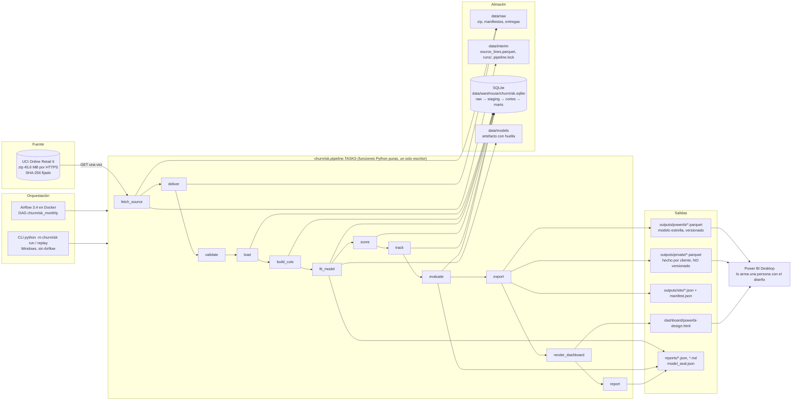

# Plan de implementación: clientes que están por irse, antes de que se vayan

Fecha: 2026-11-11. Lee primero `requirements.md` (RF, RNF, AC y los criterios C01-C10) y `decisions.md` (D01-D46). Este plan dice cómo construirlo; si un detalle no está aquí ni allí, la decisión vuelve a quien planifica: no se adivina. Las suposiciones se marcan como **[Supuesto]** y lo que hay que comprobar antes de escribir código, como **[Verificar]**.

Convenciones: documentación en español neutro; código, identificadores, tablas y columnas en inglés; medidas DAX, títulos de visuales y textos del sitio en español. Comandos para Windows (PowerShell) y el `.venv` del proyecto; rutas relativas a `04-Ecommerce-Churn-Risk/`. **El paquete se llama `churnrisk`** (variables de entorno `CHURNRISK_*`, DAG `churnrisk_monthly`, proyecto de Docker Compose `churnrisk-airflow`) y **el alcance de los commits es `churn`** (por ejemplo `feat(churn): …`, `test(churn): …`, `docs(churn): …`; D36). Cuando este plan dice «como el proyecto 02» o «como el proyecto 03», el código de referencia es el de `02-Ecommerce-Customer-Segmentation/` o `03-Logistics-Late-Deliveries/` en su último commit corregido, que se adapta y se copia, no se importa.

## 1. Arquitectura



Principios (los de los proyectos 01 a 03, más los de sus evaluaciones):

- Cada tarea es una función `fn(ctx: RunContext) -> dict` sin dependencias de Airflow. El DAG y la CLI recorren la misma tupla `TASKS`.
- Las tareas se pasan estado por archivos y tablas: `data/interim/runs/<run_key>.json` guarda lo que produjo cada tarea.
- **Un solo escritor**: SQLite tiene un escritor (`max_active_runs=1`, `max_active_tasks=1`) y, además, todo comando que escribe toma `data/interim/pipeline.lock` antes de su primera escritura (D31).
- Toda salida versionada se escribe a un temporal y se renombra con `os.replace`; los conjuntos de archivos llevan un manifiesto escrito al final.
- **Dos flujos que no se tocan**: lo que se sabe antes de un corte (variables: líneas y anulaciones con fecha anterior a `c`, neteadas con lo conocido en `c − 1`) y lo que pasa en su ventana (la etiqueta: `[c, c + N − 1]`, neteada con lo conocido en `c + N − 1`) viven en tablas separadas. Las variables nunca leen la tabla de etiquetas, y una etiqueta solo existe en el almacén desde la fecha en que su ventana cerró (D24).
- Todo lo que se calcula en una fecha de cálculo (`as_of`) recibe esa fecha y filtra por ella; el neteo de una fecha usa solo las anulaciones conocidas en ella (proyecto 02, D40).
- Los cálculos que terminan en un valor sellado reciben solo la **vista sellada** de la configuración (`SealedConfig`), construida con las claves de la huella: una clave fuera de la huella no puede llegar a un valor sellado (D19).
- El número de cliente no sale de SQLite, `data/interim/` y `outputs/private/` (D26).
- Toda ruta relativa de la configuración, de `--config` y de `CHURNRISK_CONFIG` se resuelve contra la carpeta del proyecto (D32).

## 2. Estructura de carpetas

```text
04-Ecommerce-Churn-Risk/
  README.md
  pyproject.toml              # paquete churnrisk (src layout), pytest, marcas y la suite por defecto
  requirements.txt            # ejecución, fijadas con == (D38)
  requirements-dev.txt        # -r requirements.txt, pytest y lifetimes (oráculo)
  .gitignore                  # data/raw/, data/interim/, data/warehouse/, data/models/, data/quick/, outputs/private/, airflow/logs/, airflow/config/, airflow/plugins/, airflow/.env, reports/validation/history/
  .dockerignore               # solo requirements.txt entra al contexto de la imagen
  config/
    pipeline.toml             # configuración completa (sección 4)
    pipeline.quick.toml       # modo rápido: extends = "pipeline.toml", todo bajo data/quick/
  sql/
    schema/001_core.sql  002_cuts.sql  003_model.sql
    staging/stg_lines.sql
    marts/ops/  marts/powerbi/
    checks/load/  checks/cuts/  checks/model/      # chk_*.sql: cada consulta devuelve las filas que violan
  src/churnrisk/
    __init__.py  __main__.py  cli.py  config.py  pipeline.py  lock.py  sysinfo.py  files.py
    schema.py  ingest.py  deliveries.py  validate.py  netting.py  warehouse.py
    cuts.py  features.py  split.py  baselines.py  bgnbd.py  model.py  explain.py  threshold.py
    registry.py  scoring.py  tracking.py  evaluation.py  sensitivity.py  leakage_demo.py  reporting.py
    export.py  site_export.py  figures.py  docs.py
    dashboard/__init__.py  dashboard/semantic_model.py  dashboard/render.py  dashboard/svg.py
  airflow/
    Dockerfile  docker-compose.yaml  .env.example  init.sh
    dags/churnrisk_monthly.py
  dashboard/powerbi-design.html          # generado (versionado)
  outputs/powerbi/*.parquet              # generado (versionado, ≤ 25 MB cada uno, sin número de cliente)
  outputs/private/*.parquet              # generado (NO versionado: lleva el número de cliente)
  outputs/site/*.json, manifest.json     # generado (versionado, ≤ 200 KB sin el manifiesto)
  reports/evaluation_summary.json|.md    # generado (versionado)
  reports/model_seal.json                # sello (versionado; D19)
  reports/validation/latest.json|.md     # generado (versionado); el historial no
  docs/  research.md requirements.md plan.md decisions.md
         data-dictionary.md model-card.md runbook.md paso-a-paso.md review-advisories.md evaluation.md figures/*.png
  tests/
    conftest.py               # accesorios de sesión y el presupuesto de la suite (sección 24)
    fixtures/make_fixture.py  fixtures/http_server.py  fixtures/hand_cases.py
    unit/  contract/  integration/  e2e/  docs/
  data/raw/  data/interim/  data/warehouse/  data/models/  data/quick/   # nunca versionados
```

Entorno (U01): `py -3.11 -m venv .venv`, `.venv\Scripts\python -m pip install -r requirements-dev.txt`, `pip check`. Las pruebas, el compose y los comandos del README usan `PYTHONPATH=src`, como el proyecto 03 (instalar el paquete es un pendiente del dueño, sección 29).

Marcas de pytest: `real_data` (zip real en `data/raw/`), `docker`, `oracle` (compara con `lifetimes`). Por defecto: `-m "not real_data and not docker"`.

## 3. Flujo de datos

Seis entregas componen la historia completa (D11) y una séptima corrida termina como `no_delivery`. Cada corrida mensual puntúa el corte del día siguiente a su fecha de cálculo.

| Entrega | Líneas (por fecha de factura) | Fecha de cálculo | Corte que puntúa | Qué pasa además |
| --- | --- | --- | --- | --- |
| `L2011-07` | 2009-12-01 a 2011-07-31 | 2011-07-31 | 2011-08-01 (prueba) | Construye los cortes del 2010-06-01 al 2011-08-01 y las etiquetas cuya ventana cerró (hasta el corte 2011-05-01); entrena, elige y calibra en V1, elige B* en la validación y el umbral en V2, ajusta BG/NBD, sella el lanzamiento |
| `M2011-08` | 2011-08 | 2011-08-31 | 2011-09-01 (prueba) | Sigue el corte 2011-08-01 |
| `M2011-09` | 2011-09 | 2011-09-30 | 2011-10-01 (posterior, censurado) | Sigue |
| `M2011-10` | 2011-10 | 2011-10-31 | 2011-11-01 (censurado) | Cierra la ventana del 2011-08-01 (termina el 2011-10-29): su etiqueta entra |
| `M2011-11` | 2011-11 | 2011-11-30 | 2011-12-01 (censurado) | Cierra la ventana del 2011-09-01 (2011-11-29): **evalúa la prueba una vez** con las sensibilidades y la sella |
| `C2011-12` | 2011-12-01 a 2011-12-09 | 2011-12-09 | ninguno | Sigue los cortes censurados con los últimos días |

Los cortes 2011-10-01, 2011-11-01 y 2011-12-01 tienen ventanas que terminan el 2011-12-29, el 2012-01-29 y el 2012-02-28, después del fin del archivo (2011-12-09): se puntúan y se siguen (quién volvió), pero su etiqueta nunca se completa y no se evalúan (D44).

1. `fetch_source`: si falta el zip, lo descarga (HTTPS en cada salto, hosts permitidos, topes de redirecciones, bytes y segundos, SHA-256 al vuelo, `.part`, `os.replace` solo si la huella es la aceptada). Si falta `data/interim/source_lines.parquet` o su huella de origen no es la del zip, extrae el miembro (V03), lee las dos hojas (V04, V05), comprueba el solapamiento (V06), quita las copias de la hoja 2, calcula `line_id`, `code_kind` y la fecha mínima de cada factura, y escribe el Parquet canónico con su manifiesto de huellas al final. Si ya está, no hace nada.
2. `deliver`: publica la siguiente entrega pendiente en `data/raw/deliveries/<delivery_id>.parquet` con su período, filas y SHA-256. Sin pendientes: registra la corrida `no_delivery`, refresca lo exportado si existe y corta el flujo.
3. `validate`: reglas V10-V14 y las de las líneas y las informativas sobre la entrega y lo ya cargado; reporte (y su copia por corrida en `reports/validation/history/<run_key>.json`). Con bloqueantes: cuarentena, corrida `rejected`, `ValidationError`.
4. `load`: se niega si la validación de esta corrida no existe o falló, o si otra corrida cargó la entrega (D30); en una transacción agrega las líneas a `raw_lines`, reconstruye `stg_lines` hasta `as_of` y corre `sql/checks/load/`. Abre la fila de `pipeline_runs` como `running`.
5. `build_cuts`: para cada corte `c ≤ as_of + 1` que todavía no tiene variables, netea con lo conocido en `c − 1`, arma la población y las variables y las inserta en `cut_features`; para cada corte cuya ventana cerró (`c + N − 1 ≤ as_of`) y todavía no tiene etiqueta, netea con lo conocido en `c + N − 1` y la inserta en `cut_labels`. Las dos tablas son de solo inserción. Corre `sql/checks/cuts/`.
6. `fit_model`: en el lanzamiento, ajusta los 24 candidatos en el entrenamiento, elige en V1, aplica la trampa M01, calibra en V1 el modelo y las líneas base, elige B* en la validación y el umbral en V2, calcula la sensibilidad de costos en V2, la demostración de la fuga, la importancia SHAP en V2 y las tablas de la definición (N × M y silencios en el entrenamiento), ajusta BG/NBD, guarda el artefacto con su huella, lo registra y escribe la parte del lanzamiento del sello. En las demás corridas, comprueba la huella del artefacto (M03) y el estado del sello (M05); no reentrena.
7. `score`: puntúa una vez a cada cliente activo del corte de la corrida (M02, M04), calcula sus SHAP, comprueba la aditividad en cada fila (M06) y guarda el riesgo, el contacto y los tres motivos → `model_scores`, `score_reasons` (solo inserción). El cierre no puntúa.
8. `track`: con lo cargado hasta `as_of`, recalcula `tracking` para cada corte puntuado.
9. `evaluate`: si `as_of ≥ test_last + N − 1` y la prueba no está evaluada, evalúa la prueba (C01-C10 y las sensibilidades de la sección 17) y escribe la parte de la prueba del sello, o comprueba que reproduce la sellada (sección 15).
10. `export`: reconstruye los marts de Power BI, corre `sql/checks/model/` y exporta el modelo estrella (`outputs/powerbi/` y `outputs/private/`) y los archivos del sitio con su manifiesto (la corrida sigue `running` en la tabla exportada).
11. `render_dashboard`: HTML del diseño desde la especificación y los marts.
12. `report`: escribe `reports/evaluation_summary.*` y `reports/validation/latest.*` y cierra la corrida en este orden: SQLite `ok`, `dim_pipeline_run.parquet` reescrita sola, `outputs/site/summary.json` y el manifiesto reescritos, el HTML, y recién entonces la entrega queda `loaded` en el manifiesto de entregas (el orden del proyecto 03, D72).

## 4. Configuración

`config/pipeline.toml`, leído con `tomllib`, con dataclasses congeladas y comprobación clave por clave como los proyectos 02 y 03: una sección o clave desconocida, una faltante, un tipo equivocado o un par desordenado son `ValueError` con el nombre de la clave. `CHURNRISK_CONFIG` elige otro archivo y `CHURNRISK_HOME` la carpeta del proyecto; una ruta relativa en cualquiera de las dos, o en `--config`, se resuelve contra la carpeta del proyecto (proyecto 03, D90).

```toml
[source]
mode = "http"                        # "http" o "local"
url = "https://archive.ics.uci.edu/static/public/502/online+retail+ii.zip"
allowed_hosts = ["archive.ics.uci.edu"]
max_redirects = 3
max_seconds = 900
local_path = ""                      # modo local: ruta del zip, relativa a la carpeta del proyecto
accepted_sha256 = "572e36277c2390fbfde10664750731e0a86f55e33470d91919085f0408e67bfb"   # modo http (V01)
member = "online_retail_II.xlsx"
member_sha256 = "bcbe73b35f5b7babf197fb0cb983a11f5d9ff929078d4aa53d171b1f2df2e980"     # modo http (V03)
max_bytes = 67108864                 # 64 MiB; el zip pesa 45.622.418 bytes
max_member_bytes = 104857600         # 100 MiB, como el proyecto 02
sheets = ["Year 2009-2010", "Year 2010-2011"]
chunk_bytes = 1048576
timeout_s = 120

[deliveries]                         # D11
first_date = 2009-12-01
launch_as_of = 2011-07-31
last_date = 2011-12-09

[label]                              # D06, D07
horizon_days = 90                    # N
active_days = 90                     # M
first_cut = 2010-06-01
last_cut = 2011-12-01

[split]                              # D08; cada borde exige c_anterior + N ≤ c_siguiente
train_first = 2010-06-01
train_last = 2010-12-01
v1_first = 2011-03-01
v1_last = 2011-04-01
v2_first = 2011-05-01
v2_last = 2011-05-01
test_first = 2011-08-01
test_last = 2011-09-01

[features]                           # D12
candidate_sets = ["f0", "f1", "f2"]
short_window_days = 90
long_window_days = 365
country_min_customers = 10

[model]                              # D13
learning_rate = [0.05, 0.1]
max_leaf_nodes = [15, 31]
min_samples_leaf = [50, 200]
l2_regularization = 1.0
max_iter = 300
random_state = 0
calibration = "isotonic"
model_version = "v1"

[baselines]                          # D16, D17
bgnbd_fit_cut = 2010-12-01
bgnbd_max_iter = 5000
strongest_candidates = ["b4_frequency", "b2_rfm", "b3_bgnbd"]   # en orden de simplicidad, para el desempate

[costs]                              # supuestos declarados, en unidades genéricas (D22)
offer_cost = 5.0                     # c_oferta
rescue_rate = 0.2                    # r
retained_value = 50.0                # V
threshold_min = 0.01
threshold_max = 0.99
threshold_step = 0.01
sensitivity_min = 0.10
sensitivity_max = 0.90
sensitivity_step = 0.05

[evaluation]
bootstrap_resamples = 1000
bootstrap_seed = 0
calibration_bins = 10
roc_points = 200
gain_points = 100
top_shares = [0.10, 0.20]
shap_top_reasons = 3

[sensitivity]                        # D10: informada, nunca usada para elegir
variants = ["n60", "n120", "m180", "no_december"]
n60_horizon_days = 60
n120_horizon_days = 120
m180_active_days = 180

[criteria]                           # preregistrados (requirements.md 8.1, D18)
c07_max_ece = 0.03
c07_max_bias = 0.02
leak_tripwire_auc = 0.95             # M01 (D41)
shap_additivity_tol = 1e-6           # M06 (D15)

[site]
max_total_bytes = 204800
min_cell_customers = 10

[paths]
raw_dir = "data/raw"
interim_dir = "data/interim"
warehouse = "data/warehouse/churnrisk.sqlite"
models_dir = "data/models"
outputs_dir = "outputs/powerbi"
private_dir = "outputs/private"
site_dir = "outputs/site"
reports_dir = "reports"
seal = "reports/model_seal.json"
dashboard_html = "dashboard/powerbi-design.html"
readme = "README.md"
figures_dir = "docs/figures"
```

**Qué claves entran en la huella del sello** (D19). `config.py` declara dos tuplas con el nombre completo de cada hoja de la configuración: `FINGERPRINT_KEYS` y `UNSEALED_KEYS`. Una prueba exige que cada hoja de `PipelineConfig` esté en exactamente una de las dos (AC21).

- `FINGERPRINT_KEYS`: `source.sheets` y todas las claves de `[deliveries]`, `[label]`, `[split]`, `[features]`, `[model]`, `[baselines]`, `[costs]`, `[evaluation]`, `[sensitivity]` y `[criteria]`. La huella agrega la huella observada del zip (`source_sha256`), que en modo local no está en la configuración.
- `UNSEALED_KEYS`: el resto de `[source]` (transporte, topes y huellas aceptadas: la observada ya entra), `[site]` y `[paths]`. Ninguna cambia un valor sellado: los cálculos sellados reciben `SealedConfig`, que solo tiene las claves de la huella, y una prueba estática comprueba que `cuts.py`, `features.py`, `split.py`, `baselines.py`, `bgnbd.py`, `model.py`, `explain.py`, `threshold.py`, `evaluation.py` y `sensitivity.py` no reciben `PipelineConfig`.
- Incluir de más es seguro (una corrida con `roc_points` distinto pasa a `post_seal` aunque no cambie un criterio); incluir de menos es el defecto B4 del proyecto 03. Por eso todas las claves de esas secciones entran, también las que hoy solo cambian una figura.

`config/pipeline.quick.toml`: `extends = "pipeline.toml"`; `[source] mode = "local"`, `url = ""`, `local_path = "data/quick/online_retail_fixture.zip"`, `accepted_sha256 = ""`, `member_sha256 = ""`; `[model]` con una sola configuración (`learning_rate = [0.1]`, `max_leaf_nodes = [15]`, `min_samples_leaf = [20]`, `max_iter = 50`, como el proyecto 03, D73); `[evaluation] bootstrap_resamples = 200`; `[paths]` todas bajo `data/quick/`, incluidos el sello, el README, las figuras y `private_dir`. El accesorio cubre el mismo calendario que la fuente. `_check` rechaza además: `mode = "local"` con `local_path` vacía o con `url`/`accepted_sha256` no vacías; `mode = "http"` sin huellas, con una URL que no sea `https://` o con un host fuera de `allowed_hosts`; una ruta relativa que sale de la carpeta del proyecto; un corte que no es día 1; un borde de la partición que no cumple la purga (con el nombre del borde); costos ≤ 0 o `rescue_rate` fuera de (0, 1]; una variante de sensibilidad desconocida; `strongest_candidates` con algo fuera de B2, B3 y B4.

## 5. Almacenamiento

SQLite con archivos SQL en capas y controles en SQL (D24). Reglas del runner (`warehouse.py`), las de los proyectos 02 y 03: `connect()` en modo autocommit con `journal_mode=DELETE`, `synchronous=FULL`, `foreign_keys=ON`; transacciones explícitas `BEGIN IMMEDIATE`; **nunca** `executescript()`; sentencias partidas con `sqlite3.complete_statement`; marts con `DROP TABLE IF EXISTS` + `CREATE TABLE AS` dentro de la transacción; parámetros con nombre; `require_json_functions` antes de usar `json_*` (proyecto 03, D78).

`sql/schema/001_core.sql` (clave primaria entre paréntesis):

- `raw_lines` (`line_id`): `delivery_id`, `sheet`, `invoice`, `stock_code`, `description`, `quantity`, `invoice_ts`, `invoice_date`, `price`, `customer_id` (nulo en invitados), `country`, `code_kind`, `is_repeated_line`.
- `deliveries` (`delivery_id`): `kind` (`launch`, `monthly`, `close`), `lines_from`, `lines_to`, `as_of_date`, `lines`, `sha256`, `status` (`published`, `loaded`, `rejected`), `run_key`.
- `pipeline_runs` (`run_key`): `started_at`, `finished_at`, `status` (`running`, `ok`, `failed`, `rejected`, `no_delivery`), `delivery_id`, `as_of_date`, `cut_date`, `source_sha256`, `lines_delivery`, `customers_scored`, `contacts`, `peak_working_set_mb`, `peak_commit_mb`, `memory_counter`, `message`.
- `validation_results` (`run_key`, `rule_id`): `name_es`, `severity`, `scope`, `aggregation` (`source`, `per_run`, `latest`), `passed`, `rows_affected`, `customers_affected`, `value_gbp`, `examples_json` (solo `line_id` y columnas que no identifican: nunca `customer_id` ni `invoice`).
- `stg_lines`: las de `raw_lines` con `invoice_date <= :as_of`, tipos, `role`, `exclusion_reason` y `quality_flags`.

`sql/schema/002_cuts.sql`:

- `cut_features` (`cut_date`, `customer_id`): `country_group`, las 16 variables de la sección 10, `computed_as_of`, `run_key`. **Solo inserción** (las variables de un corte no cambian: usan lo conocido en `c − 1`).
- `cut_labels` (`cut_date`, `customer_id`): `churned`, `label_end`, `known_as_of`, `run_key`. **Solo inserción**; un control rechaza una fila con `known_as_of < label_end`.
- `cut_blocks` (`cut_date`): `block` (`train`, `purge_1`, `valid_v1`, `valid_v2`, `purge_2`, `test`, `post_test`, `before`), `label_end`, `is_censored`, una sola tabla para los bordes (proyecto 03, D70).

`sql/schema/003_model.sql`:

- `model_registry` (`model_version`): `trained_as_of`, `artifact_path`, `artifact_sha256`, `feature_set`, `feature_names_json`, `country_groups_json`, `params_json`, `calibration`, `threshold`, `b_star`, `bgnbd_json`, `costs_json`, `config_sha256`, `selection_json`, `valid_scores_sha256`.
- `baseline_calibrators` (`method`): la huella de cada calibrador de las líneas base dentro del artefacto.
- `model_scores` (`cut_date`, `customer_id`): `as_of_date`, `run_key`, `model_version`, `risk`, `log_odds`, `threshold`, `is_contact`. **Solo inserción** con tres disparadores (`BEFORE UPDATE`, `BEFORE DELETE` y un `BEFORE INSERT` que rechaza una clave ya puntuada: `INSERT OR REPLACE` borra sin disparar el de borrado; proyecto 02, D44).
- `score_reasons` (`cut_date`, `customer_id`, `rank`): `feature`, `shap_value`, `direction`. Solo inserción, igual.
- `tracking` (`as_of_date`, `cut_date`): `scored`, `contacted`, `returned`, `window_closed`, `churned`, `contacted_churned`, `contacted_returned`, `expected_churners`, `is_censored`.
- `eval_metrics` (`scope`, `method`, `metric`, `seal_state`), `eval_bootstrap` (`comparison`, `seal_state`), `eval_criteria` (`criterion_id`, `seal_state`), `eval_cost_sensitivity` (`break_even`, `method`, `seal_state`), `eval_gain` (`scope`, `method`, `point`, `seal_state`), `eval_calibration`, `eval_roc`, `eval_per_cut` (`scope`, `cut_date`, `method`, `metric`, `seal_state`), `eval_variants` (`variant`, `method`, `metric`, `seal_state`), `eval_leakage`, `eval_label_definition` (`n`, `m`), `eval_silence_return` (`n`), `feature_importance` (`scope`, `feature`). `scope` en `valid_v1`, `valid_v2`, `valid`, `test`; `seal_state` en `sealed`, `post_seal`.

`model_registry`, `model_scores`, `score_reasons`, `cut_features` y `cut_labels` no se reemplazan nunca; `tracking` y `eval_*` de una fecha se reemplazan al repetir esa fecha, salvo las filas `sealed` de la prueba, que se escriben una vez (sección 15).

## 6. Contrato del libro, entregas y validación

`schema.py` es la única fuente de las columnas (`SOURCE_COLUMNS`, con los nombres en inglés `invoice`, `stock_code`, `description`, `quantity`, `invoice_ts`, `price`, `customer_id`, `country`), de `code_kind(stock_code)` (el patrón del proyecto 02: cinco dígitos con hasta dos letras o prefijo `DCGS`; `PADS` es servicio, D03), de la lista de variables permitidas (`FEATURE_COLUMNS`), de la de columnas de la ventana y de etiqueta (`LABEL_COLUMNS`: `churned`, `label_end`, `known_as_of`, `returned`, `first_return_date`, `days_to_next_purchase`) y de la de identificadores (`IDENTIFIER_COLUMNS`: `customer_id`, `invoice`). Una prueba comprueba que no se solapan.

Reglas. Las de la fuente corren en `fetch_source`, una vez por huella; las de la entrega y de las líneas, en `validate`; las del modelo, donde se indica. Las que apartan se aplican en el orden de la tabla y cada línea se cuenta en la primera que la aparta. Cifras de referencia de la base real (research.md) entre paréntesis. **Agregación** dice cómo se publica la regla entre corridas en `validation_rules.json`: `source` (una vez, del reporte de la fuente), `per_run` (se suma sobre las corridas cargadas) o `latest` (se lee una vez, de la última corrida cargada, porque ya acumula las anteriores; lección D94 del proyecto 03).

| ID | Severidad | Alcance | Agregación | Regla | Acción |
| --- | --- | --- | --- | --- | --- |
| V01 | bloqueante | fuente | source | El zip tiene la huella aceptada (o la registrada, en modo local) | Rechazo; nada cambia |
| V02 | bloqueante | fuente | source | Descarga segura: HTTPS en cada salto, host permitido, ≤ 3 redirecciones, ≤ `max_bytes`, ≤ `max_seconds` | Corte antes del archivo final |
| V03 | bloqueante | fuente | source | El zip tiene exactamente el miembro esperado, sin rutas, ≤ `max_member_bytes`, con su huella (modo http) | Rechazo |
| V04 | bloqueante | fuente | source | El libro tiene las hojas configuradas y en cada una las 8 columnas exactas, en orden | Rechazo |
| V05 | bloqueante | fuente | source | Tipos: `Quantity` entero, `Price` número, `InvoiceDate` fecha y hora, `Invoice` y `StockCode` no vacíos, `Customer ID` entero de 5 cifras o vacío (0 no convertibles) | Rechazo |
| V06 | bloqueante | fuente | source | El solapamiento entre hojas es el mismo multiconjunto de filas (22.523 en cada una) | Rechazo |
| V10 | bloqueante | entrega | per_run | La entrega es la siguiente del plan y su período empieza el día siguiente al fin de la anterior | Rechazo |
| V11 | bloqueante | entrega | per_run | La fecha de cada factura está dentro del período de la entrega | Rechazo |
| V12 | bloqueante | entrega | per_run | Ninguna `line_id` de la entrega está ya en el almacén | Rechazo |
| V13 | bloqueante | entrega | per_run | Cada factura tiene un solo cliente y un solo país, también contra lo ya cargado | Rechazo |
| V14 | bloqueante | entrega | per_run | La entrega no está vacía y sus filas y su SHA-256 son los del manifiesto | Rechazo |
| V20 | advertencia | líneas | per_run | Línea sin cliente (235.287 en la base, 22,52 %) | Se aparta (`no_customer`) |
| V21 | advertencia | líneas | per_run | Anulación con cliente y producto | Se netea (D04) |
| V22 | advertencia | líneas | latest | Anulación o resto sin compra que anular, con lo conocido en la fecha | Se descarta y se cuenta |
| V23 | advertencia | líneas | per_run | Cantidad ≤ 0 en una factura sin «C» | Se aparta (`non_positive_quantity`) |
| V24 | advertencia | líneas | per_run | Precio ≤ 0 | Se aparta (`non_positive_price`) |
| V25 | advertencia | líneas | per_run | Código de servicio, `PADS` incluido (3.663 con cliente) | Se aparta (`service_code`) |
| V26 | advertencia | líneas | per_run | Vale de regalo (100, ninguno con cliente) | Se aparta (`gift_voucher`) |
| V27 | advertencia | líneas | per_run | Factura «A» de ajuste de deuda (6 líneas) **[Verificar en U05 si otra regla la aparta antes]** | Se aparta (`adjustment_invoice`) |
| V28 | advertencia | líneas | per_run | Línea repetida idéntica dentro de la hoja (11.812) | Se conserva y se marca |
| V29 | advertencia | líneas | per_run | Cantidad ≥ 5.000 en una línea (43) | Se conserva y se marca |
| V30 | advertencia | líneas | per_run | Cliente con más de un país (13) | País de su última línea anterior al corte, marca |
| V31 | advertencia | líneas | per_run | País «Unspecified» (756 líneas, 7 clientes) | Va a «Otros» y se marca |
| M01 | bloqueante | modelo | latest | Trampa de fuga: AUC del candidato elegido en V1 < `leak_tripwire_auc` | Detiene el lanzamiento: «posible fuga» (D41) |
| M02 | bloqueante | modelo | per_run | Las columnas de la matriz son exactamente las del conjunto elegido; ninguna es de etiqueta, de calendario ni un identificador | Falla la tarea |
| M03 | bloqueante | modelo | per_run | El artefacto tiene la huella registrada (antes de deserializarlo) | Falla la tarea (D40) |
| M04 | bloqueante | modelo | per_run | Una probabilidad finita en [0, 1] por cliente puntuado | Falla la tarea |
| M05 | advertencia | modelo | latest | La configuración es distinta de la sellada | Todo lo calculado es `post_seal` (D19) |
| M06 | bloqueante | modelo | per_run | SHAP aditivo en cada fila explicada (≤ `shap_additivity_tol`) | Falla la tarea (D15) |
| M07 | bloqueante | modelo | latest | Ningún bloque usado (entrenamiento, V1, V2, prueba) con una sola clase | `BlockLabelError` antes de ajustar (proyecto 03, D65) |
| M08 | bloqueante | modelo | latest | El ajuste de BG/NBD converge (L-BFGS-B, o Nelder-Mead una vez) | Falla la tarea (proyecto 02) |
| I01 | informativa | entrega | per_run | Clientes nuevos en la entrega | Solo cuenta |
| I02 | informativa | entrega | per_run | Importe y líneas de invitados (sin cliente), en £ y % | Solo cuenta |
| I03 | informativa | fuente | source | Copias del solapamiento quitadas (22.523) | Solo cuenta |
| I04 | informativa | modelo | per_run | Clientes activos puntuados en el corte de la corrida | Solo cuenta |
| I05 | informativa | modelo | per_run | Contactos sugeridos en el corte de la corrida | Solo cuenta |
| I06 | informativa | modelo | per_run | Clientes inactivos más de M días en el corte (fuera de la población, D07) | Solo cuenta |
| I07 | informativa | modelo | latest | Clientes de los cortes puntuados que ya volvieron a comprar | Solo cuenta (acumula) |
| I08 | informativa | modelo | latest | Contactos de ventanas cerradas que se fueron | Solo cuenta (acumula) |

`ValidationReport` como el del proyecto 02 (con `not_evaluated` y hasta 5 ejemplos por regla), con `customers_affected` y `value_gbp`, y `aggregation` en cada `RuleResult`.

Entregas (`deliveries.py`): el plan es la lista fija `L2011-07`, `M2011-08` … `M2011-11`, `C2011-12`; la entrega de una línea es la de su `invoice_date`. Manifiesto `data/raw/deliveries/manifest.json` con versión (`{"version": 1, "entries": [...]}`), escrito a un temporal y renombrado.

## 7. SQL

- `sql/staging/stg_lines.sql`: desde `raw_lines` con `invoice_date <= :as_of`; `is_cancellation = invoice LIKE 'C%'`; `exclusion_reason` con un `CASE` en el orden de la sección 6; `role`; `quality_flags`. Lo mismo que `validate.classify_lines`: una prueba compara los dos (proyecto 02).
- `sql/marts/ops/mart_cut_population.sql` y `mart_labelled_rows.sql`: `cut_features` unido a `cut_blocks` y, solo en el segundo, a `cut_labels`. `mart_labelled_rows` es la única fuente de etiquetas del modelo; `features.py` y `scoring.py` no la leen (prueba estática).
- `sql/checks/load/`: `chk_raw_unique_line`, `chk_stg_one_per_raw`, `chk_one_customer_per_invoice`, `chk_one_country_per_invoice`, `chk_delivery_period`.
- `sql/checks/cuts/`: `chk_cut_is_first_of_month`, `chk_population_bought_in_m_days`, `chk_label_known_after_window`, `chk_label_has_features`, `chk_features_unique`, `chk_blocks_single_and_purged`.
- `sql/marts/powerbi/` y `sql/checks/model/` (corren en `export`): `chk_one_score_per_row`, `chk_scores_range`, `chk_contact_matches_threshold` (`is_contact = risk >= threshold`), `chk_three_reasons_per_score`, `chk_tracking_totals`, `chk_no_customer_column_in_versioned_marts`, `chk_fk_*` (una por relación), `chk_star_keys_unique`.

## 8. Neteo y días de compra conocidos en una fecha (`netting.py`)

Copiado y adaptado del proyecto 02 (su sección 8, D04, D37 y D40):

```python
@dataclass(frozen=True)
class NettingResult: net_lines: pd.DataFrame; matches: pd.DataFrame; unmatched: pd.DataFrame
def net_cancellations(purchases: pd.DataFrame, cancellations: pd.DataFrame, as_of: date) -> NettingResult
def customer_days(net_lines: pd.DataFrame) -> pd.DataFrame        # customer_id, day, net_revenue, units, lines
def net_lines_at(conn, as_of: date) -> pd.DataFrame                # lo conocido en as_of, aunque el almacén tenga más
```

- Entrada: compras y anulaciones con `invoice_date ≤ as_of`. Por (`customer_id`, `stock_code`), los eventos se ordenan por (`invoice_ts`, compra antes que anulación, `line_id`); una pila guarda las compras con cantidad restante; cada anulación toma de la cima hacia abajo; lo que no alcanza va a `unmatched`.
- Propiedades probadas: `0 ≤ net_quantity ≤ quantity`; una compra nunca recibe una anulación anterior; asignado + no asignado = anulado; el resultado no depende del orden de las filas; una anulación posterior a `as_of` no cambia nada.
- **Conciliación con el proyecto 02** (pregunta abierta 13 de research.md): research.md contó 16.426 pares anulación-compra y 1.706 líneas sin compra; la D04 del proyecto 02, 15.875 anulaciones completas, 126 parciales y 1.585 sin compra. Son unidades distintas (pares contra anulaciones). U06 cuenta con la definición del proyecto 02 (por anulación: completa, parcial, sin compra) sobre la misma base y con `as_of` = el fin de los datos, y una prueba `real_data` exige los números del proyecto 02 **[Verificar en U06]**; si no coinciden, se registra la diferencia y su causa en una decisión antes de seguir.
- Medido por el proyecto 02: 0,46 s para toda la base. El lanzamiento netea dos veces por corte (unas 30 veces).

## 9. Cortes, población, etiqueta y bloques (`cuts.py`, `split.py`)

```python
def cut_dates(cfg: SealedConfig) -> list[date]                                   # los días 1 de first_cut a last_cut
def population(days_before: pd.DataFrame, cut: date, active_days: int) -> pd.Index   # clientes con un día en [c − M, c − 1]
def label(days_known_at_end: pd.DataFrame, cut: date, horizon_days: int, customers: pd.Index) -> pd.Series
def block(cut: date, cfg: SealedConfig) -> str
def check_purges(cfg: SealedConfig, horizon_days: int) -> None                   # PurgeError con el nombre del borde
def build_cuts(conn, as_of: date, cfg: SealedConfig, run_key: str) -> CutsResult
```

- **Corte** `c`: día 1 de un mes. **Historia**: líneas y anulaciones con `invoice_date < c`, neteadas con `as_of = c − 1`. **Población**: los clientes con un día de compra neta en `[c − M, c − 1]`. **Etiqueta**: `churned = 1` si no hay ningún día de compra neta en `[c, c + N − 1]` con el neteo conocido en `c + N − 1` (una compra de la ventana anulada dentro de la ventana no cuenta; una anulada después, sí).
- **Bloques** (D08): `before` (cortes anteriores a `train_first`: no hay), `train` (2010-06-01 a 2010-12-01, 7 cortes), `purge_1` (2011-01-01, 2011-02-01), `valid_v1` (2011-03-01, 2011-04-01), `valid_v2` (2011-05-01), `purge_2` (2011-06-01, 2011-07-01), `test` (2011-08-01, 2011-09-01) y `post_test` (2011-10-01 a 2011-12-01, censurados). Las purgas: 2010-12-01 + 90 días = 2011-03-01 ≤ 2011-03-01; 2011-05-01 + 90 = 2011-07-30 ≤ 2011-08-01. No hay purga entre V1 y V2: sus ventanas se solapan y los dos son validación (D08).
- `check_purges` exige `c_anterior + N ≤ c_siguiente` en cada borde entre bloques distintos y que la ventana del último corte de prueba termine dentro de los datos (`test_last + N − 1 ≤ last_date`); la configuración lo comprueba al cargarse y `build_cuts` otra vez antes de escribir (segunda línea, como la D78 del proyecto 03).
- En el lanzamiento se construyen 15 cortes (2010-06-01 a 2011-08-01) y las etiquetas de los cortes con `c + N − 1 ≤ 2011-07-31` (hasta el 2011-05-01). Las corridas mensuales agregan su corte y las etiquetas que cerraron.

## 10. Variables y fuga (`features.py`)

```python
FEATURE_SETS: dict[str, tuple[str, ...]]          # "f0", "f1", "f2" (D12)
class LeakageError(RuntimeError): ...
def compute_features(days_before: pd.DataFrame, lines_before: pd.DataFrame, cut: date, customers: pd.Index, cfg: SealedConfig) -> pd.DataFrame
def build_matrix(features: pd.DataFrame, feature_set: str, country_groups: tuple[str, ...]) -> pd.DataFrame
```

Las 16 variables de research.md, todas con `invoice_date < c`:

| Variable | Definición |
| --- | --- |
| `rec_days` | días desde el último día de compra neta hasta `c` |
| `tenure_days` | días desde el primer día de compra neta hasta `c` |
| `freq_total`, `freq_90`, `freq_365` | días de compra neta: todos, en `[c − 90, c − 1]`, en `[c − 365, c − 1]` |
| `mon_total`, `mon_90`, `mon_365` | importe neto (£) en las mismas ventanas |
| `aov_day` | `mon_total / freq_total` |
| `units_90` | unidades netas en `[c − 90, c − 1]` |
| `gap_mean`, `gap_max` | media y máximo de las brechas entre días de compra consecutivos; 0 con un solo día **[Supuesto: research.md no documenta su convención; 0 no se confunde con una brecha real, que es ≥ 1]** |
| `n_products_365` | códigos de producto distintos con compra neta en 365 días |
| `med_units_365` | mediana de las unidades netas por línea en 365 días |
| `canc_365`, `canc_value_365` | líneas de anulación y su importe absoluto en 365 días |
| `country_group` | país de la última línea anterior a `c`; los países con menos de `country_min_customers` clientes en las filas de entrenamiento y «Unspecified» van a «Otros»; la lista se fija en el lanzamiento y se guarda en el registro |

- **F0** (2): `rec_days`, `freq_365` (la variante de dos columnas de research.md). **F1** (16): las 16 numéricas. **F2** (16 + país): F1 más los indicadores one-hot de `country_group` (los de research.md: 8 países y «Otros»; el número real sale del entrenamiento **[Verificar en U11]**).
- **Guardas** (AC12, AC13): `build_matrix` lanza `LeakageError` si recibe o produce una columna de `LABEL_COLUMNS`, de `IDENTIFIER_COLUMNS`, una variable de calendario (`cut_month`, `cut_date`, `month`, `weekday`) o cualquiera fuera de `FEATURE_COLUMNS`; la salida tiene exactamente las columnas del conjunto, en orden (M02). Una prueba estática recorre `features.py`, `scoring.py`, `explain.py` y los SQL de variables y falla si nombran `cut_labels` o `mart_labelled_rows`.
- **Truncamiento**: las variables de un corte calculadas desde el almacén con todo cargado son idénticas a las calculadas con las líneas y anulaciones truncadas en `c − 1` (prueba de research.md, «Pruebas que el plan debe escribir», 1).
- **Perturbación**: borrar, cambiar o agregar líneas y anulaciones desde `c` no cambia ninguna variable, modelo, calibración, B*, umbral, puntaje ni motivo de esa fecha.
- Sin variables de calendario (D09), sin el número de cliente, sin salidas de BG/NBD (sus parámetros se ajustan con datos posteriores a los primeros cortes de entrenamiento: serían optimistas dentro del entrenamiento, D12).

## 11. Líneas base (`baselines.py`, `bgnbd.py`)

| ID | Regla | Puntaje de riesgo | Uso |
| --- | --- | --- | --- |
| B0 | Contactar a todos | 1 | C06 (y «no contactar a nadie», BN = 0) |
| B1 | Recencia | `rec_days` | La afirmación del sitio («recencia» como variable principal); C10 |
| B2 | RFM | −(R + F + M), quintiles dentro del corte por rango medio (proyecto 02, D09): R de −`rec_days`, F de `freq_365`, M de `mon_365`; puntaje 3 a 15 | La regla de un gerente y de la investigación; C01, C02 |
| B3 | BG/NBD | −(compras esperadas en los N días siguientes) | Candidata a B*; la variante que mide la ventana de la etiqueta |
| B4 | Frecuencia | −`freq_365` | Candidata a B*; la más fuerte del entrenamiento (requerimientos, sección 4) |
| B5 | 1 − P(vivo) | `1 − p_alive` | Informativa: muestra la saturación (AUC 0,362 en el entrenamiento) |

- **B***: la de mayor AUC en la validación completa (V1 y V2) entre `strongest_candidates`; en un empate a 10⁻⁶, la primera de la lista (la más simple). Se elige en el lanzamiento y entra en el sello (D14).
- **Probabilidades de las bases**: para C05, C06, C08 y C09, cada puntaje se convierte en probabilidad con `IsotonicRegression(out_of_bounds="clip")` ajustada en V1, el mismo procedimiento que el modelo; el umbral de cada una se elige en V2 con el de la sección 14. Los calibradores van en el artefacto.
- **BG/NBD** (`bgnbd.py`): copiado del `clv.py` del proyecto 02 (fórmulas de Fader, Hardie y Lee, 2005, en días; `fit_bgnbd` con L-BFGS-B sobre el logaritmo de los parámetros y un reintento con Nelder-Mead; `expected_purchases`; `p_alive`; `summary_from_days`), sin Gamma-Gamma ni el valor de vida (no se usan, D17). Se ajusta una vez, en el lanzamiento, con los clientes que tienen compras antes de `bgnbd_fit_cut` (2010-12-01) y `T` medido hasta el corte; para cada corte, `x`, `t_x` y `T` salen de la historia anterior al corte y los parámetros quedan fijos. Comprobado por el agente de planificación sobre el entrenamiento (requerimientos, sección 4).
- Pruebas: quintiles exactos en un caso a mano; los parámetros de BG/NBD iguales con la historia truncada en el corte de ajuste; el oráculo `lifetimes` (marca `oracle`): mismas log-verosimilitudes a 10⁻³ y compras esperadas a 10⁻² relativo en un conjunto simulado con `simulate_bgnbd` y en los datos CDNOW que trae `lifetimes` (como el proyecto 02); cambiar etiquetas de la validación o de la prueba no cambia ningún parámetro de B1-B5.

## 12. Modelo, selección y calibración (`model.py`)

```python
@dataclass(frozen=True)
class Candidate: feature_set: str; learning_rate: float; max_leaf_nodes: int; min_samples_leaf: int
def candidates(cfg: SealedConfig) -> list[Candidate]                              # 3 × 8 = 24, en orden fijo
def make_pipeline(c: Candidate, cfg: SealedConfig, country_groups: tuple[str, ...]) -> Pipeline
def select(fitted: list[tuple[Candidate, Pipeline]], X_v1, y_v1) -> Selection      # menor log-loss en V1
def calibrate(pipe: Pipeline, X_v1, y_v1) -> CalibratedClassifierCV
def predict_risk(model, X) -> np.ndarray
def log_odds(pipe: Pipeline, X) -> np.ndarray                                      # decision_function del modelo sin calibrar
```

- `make_pipeline`: `ColumnTransformer` con `OneHotEncoder(categories=[country_groups], handle_unknown="error", sparse_output=False)` para el país (las categorías fijadas en el lanzamiento, «Otros» incluida) y las numéricas tal cual, seguido de `HistGradientBoostingClassifier(learning_rate, max_leaf_nodes, min_samples_leaf, l2_regularization=1.0, max_iter=300, early_stopping=False, random_state=0)` **sin `categorical_features`** (D13, D15). Un país que no estaba en el entrenamiento se mapea a «Otros» antes del codificador, en `build_matrix`; `handle_unknown="error"` hace que un valor sin mapear sea un error y no una fila de ceros **[Verificar en U13 con un país nuevo en un corte de validación del accesorio]**.
- `select`: menor `log_loss` en V1 sin calibrar; empate a 10⁻⁶: F0 < F1 < F2, después menos hojas, más muestras por hoja y menor tasa de aprendizaje. Se guardan las 24 pérdidas.
- M07 antes de ajustar; M01: si el AUC del elegido en V1 es ≥ `leak_tripwire_auc`, `LeakageError` y el lanzamiento se detiene (runbook R5).
- `calibrate`: `CalibratedClassifierCV(FrozenEstimator(pipe), method="isotonic")` con V1. El riesgo publicado es el calibrado; los motivos explican el log-odds sin calibrar, que la isotónica no reordena (es monótona; D15).
- Medido en research.md: un ajuste de 300 iteraciones sobre 15.297 filas y 25 columnas tarda 0,3 s; los 24, unos 7 s **[Supuesto]**.

## 13. Motivos de cada cliente: SHAP (`explain.py`)

```python
def explainer_for(pipe: Pipeline) -> shap.TreeExplainer                     # refuse_native_categorical primero
def explain(pipe: Pipeline, X: pd.DataFrame, tol: float) -> Explanation     # valores, valor base, log-odds, error máximo
def top_reasons(expl: Explanation, k: int) -> pd.DataFrame                  # cut_date, customer_id, rank, feature, shap_value, direction
def global_importance(expl: Explanation) -> pd.DataFrame                    # media de |SHAP| por variable; los one-hot del país sumados en «país»
```

- `shap.TreeExplainer(hgb, feature_perturbation="tree_path_dependent")` sobre la matriz ya transformada (los nombres de columna salen del `ColumnTransformer`). research.md comprobó con `shap` 0.51.0 y scikit-learn 1.9.1: error máximo 8,4·10⁻¹⁵ con el país en one-hot y 3,6 con las divisiones categóricas nativas.
- **Aditividad comprobada en cada fila** (M06): `|valor base + Σ SHAP − log_odds| ≤ shap_additivity_tol` (10⁻⁶) en todas las filas explicadas; si una falla, `ExplanationError` con la fila (por posición, nunca por número de cliente) y el error máximo, y la tarea falla. `refuse_native_categorical` levanta antes de explicar si el clasificador tiene `categorical_features` o `is_categorical_` con algún valor verdadero.
- Motivos: los `shap_top_reasons` (3) valores mayores (hacia el riesgo), con su dirección (`sube` si > 0, `baja` si ≤ 0) y el nombre en español de `dashboard/semantic_model.py`. Se calculan al puntuar (unos 2.000 clientes por corte, unos 1,2 s por corte según research.md **[Supuesto]**) y en V2 (importancia del lanzamiento); en la prueba, en la evaluación (importancia de la prueba).
- Alternativa si el explicador falla en una versión: permutación (como la primera mirada) y la tarea falla con M06; no se publican motivos sin aditividad.

## 14. Umbral por costo, curva de ganancia y sensibilidad (`threshold.py`)

```python
@dataclass(frozen=True)
class Costs: offer_cost: float; rescue_rate: float; retained_value: float
    def break_even(self) -> float: return self.offer_cost / (self.rescue_rate * self.retained_value)
def net_benefit(y: np.ndarray, contacted: np.ndarray, costs: Costs) -> float
def choose_threshold(p: np.ndarray, y: np.ndarray, costs: Costs, grid: np.ndarray) -> float
def gain_curve(score: np.ndarray, y: np.ndarray, points: int) -> pd.DataFrame     # share_contacted, share_captured, lift
def top_share_capture(score, y, cut_ids, share: float) -> tuple[int, int]          # por corte, ceil(share × n)
def cost_sensitivity(p_v2: dict[str, np.ndarray], y_v2, p_test: dict | None, y_test, cfg: SealedConfig) -> pd.DataFrame
```

- Beneficio neto de un cliente contactado: `churned × rescue_rate × retained_value − offer_cost`; de uno no contactado, 0. Con los valores por defecto, `Σ_contactados (10 × churned − 5)`, el mismo punto de equilibrio neutro (0,5) que el proyecto 03 (D22).
- `choose_threshold`: la grilla de `threshold_min` a `threshold_max` de a `threshold_step`, contacta `p ≥ t` y se queda con el mayor BN en V2; empate, el mayor `t`. Se guarda junto el punto de equilibrio teórico.
- Nunca F1: `threshold.py` y `model.py` no importan `f1_score` (prueba estática); en un accesorio donde F1 contactaría a ≥ 95 %, el umbral por costo no lo hace.
- **Curva de ganancia**: clientes ordenados por riesgo (empates por el orden interno de las filas, que nunca se publica), proporción de bajas captadas según la proporción contactada, `gain_points` puntos, para el modelo, B2, B* y la diagonal; lift = proporción captada / proporción contactada; captura y lift al 10 % y al 20 % por corte (C04 usa el 10 %). En V2 en el lanzamiento y en la prueba en la evaluación.
- **Sensibilidad de costos**: para cada punto de equilibrio `b` del rango (17 valores), `offer_cost = b × rescue_rate × retained_value`, se elige el umbral en V2 para el modelo y B*, y en la prueba (solo al evaluarla) se calcula el BN por cada 1.000 clientes y la proporción contactada (C09). El tablero mueve los tres supuestos con parámetros de hipótesis (sección 20).

## 15. Lanzamiento congelado, puntuación y sello (`registry.py`, `scoring.py`)

```python
def save_artifact(bundle: ModelBundle, path: Path) -> str            # pickle protocolo 5: modelo calibrado, canalización, calibradores de las bases, grupos de país
def load_artifact(path: Path, expected_sha256: str) -> ModelBundle    # M03: lee los bytes una vez, compara y recién entonces pickle.loads de esos bytes
def sealed_view(cfg: PipelineConfig, source_sha256: str) -> SealedConfig
def config_fingerprint(view: SealedConfig) -> str                     # SHA-256 del JSON canónico (sort_keys, separadores fijos)
def seal_state(seal_path: Path, config_sha256: str) -> Literal["none", "match", "post_seal"]
def write_launch_seal(seal_path: Path, launch: dict) -> None          # creación exclusiva o enlace duro; una vez
def write_test_seal(seal_path: Path, test: dict) -> None              # una vez
def score_cut(conn, cut: date, bundle: ModelBundle, run_meta: RunMeta, view: SealedConfig) -> ScoreResult
```

- El artefacto va a `data/models/<model_version>.pkl` (no versionado), con `pickle` de la biblioteca estándar, y su SHA-256 a `model_registry`; se deserializa solo si la huella de los mismos bytes coincide (D40, runbook R6). El explicador de SHAP no se guarda: se rehace desde el modelo.
- **Sello** (`reports/model_seal.json`, versionado; D19):

  ```json
  {
    "version": 1,
    "launch": {
      "run_key": "...", "as_of": "2011-07-31", "source_sha256": "572e...7bfb",
      "config_sha256": "...", "sealed_config": {"label": {}, "split": {}, "...": "toda la vista sellada"},
      "model_version": "v1", "feature_set": "<elegido en V1>", "params": {}, "country_groups": [],
      "threshold": "<elegido en V2>", "b_star": "<b2_rfm|b3_bgnbd|b4_frequency>",
      "bgnbd": {"r": 0.0, "alpha": 0.0, "a": 0.0, "b": 0.0, "log_likelihood": 0.0},
      "valid_scores_sha256": "..."
    },
    "test": {
      "run_key": "...", "as_of": "2011-11-30", "config_sha256": "...",
      "criteria": [{"id": "C01", "value": 0.0, "baseline_value": 0.0, "ci_low": null, "ci_high": null, "passed": false, "verdict_es": "..."}],
      "metrics": {"model": {}, "b2_rfm": {}, "b_star": {}},
      "per_cut": [], "variants": []
    }
  }
  ```

  (los valores son de forma, no resultados). `config_sha256` es la huella de la vista sellada completa, guardada también entera (`sealed_config`) para que una diferencia se pueda nombrar clave por clave; `valid_scores_sha256`, la de los riesgos de la validación redondeados a 6 decimales y ordenados por (`cut_date`, posición interna).
- Reglas del sello: sin sello, el lanzamiento escribe `launch`; con sello y el mismo `config_sha256`, comprueba `valid_scores_sha256`, el conjunto elegido, el umbral y B* (distintos: `SealMismatchError` que nombra cada valor, la tarea falla, runbook R7); con otro `config_sha256`, la corrida sigue y todo lo que calcule es `post_seal` (M05), con un aviso que nombra las claves que difieren (comparando `sealed_config`). La primera evaluación de la prueba con la configuración sellada escribe `test`; una repetición con la misma configuración compara sus valores redondeados a 6 decimales (distintos: `SealMismatchError` con los valores; como todas las claves que cambian un valor sellado están en la huella, no hay un tercer caso como el de la D89 del proyecto 03); con otra configuración, sus valores se guardan como `post_seal`. **Ninguna parte del sello se reescribe**: creación exclusiva o enlace duro, modo 0o600 donde el modo es el control de acceso y un aviso donde no lo es (proyecto 03, D64 y D78); la parte de la prueba se vuelve a leer tras escribirla. Borrar el sello es empezar un análisis nuevo y se registra en `decisions.md` (runbook R13).
- `score_cut`: arma la matriz del corte con `build_matrix`, comprueba M02 y M04, calcula SHAP con M06 e inserta una fila por cliente en `model_scores` y tres en `score_reasons`, leyendo dentro de la transacción qué ya está puntuado (proyecto 03, D63). Es la función que envolvería una API (D43).

## 16. Evaluación, remuestreo por cliente, criterios y resumen (`evaluation.py`, `reporting.py`, `leakage_demo.py`)

Cohorte, definiciones y umbrales: `requirements.md`, sección 8.1.

- `evaluate_block(conn, scope, view) -> EvaluationResult`: para el modelo (en la prueba, `model_scores` de los cortes de prueba; en la validación, predicción con el artefacto), B0-B5 y B* con las etiquetas de `mart_labelled_rows`: AUC, PR-AUC, Brier, ECE, sesgo, umbral, proporción contactada, precisión, recall, BN total y por 1.000 clientes, captura y lift al 10 % y al 20 %, curva ROC (`roc_points`), calibración por intervalo y curva de ganancia; lo mismo por corte (`eval_per_cut`).
- `cluster_bootstrap(y, s_a, s_b, customer_ids, n, seed) -> Bootstrap`: `rng = np.random.default_rng(seed)`; en cada remuestra se sortean clientes con reposición y entran todas sus filas de los cortes de prueba; los mismos clientes para los dos puntajes; `diff = AUC(s_a) − AUC(s_b)`; percentiles 2,5 y 97,5; una remuestra con una sola clase se descarta y se cuenta (D21).
- `evaluate_criteria(result, view) -> list[Criterion]` y `criteria_from_seal(seal) -> list[Criterion]` comparten `_criteria_of`: `criterion_id`, `value`, `baseline_value`, `ci_low`, `ci_high`, `threshold_es`, `passed`, `seen_by_research`, `seen_by_planner`, `verdict_es` de plantillas fijas, por ejemplo «El modelo no supera a RFM: la diferencia de AUC es −0,01, con un intervalo del 95 % de −0,03 a 0,01.» o «El modelo supera a contactar a todos y a no contactar a nadie: 1.234,5 u. por cada 1.000 clientes frente a 0.». C10 no tiene `passed`. Un criterio que no se puede calcular queda `passed = false` con el motivo (M07).
- `leakage_table(conn, view)` (en el lanzamiento, en su módulo, que no puede escribir en `model_registry` ni en `model_scores`; proyecto 03, D31): el AUC en V2 de un modelo entrenado con F1 más la variable de control `days_to_next_purchase` (días desde el corte hasta la próxima compra, que mira la ventana), frente al de F1 solo. research.md midió AUC 1,000 con un control así en los cortes de entrenamiento.
- `write_summary(...)` escribe `reports/evaluation_summary.{json,md}`; `docs-sync` copia el Markdown entre `<!-- results:start -->` y `<!-- results:end -->` del README.
- Antes de evaluar la prueba, el resumen dice «La prueba se evalúa con la entrega de 2011-11» y los criterios quedan `pending`; las cifras de V2 sí se muestran, rotuladas como validación, con el motivo de la espera (que las ventanas de prueba no cerraron) y una prueba para esa rama (la advertencia `R3-pending-why-branch-untested` del proyecto 03).
- **Después del sello** (D20, corrección B3 del proyecto 03 desde el diseño): `load_summary` lee el sello; si tiene su parte de la prueba y el almacén no tiene C01 sellado (por ejemplo, una reconstrucción desde cero con otros costos), los criterios C01-C09 y las cifras de la prueba salen del sello por `criteria_from_seal`, cada uno debe devolver su propia entrada del sello a 6 decimales o el sello no se toma (`SealError`, con una prueba propia para ese camino), y el análisis de la corrida se muestra debajo como posterior al sello con sus costos. El rango de C09 se reconstruye de `sealed_config`, no de una constante (la advertencia `R3-c09-range-hardcoded` del proyecto 03).

## 17. Sensibilidad de N, M y del corte de diciembre (`sensitivity.py`)

Informada, nunca usada para elegir (D10). Corre solo dentro de la evaluación de la prueba, después de escrita la parte del lanzamiento del sello, y sus resultados entran en la parte de la prueba.

| Variante | N | M | Entrenamiento | V1 (calibración) | Prueba |
| --- | ---: | ---: | --- | --- | --- |
| `n60` | 60 | 90 | los 7 cortes | 2011-03-01, 2011-04-01 | 2011-08-01, 2011-09-01 |
| `n120` | 120 | 90 | 2010-06-01 a 2010-11-01 (6; el de diciembre pisa la validación: 2010-12-01 + 120 > 2011-03-01) | 2011-03-01, 2011-04-01 | 2011-08-01 (la ventana del 2011-09-01 terminaría el 2011-12-29) |
| `m180` | 90 | 180 | los 7 cortes | 2011-03-01, 2011-04-01 | 2011-08-01, 2011-09-01 |
| `no_december` | 90 | 90 | 2010-06-01 a 2010-11-01 (6) | 2011-03-01, 2011-04-01 | 2011-08-01, 2011-09-01 |

- Regla: cada variante conserva las fechas de corte del diseño y deja afuera los cortes cuya ventana o cuya purga no cumple su N (`check_purges` con su N).
- Para cada variante: las etiquetas y la población con su N y su M; el mismo candidato sellado (conjunto e hiperparámetros: no hay otra selección) reajustado en su entrenamiento y recalibrado en su V1; BG/NBD con su N como horizonte de las compras esperadas; en su prueba, AUC del modelo, de B2 y de B* (la sellada), la tasa de bajas, las filas y el intervalo de la diferencia con B2 y con B* (C10). Sin umbral ni costos.
- Una prueba estática exige que `model.select`, `model.calibrate`, `baselines.strongest` y `threshold.choose_threshold` no lean `eval_variants` ni importen `sensitivity`; otra, que la parte del lanzamiento del sello exista antes de que corra `sensitivity.run_variants`.
- Las tasas de entrenamiento de cada variante ya se conocen (requerimientos, sección 4); también van al tablero y a `label.json`.

## 18. Seguimiento mensual (`tracking.py`)

`tracking_at(conn, as_of, view) -> pd.DataFrame`, por corte puntuado: `scored`, `contacted`, `returned` (con un día de compra neta en `[c, min(as_of, c + N − 1)]`, neteado con lo conocido en `as_of`), `window_closed` (`as_of ≥ c + N − 1`), `churned` (de `cut_labels`, solo con la ventana cerrada), `contacted_churned`, `contacted_returned`, `expected_churners` (Σ riesgo) e `is_censored` (`c + N − 1 > last_date`). `returned` es provisional: una compra anulada después puede convertir a quien volvió en una baja cuando cierre la ventana; la etiqueta es la que cuenta, y la documentación lo dice. Es lo que vería un equipo de retención mes a mes; no cambia el modelo, el umbral ni los costos (D19, D44). La precisión y el recall de los contactos se calculan en el tablero y en `retention.json` a partir de estos conteos.

## 19. Salidas: modelo estrella

Parquet, uno por tabla, con esquema Arrow tomado de la especificación y metadatos `churnrisk.run_key`, `churnrisk.as_of`, `churnrisk.source_sha256`, `churnrisk.attribution`. **Los hechos por cliente van a `outputs/private/`** (no versionada); todo lo demás, a `outputs/powerbi/` (versionada), sin ninguna columna de cliente (D26).

Dimensiones (clave en negrita):

| Tabla | Columnas |
| --- | --- |
| `dim_date` | **`date_key`** int32 (AAAAMMDD), `date`, `year`, `month`, `month_name_es`, `weekday`, `weekday_es` |
| `dim_cut` | **`cut_key`** int32, `cut_date`, `label_end`, `block`, `block_es`, `is_censored`, `active_customers`, `churn_rate` (nulo hasta conocerlo; en la prueba, hasta el sello) |
| `dim_country` | **`country_key`** int32, `country_group`, `country_es`, `train_customers` |
| `dim_risk_band` | **`band_key`** int32 (1-10), `band_es`, `p_low`, `p_high` (intervalos fijos de 0,1) |
| `dim_reason` | **`reason_key`** string, `feature`, `feature_es`, `description_es` |
| `dim_method` | **`method_key`** string (`model`, `b0_all`, `b1_recency`, `b2_rfm`, `b3_bgnbd`, `b4_frequency`, `b5_alive`), `method_es`, `is_b_star` |
| `dim_model` | **`model_version`**, `feature_set`, `params_es`, `calibration`, `threshold`, `offer_cost`, `rescue_rate`, `retained_value`, `break_even`, `b_star`, `trained_as_of`, `config_sha256`, `seal_state` |
| `dim_pipeline_run` | **`run_key`** y las columnas de `pipeline_runs`, con `as_of_key` |
| `dim_as_of` | **`as_of_key`**, `as_of_date`, `as_of_label` (tabla de parámetro, sin relaciones) |

Hechos versionados (`outputs/powerbi/`):

| Tabla | Grano | Columnas |
| --- | --- | --- |
| `fact_cut_band` | corte × banda | `cut_key`, `band_key`, `customers`, `contacted`, `returned`, `churned`, `expected_churners`, `suppressed` |
| `fact_cut_country` | corte × país | `cut_key`, `country_key`, `customers`, `contacted`, `churned`, `suppressed` |
| `fact_reason_summary` | corte × motivo | `cut_key`, `reason_key`, `customers_top3`, `contacted_top3`, `mean_shap` |
| `fact_tracking` | fecha de cálculo × corte | `as_of_key`, `cut_key`, los conteos de la sección 18 |
| `fact_method_metrics` | alcance × método | `scope`, `method_key`, `auc`, `pr_auc`, `brier`, `ece`, `threshold`, `contact_share`, `precision`, `recall`, `capture_10`, `lift_10`, `capture_20`, `lift_20`, `nb_total`, `nb_per_1000`, `seal_state` |
| `fact_evaluation_summary` | criterio | `criterion_id`, `name_es`, `value`, `baseline_value`, `ci_low`, `ci_high`, `threshold_es`, `passed`, `seen_by_research`, `seen_by_planner`, `verdict_es`, `seal_state` |
| `fact_gain_curve`, `fact_roc`, `fact_calibration` | alcance × método × punto | `scope`, `method_key`, `point`, y `share_contacted`, `share_captured`, `lift` (ganancia), `fpr`, `tpr` (ROC), `p_mean`, `observed`, `rows` (calibración) |
| `fact_cost_sensitivity` | punto de equilibrio × método | `break_even`, `method_key`, `threshold`, `nb_per_1000`, `contact_share`, `seal_state` |
| `fact_sensitivity` | variante × método | `variant`, `variant_es`, `n`, `m`, `method_key`, `auc`, `churn_rate`, `rows`, `diff_ci_low`, `diff_ci_high` |
| `fact_label_definition` | N × M | `n`, `m`, `churn_rate`, `rows` (entrenamiento) |
| `fact_silence_return` | N | `n`, `silences`, `return_share` (entrenamiento) |
| `fact_importance` | alcance × variable | `scope`, `reason_key`, `mean_abs_shap` |
| `fact_selection` | candidato | `feature_set`, `learning_rate`, `max_leaf_nodes`, `min_samples_leaf`, `log_loss_v1`, `chosen` |
| `fact_leakage` | variable | `variable`, `variable_es`, `auc_valid_v2`, `note_es` |
| `fact_validation` | corrida × regla | `run_key`, `rule_id`, `name_es`, `severity`, `scope`, `aggregation`, `status`, `rows_affected`, `customers_affected`, `value_gbp` |

Hecho no versionado (`outputs/private/`):

| Tabla | Grano | Columnas |
| --- | --- | --- |
| `fact_customer_cut` | cliente × corte puntuado | `customer_id`, `cut_key`, `country_key`, `band_key`, `rec_days`, `freq_365`, `mon_365`, `gap_mean`, `risk`, `is_contact`, `reason_1_es`, `reason_2_es`, `reason_3_es`, `returned`, `first_return_date`, `churned`, `scored_as_of_date`, `model_version`, `run_key` |

Relaciones: uno a varios, filtro unidireccional de la dimensión al hecho, todas activas. `dim_as_of`, `dim_model` y los hechos de evaluación sin relaciones de clave (alimentan sus visuales).

| ID | Dimensión (1) | Hecho (*) |
| --- | --- | --- |
| R01-R05 | `dim_cut[cut_key]` | `fact_customer_cut`, `fact_cut_band`, `fact_cut_country`, `fact_reason_summary`, `fact_tracking` |
| R06-R07 | `dim_country[country_key]` | `fact_customer_cut`, `fact_cut_country` |
| R08-R09 | `dim_risk_band[band_key]` | `fact_customer_cut`, `fact_cut_band` |
| R10-R11 | `dim_reason[reason_key]` | `fact_reason_summary`, `fact_importance` |
| R12-R16 | `dim_method[method_key]` | `fact_method_metrics`, `fact_gain_curve`, `fact_roc`, `fact_calibration`, `fact_cost_sensitivity` |
| R17 | `dim_date[date_key]` | `fact_tracking[as_of_key]` |
| R18 | `dim_pipeline_run[run_key]` | `fact_validation` |

`chk_no_customer_column_in_versioned_marts` falla si un mart de `outputs/powerbi/` tiene una columna cuyo nombre contiene `customer_id` o `invoice`. Versionado: ≤ 25 MB cada uno; el más grande se estima en menos de 1 MB **[Supuesto: unas decenas de miles de filas agregadas; U20 lo mide]**.

## 20. Diseño del tablero (HTML)

`dashboard/semantic_model.py` es la única fuente: tablas, columnas (tipo, descripción, unidad), relaciones, medidas, parámetros de hipótesis y páginas; de ahí salen los esquemas Arrow, las tablas del diccionario y el HTML. `render.py` y `svg.py` se adaptan de los del proyecto 03 (autocontenido, CSS y SVG en línea, sin recursos externos ni scripts; todo texto de los datos con `html.escape`). Las vistas previas ocultan las celdas con menos de `min_cell_customers` clientes y **la lista de la página 1 se muestra con la columna de cliente enmascarada** («•••••», del mismo ancho): el HTML no recibe ningún número de cliente (D26).

Parámetros de hipótesis (se crean en Power BI con «Nuevo parámetro»; el HTML dice cómo): `Costo de la oferta` (`GENERATESERIES(1, 20, 0.5)`, por defecto 5), `Tasa de rescate` (`GENERATESERIES(0.05, 0.5, 0.05)`, por defecto 0,2) y `Valor del cliente retenido` (`GENERATESERIES(10, 200, 5)`, por defecto 50), cada uno rotulado «supuesto».

Medidas (en `_Medidas`; las de la lista y el panel usan el hecho no versionado):

```dax
Costo de la oferta (u.) = SELECTEDVALUE ( 'Costo de la oferta'[Costo de la oferta], 5 )
Tasa de rescate = SELECTEDVALUE ( 'Tasa de rescate'[Tasa de rescate], 0.2 )
Valor del cliente retenido (u.) = SELECTEDVALUE ( 'Valor del cliente retenido'[Valor del cliente retenido], 50 )
Punto de equilibrio del panel = DIVIDE ( [Costo de la oferta (u.)], [Tasa de rescate] * [Valor del cliente retenido (u.)] )
Clientes puntuados = COUNTROWS ( fact_customer_cut )
Riesgo medio = AVERAGE ( fact_customer_cut[risk] )
Bajas esperadas = SUM ( fact_customer_cut[risk] )
Contactos (umbral sellado) = CALCULATE ( COUNTROWS ( fact_customer_cut ), fact_customer_cut[is_contact] = TRUE () )
Contactos con el panel = VAR t = [Punto de equilibrio del panel]
    RETURN CALCULATE ( COUNTROWS ( fact_customer_cut ), KEEPFILTERS ( fact_customer_cut[risk] >= t ) )
Beneficio esperado con el panel (u.) = VAR t = [Punto de equilibrio del panel]
    RETURN SUMX ( FILTER ( fact_customer_cut, fact_customer_cut[risk] >= t ),
        fact_customer_cut[risk] * [Tasa de rescate] * [Valor del cliente retenido (u.)] - [Costo de la oferta (u.)] )
Ventanas cerradas = CALCULATE ( COUNTROWS ( fact_customer_cut ), NOT ISBLANK ( fact_customer_cut[churned] ) )
Bajas observadas = CALCULATE ( COUNTROWS ( fact_customer_cut ), fact_customer_cut[churned] = 1 )
Tasa de bajas observada = DIVIDE ( [Bajas observadas], [Ventanas cerradas] )
Volvieron a comprar = CALCULATE ( COUNTROWS ( fact_customer_cut ), fact_customer_cut[returned] = TRUE () )
Contactos que se fueron = CALCULATE ( [Contactos (umbral sellado)], fact_customer_cut[churned] = 1 )
Contactos con ventana cerrada = CALCULATE ( [Contactos (umbral sellado)], NOT ISBLANK ( fact_customer_cut[churned] ) )
Precisión de los contactos = DIVIDE ( [Contactos que se fueron], [Contactos con ventana cerrada] )
Recall de los contactos = DIVIDE ( [Contactos que se fueron], [Bajas observadas] )
Beneficio neto con los supuestos (u.) = [Contactos que se fueron] * [Tasa de rescate] * [Valor del cliente retenido (u.)]
    - [Contactos con ventana cerrada] * [Costo de la oferta (u.)]
Clientes del corte (agregado) = SUM ( fact_cut_band[customers] )
Contactos del corte (agregado) = SUM ( fact_cut_band[contacted] )
Volvieron (seguimiento) = VAR d = MAX ( fact_tracking[as_of_key] ) RETURN CALCULATE ( SUM ( fact_tracking[returned] ), fact_tracking[as_of_key] = d )
AUC del modelo (prueba) = CALCULATE ( SELECTEDVALUE ( fact_method_metrics[auc] ), fact_method_metrics[scope] = "test", fact_method_metrics[method_key] = "model" )
Captura en el 10 % (prueba) = CALCULATE ( SELECTEDVALUE ( fact_method_metrics[capture_10] ), fact_method_metrics[scope] = "test" )
Umbral sellado = SELECTEDVALUE ( dim_model[threshold] )
Veredicto = SELECTEDVALUE ( fact_evaluation_summary[verdict_es] )
Última fecha de cálculo = CALCULATE ( MAX ( dim_pipeline_run[as_of_date] ), dim_pipeline_run[status] = "ok" )
Reglas bloqueantes fallidas = CALCULATE ( COUNTROWS ( fact_validation ), fact_validation[severity] = "bloqueante", fact_validation[status] = "falla" )
```

**[Verificar en U21]** que `Contactos con el panel` y `Beneficio esperado con el panel` respetan los segmentadores de corte, país y banda con `KEEPFILTERS` y el `FILTER` por fila; ninguna medida se ejecuta en el proyecto (no hay Power BI): el HTML lo dice, como en el proyecto 03 (D67).

Páginas (grilla de 12 por 9, como el proyecto 03):

1. **Clientes en riesgo y sus motivos**. Segmentadores: corte, país, banda de riesgo. Tarjetas: Clientes puntuados, Contactos (umbral sellado), Riesgo medio, Bajas esperadas. Tabla: la lista ordenada por riesgo (cliente, país, días desde la última compra, compras en 365 días, gasto de 365 días, riesgo, los tres motivos, contacto). Barras: motivos entre los contactados (`fact_reason_summary`).
2. **Ganancia y costos**. Curva de ganancia del modelo, RFM, B* y la diagonal en la prueba. Los tres parámetros como segmentadores, rotulados «supuesto». Tarjetas: Punto de equilibrio del panel, Contactos con el panel, Beneficio esperado con el panel. Curva de costo (BN por 1.000 clientes según el punto de equilibrio, modelo contra B*).
3. **Seguimiento**. Por corte y fecha de cálculo: puntuados, contactos, volvieron, se fueron y bajas esperadas; los cortes censurados marcados («ventana incompleta»).
4. **Validación del modelo**. Tabla C01-C10 con su número, umbral, lo visto y el veredicto. AUC por método. Calibración. Sensibilidades (N, M, diciembre). La definición: tasa de bajas por N y M, silencios que vuelven y la tasa por corte (estacionalidad). Importancia media |SHAP|. La demostración de la fuga.
5. **Calidad y corridas**. Tarjetas: última fecha de cálculo, estado de la última corrida, reglas bloqueantes fallidas, líneas de invitados. Tabla de reglas (severidad, filas, clientes, libras, estado). Tabla de corridas.

## 21. Exportación para el sitio (`site_export.py`)

Cinco archivos en `outputs/site/` y al final `manifest.json`; JSON con claves en inglés y textos en español, `json.dumps(obj, ensure_ascii=False, sort_keys=True, indent=1)` y un salto de línea final, números redondeados a lo que muestra el sitio. **Ninguno lleva un número de cliente, un número de factura ni una clave que nombre a un cliente.** Toda celda agregada con menos de `min_cell_customers` clientes lleva sus valores en `null` y `"suppressed": true`, y en cada desglose cuyo total se publica se oculta además la celda mostrada más chica cuando la regla ocultaría una sola (supresión secundaria; proyecto 03, D77).

**Envoltorio común**: `schema_version` (1), `run_key`, `as_of`, `source_sha256`, `attribution` (la cita de RNF09 y «CC BY 4.0»).

**`summary.json`** (lo reescribe `report` al cerrar):

| Campo | Tipo | Redondeo y origen |
| --- | --- | --- |
| `status`, `evaluation_status` | string | estado de la corrida; `pending`, `sealed` o `post_seal` |
| `headline.lines_raw`, `.lines_base`, `.customers_with_purchase`, `.countries_with_customers` | int | lectura canónica |
| `headline.guest_lines_share`, `.guest_value_share`, `.cancelled_value_share` | float, 3 | I02, V21 |
| `headline.period_start`, `.period_end` | string | primera y última factura |
| `headline.n_days`, `.m_days`, `.train_cuts`, `.valid_cuts`, `.test_cuts`, `.test_rows` | int | configuración y cortes |
| `headline.train_churn_rate`, `.test_churn_rate` | float, 3, o `null` | la de prueba, `null` hasta el sello |
| `headline.threshold`, `.break_even`, `.offer_cost`, `.rescue_rate`, `.retained_value` | float | registro y `[costs]` |
| `headline.b_star` | string | `b2_rfm`, `b3_bgnbd` o `b4_frequency` |
| `headline.auc` | objeto `{model, b2_rfm, b_star}` | float, 3, o `null` |
| `headline.capture_10` | objeto `{model, b_star}` | float, 3, o `null` |
| `headline.net_benefit_per_1000` | objeto `{model, b_star, contact_all}` | float, 1, o `null` |
| `criteria[]` | lista de 10, en orden | `id`, `name_es`, `passed`, `value`, `baseline_value`, `ci_low`, `ci_high` (float, 4, o `null`), `threshold_es`, `seen_by_research`, `seen_by_planner`, `verdict_es` |
| `seal` | objeto | `config_sha256`, `launch_run_key`, `test_run_key`, `test_as_of` |
| `sealed_from` | string o ausente | solo cuando los criterios salen del sello (D20) |

**`validation_rules.json`**: `rules[]` en el orden de la sección 6 (`rule_id`, `name_es`, `severity` en inglés, `scope`, `aggregation`, `status` (`pass`, `fail`, `warn`, `not_evaluated`), `rows`, `customers`, `value_gbp`), agregadas como dice su columna `aggregation`: `source` una vez, `per_run` sumadas sobre las corridas cargadas y `latest` leídas una vez de la última corrida cargada; `totals` (`lines_raw`, `lines_base`, `overlap_removed`, `guest_lines`, `cancellation_lines`, `deliveries_loaded`, `deliveries_rejected`).

**`label.json`** (para la sección Datasets: la baja no está en los datos y se define):

| Campo | Tipo | Origen |
| --- | --- | --- |
| `rule` | objeto | `n_days`, `m_days`, `text_es` |
| `rates_by_cut[]` | lista de cortes | `cut`, `block`, `customers` (int), `churn_rate` (float, 3, o `null`: la prueba hasta el sello, los censurados siempre), `suppressed` |
| `n_by_m[]` | lista | `n`, `m`, `churn_rate` (float, 3), del entrenamiento |
| `silence_return[]` | lista | `n`, `silences` (int), `return_share` (float, 3), del entrenamiento |
| `leakage` | objeto | `control_es`, `auc_control_v2`, `auc_f1_v2` (float, 3) |
| `guests` | objeto | `lines_share`, `value_share` (float, 3) |

**`algorithms.json`** (la sección Algoritmos, contada como una historia: la definición, el modelo contra RFM y la frecuencia, los motivos y la decisión por costo):

| Campo | Tipo | Origen |
| --- | --- | --- |
| `split[]` | lista de bloques | `block`, `label_es`, `cuts` (lista de fechas), `rows` (int), `churn_rate` (float, 3, o `null`) |
| `selection[]` | lista de 24 | candidato, `log_loss_v1` (float, 4), `chosen` |
| `b_star` | objeto | `method`, `auc_valid` (float, 3), `chosen_on` (`valid`) |
| `methods[]` | métodos × `valid_v2` y `test` | `method`, `label_es`, `scope`, `auc`, `pr_auc` (float, 3), `brier` (float, 4), `capture_10`, `lift_10`, `capture_20`, `lift_20` (float, 3), `net_benefit_per_1000` (float, 1); los de la prueba, vacíos hasta el sello |
| `gain[]` | ≤ `gain_points` por método | `method`, `share_contacted`, `share_captured` (float, 3), de la prueba |
| `calibration[]` | lista de 10 | `bin`, `p_mean`, `observed` (float, 3, o `null`), `rows`, `suppressed` |
| `cost_curve[]` | lista de 17 | `break_even`, `threshold_model`, `nb_model`, `nb_b_star`, `contact_share_model` |
| `threshold` | objeto | `value`, `break_even`, `offer_cost`, `rescue_rate`, `retained_value`, `chosen_on` (`valid_v2`) |
| `importance[]` | hasta 10 | `feature`, `feature_es`, `mean_abs_shap` (float, 3), de la prueba (de V2 antes del sello) |
| `examples[]` | hasta 5, «Cliente A» a «Cliente E» | `label`, `risk_quintile`, `outcome` (`se fue`, `volvió`), `contacted`, y los detalles `risk` (float, 2), `reason_1_es`, `reason_2_es`, `reason_3_es`, `recency_band_es`, `frequency_band_es`, `spend_band_es` (cada uno o `null`) |
| `variants[]` | lista de 4 | `variant`, `label_es`, `n`, `m`, `test_cuts`, `auc_model`, `auc_b2`, `auc_b_star`, `diff_b_star_ci_low`, `diff_b_star_ci_high` |

Regla de los ejemplos (fija, para no mostrar solo los casos que salen bien, y para que ninguno señale a un cliente; D27): en el último corte de prueba, después del sello, para cada quintil del riesgo del modelo (del más bajo al más alto), el cliente con el riesgo mediano (mediana inferior; empates por el orden interno, nunca publicado). El ejemplo existe solo si al menos `min_cell_customers` clientes del corte comparten su quintil, su resultado y si se lo contactó; después, en el orden de la tabla (`risk`, los tres motivos, las tres bandas: el quintil del corte de la recencia, la frecuencia y el gasto), cada detalle se publica si los clientes que lo comparten junto con todo lo ya publicado siguen siendo al menos el mínimo, y queda `null` si no. Nunca se publican el número del cliente, su país, sus valores exactos ni sus valores SHAP. Antes del sello, la lista queda vacía.

**`retention.json`** (la sección Producto final: lo que vería un equipo de retención mes a mes):

| Campo | Tipo | Origen |
| --- | --- | --- |
| `threshold`, `model_version` | float, 2; string | registro |
| `cuts[]` | lista de cortes puntuados | `cut`, `block` (`test`, `post_test`), `is_censored`, `scored`, `contacted` (int), `contact_share` (float, 3), `by_as_of[]` (`as_of`, `returned`, `window_closed`, `churned`, `contacted_churned`, `contacted_returned` (int o `null`), `expected_churners` (float, 1)) |
| `by_country[]` | lista | `country_es`, `customers`, `contacted` (int), `churn_rate_observed` (float, 3, o `null`), `suppressed` |
| `reasons[]` | hasta 10 | `feature_es`, `share_of_contacted_top3` (float, 3) |

**`manifest.json`**: el envoltorio común más `files` (nombre, `bytes`, `sha256` de cada uno de los cinco), escrito al final; `read_site` y `verify_site` comprueban los bytes contra él; una exportación se niega a escribir sobre una carpeta que no es una misma exportación; la tarea `export` y `figures.py` leen a través de `read_site` (proyecto 03, D77).

Contrato: `tests/contract/test_site_export.py` valida el esquema con dataclasses propias, el tamaño total, que ninguna clave contenga `customer` ni `invoice`, que ningún número de cliente del accesorio aparezca en los bytes, que ninguna celda con menos del mínimo tenga sus valores ni salga por resta, la regla de los ejemplos, el manifiesto y la agregación de cada regla, y que cada cifra sea igual a la de los Parquet o del resumen de la misma corrida. El sitio (marca-personal) copia estos archivos; cambiar su forma después de publicada es de riesgo alto (ítem 3).

## 22. Orquestación

```python
TASKS: tuple[TaskSpec, ...] = (
    TaskSpec("fetch_source", fetch_source, 3, 10, 20),
    TaskSpec("deliver", deliver, 0, 0, 5, short_circuit=True),
    TaskSpec("validate", validate, 0, 0, 10),
    TaskSpec("load", load, 1, 5, 30),
    TaskSpec("build_cuts", build_cuts, 1, 5, 20),
    TaskSpec("fit_model", fit_model, 1, 5, 30),
    TaskSpec("score", score, 1, 5, 10),
    TaskSpec("track", track, 1, 5, 10),
    TaskSpec("evaluate", evaluate, 1, 5, 30),
    TaskSpec("export", export, 1, 5, 10),
    TaskSpec("render_dashboard", render_dashboard, 1, 5, 10),
    TaskSpec("report", report, 1, 5, 5),
)
```

**Estado, cierre y rechazos** (el diseño del proyecto 03 con sus correcciones, desde el principio; D30):

- `data/interim/runs/<run_key>.json` con el inicio, la entrega, el estado y el resultado de cada tarea (filas, segundos, `peak_working_set_mb`, `peak_commit_mb`, `memory_counter` y la traza completa si falla). Un rechazo o una falla antes de `load` no escribe en SQLite (AC08).
- La corrida queda `running` hasta que `report` la cierra en el orden de la sección 3. Si una tarea falla después de `load`, el envoltorio la marca `failed` en SQLite y reescribe `dim_pipeline_run.parquet`, `summary.json` y el HTML si existen; una `no_delivery` reescribe la tabla y el HTML.
- **El manejador de fallas no reemplaza el error**: cada una de sus escrituras se intenta por separado, se registra con su rastro si falla, y al final se relanza el error de la tarea; una falla al guardar el resultado de una tarea se registra como falla salvo que la tarea ya cerró la corrida (proyecto 03, D79).
- **Rechazos antes de escribir** (`RunRefusedError`, salida 2, el DAG sin reintentos), en este orden: una tarea de una corrida `ok` o `no_delivery`; `deliver` en una corrida que ya tiene otra entrega; `load` si otra corrida cargó la entrega, y toda tarea posterior a `load` si esta corrida no cargó su propia entrega (proyecto 03, D86); `load` si `reports/validation/history/<run_key>.json` no existe o tiene una regla bloqueante que falla (proyecto 03, D93); `fit_model`, `score`, `track` y `evaluate` si la entrega de la corrida no es la última cargada. `_close_sqlite` nunca crea la fila de una corrida.
- `sysinfo.peak_memory() -> MemoryPeaks` como el del proyecto 03 (`PeakWorkingSetSize` y `PeakPagefileUsage` por `ctypes` con `argtypes` y `restype`; `ru_maxrss` en Linux), con el nombre del contador.

**Un solo escritor** (`lock.py`, D31; el bloqueo de la D82 del proyecto 03 con las correcciones de su D87 y de la revisión de B2, desde el diseño):

- `run_task`, `run_all` y `replay` toman `<interim_dir>/pipeline.lock` con `O_CREAT | O_EXCL` antes del archivo de estado y lo sueltan en un `finally`. El archivo dice el proceso, su hora de inicio (`GetProcessTimes` en Windows, el campo 22 de `/proc/<pid>/stat` en Linux), el equipo, el comando, la corrida, la hora y una ficha aleatoria.
- Un segundo escritor recibe `RunLockedError` (un `RunRefusedError`: salida 2, sin reintento, nada escrito) con el estado del dueño: vivo en este equipo, terminado (en Windows `OpenProcess` y `GetExitCodeProcess`, nunca `os.kill`), terminado con el número reusado por otro proceso (otra hora de inicio), de otro equipo o ilegible. Nadie más que su dueño lo borra (la ficha debe coincidir); si el archivo desapareció entre la creación fallida y la lectura, se intenta crear una vez más.
- **Soltar nunca levanta**: reintenta durante 2 s (40 veces de a 0,05 s) mientras otro proceso tiene el archivo abierto (Windows da `PermissionError` 32), nunca deja escapar un `OSError` y, si el archivo sigue, registra un aviso con la traza de la última excepción (pasando la excepción, no `exc_info=True` fuera de un `except`) que nombra el runbook R9; el resultado o el error de quien llamó queda en pie.
- **Toma anidada**: el mismo proceso y el mismo hilo la vuelven a tomar (`replay` llama a `run_all`); la toma de adentro reescribe el archivo (temporal y `os.replace`, con los mismos reintentos) con su comando y su corrida, y soltarla devuelve el registro de afuera. Una reescritura que falla nunca levanta y deja un aviso, y una toma interrumpida mientras reescribe saca su registro, de modo que el bloqueo nunca queda atrás (la corrección de la revisión de B2 del proyecto 03). Otro hilo del mismo proceso se rechaza (`state="thread"`), con un candado de `threading` que hace del control y la creación un solo paso.
- Un `replay` sin entregas pendientes no toma el bloqueo, no escribe nada y termina con 0; el bucle vuelve a mirar el manifiesto, ya con el bloqueo, antes de cada corrida.
- El bloqueo es por proceso: entre dos tareas de Airflow no hay bloqueo, y lo cubren `max_active_runs=1` y `max_active_tasks=1`; el servicio de depuración del compose es un segundo escritor posible y el compose lo dice (proyecto 03, D80, D82).

**DAG** `airflow/dags/churnrisk_monthly.py` (Airflow 3: `from airflow.sdk import DAG, task`): `dag_id="churnrisk_monthly"`, `schedule="0 6 2 * *"`, `start_date` 2026-11-01 UTC, `catchup=False`, `max_active_runs=1`, `max_active_tasks=1`, `tags=["churnrisk"]`; una tarea por `TaskSpec`, creada por una función, `@task.short_circuit` para `deliver`. Cada tarea llama a `pipeline.run_task(task_id, run_id)`; un `ValidationError`, un `LeakageError`, un `ExplanationError` y un `RunRefusedError` fallan con `AirflowFailException`, sin reintentos.

**Docker** (`airflow/`, D29): `Dockerfile` `FROM apache/airflow:3.4.0@sha256:<el resumen que fijó el proyecto 03>`, `COPY requirements.txt`, `RUN pip install --no-cache-dir "apache-airflow==${AIRFLOW_VERSION}" -r /requirements.txt`; contexto = la carpeta del proyecto con `.dockerignore`. `docker-compose.yaml` copiado del corregido del proyecto 03 y adaptado (montaje en `/opt/churnrisk`, `PYTHONPATH=/opt/churnrisk/src`, `CHURNRISK_CONFIG`, `CHURNRISK_HOME=/opt/churnrisk`, imagen `churnrisk-airflow:3.4.0`, `name: churnrisk-airflow`): interfaz en `127.0.0.1`; **cada secreto con `${VAR:?}` y sin valor por defecto, incluida la contraseña de la base de metadatos en el servicio de PostgreSQL y dentro de la cadena de conexión** (las cuatro claves del proyecto 03 con el prefijo `CHURNRISK_` **[Verificar en U27 sus nombres en el compose del proyecto 03]**); `src/`, `sql/`, `config/`, `dags/` y `plugins/` en solo lectura, `config/` de Airflow escribible (proyecto 03, D80); `init.sh` con `set -e` (la corrección de la revisión de U23 del proyecto 03). `.env.example` lista las claves vacías y cómo generarlas (`python -c "import secrets; print(secrets.token_hex(24))"`); lo escribe quien construye U27; esta planificación no lo lee ni lo edita.

Prueba `tests/e2e/test_airflow_docker.py` (marca `docker`): genera las claves de usar y tirar y las pasa por el entorno, escribe el accesorio en `data/quick/`, construye, corre `pip check` dentro de la imagen (con `shap` y `numba`) y `airflow dags test churnrisk_monthly` dos veces con `CHURNRISK_CONFIG=/opt/churnrisk/config/pipeline.quick.toml`: la primera es el lanzamiento y la segunda `M2011-08`; comprueba que el artefacto y el sello no cambiaron entre las dos y que el corte 2011-09-01 tiene puntajes con sus motivos; baja los servicios con `--volumes` y borra lo que creó.

**CLI** (`cli.py`, `__main__.py`):

```text
python -m churnrisk run [--config RUTA] [--only TAREA ...] [--from TAREA] [--run-key CLAVE] [-v]
python -m churnrisk replay [--config RUTA] [--until ENTREGA] [-v]
python -m churnrisk task TAREA [--config RUTA] [--run-key CLAVE] [-v]
python -m churnrisk make-fixture SALIDA.zip [--customers 1500] [--seed 0] [--signal none|irregular_gaps|rfm_only]
python -m churnrisk figures [--config RUTA]
python -m churnrisk docs-sync [--config RUTA]
```

Códigos de salida: 0 (también `no_delivery` y un `replay` sin pendientes), 1 falla de una tarea, 2 uso, configuración, corrida rechazada por su estado o bloqueo tomado, 3 entrega o fuente rechazada. Salen con 2 antes de escribir: `--only` con `--from`; `--run-key` sin `--only` ni `--from`; una selección que no empieza por `fetch_source` sin `--run-key`; `--until` que no es una entrega del plan o es anterior a la siguiente pendiente; una tarea desconocida; `docs-sync` sin README en la configuración (lo dice, como el proyecto 03, D90). `cli.main(argv) -> int` es la entrada que usan las pruebas, en el mismo proceso.

## 23. Módulos y funciones públicas

Las firmas son el contrato con las pruebas; los detalles internos quedan a criterio de quien programa. Las de neteo, cortes, variables, bases, modelo, SHAP, umbral, sello, evaluación y sensibilidad están en las secciones 8 a 17.

```python
# config.py
@dataclass(frozen=True)
class PipelineConfig: source; deliveries; label; split; features; model; baselines; costs; evaluation; sensitivity; criteria; site; paths; project_root: Path
@dataclass(frozen=True)
class SealedConfig: ...                                     # solo las claves de FINGERPRINT_KEYS y source_sha256
FINGERPRINT_KEYS: tuple[str, ...]; UNSEALED_KEYS: tuple[str, ...]
def load_config(path: Path | None = None) -> PipelineConfig

# ingest.py
def download_file(url, dest, accepted_sha256, allowed_hosts, max_redirects, max_bytes, max_seconds, chunk_bytes, timeout_s) -> tuple[Path, str]
def extract_member(zip_path: Path, member: str, max_member_bytes: int, member_sha256: str) -> Path
def read_source(xlsx: Path, cfg: PipelineConfig) -> tuple[pd.DataFrame, ValidationReport]
def fetch_source(ctx: RunContext) -> dict

# deliveries.py
@dataclass(frozen=True)
class DeliverySpec: delivery_id: str; kind: str; lines_from: date; lines_to: date; as_of: date; cut: date | None
def delivery_plan(cfg) -> list[DeliverySpec]
def next_pending(manifest: Path, plan: list[DeliverySpec]) -> DeliverySpec | None
def publish(spec: DeliverySpec, lines: pd.DataFrame, out_dir: Path) -> ManifestEntry

# validate.py
class Severity(StrEnum): BLOCKING = "blocking"; WARNING = "warning"; INFO = "info"
class Aggregation(StrEnum): SOURCE = "source"; PER_RUN = "per_run"; LATEST = "latest"
def classify_lines(frame: pd.DataFrame) -> pd.DataFrame
def validate_delivery(lines, spec, conn, cfg) -> ValidationReport
class ValidationError(RuntimeError): ...

# warehouse.py
def connect(path: Path) -> sqlite3.Connection
def apply_schema(conn) -> None
def load_delivery(conn, lines, spec, run_key: str) -> LoadResult
def run_checks(conn, group: Literal["load", "cuts", "model"]) -> list[CheckResult]

# tracking.py, reporting.py, export.py, site_export.py, dashboard
def tracking_at(conn, as_of: date, view: SealedConfig) -> pd.DataFrame
def write_summary(criteria, result, reports_dir: Path, seal_path: Path) -> tuple[Path, Path]
def sync_block(path: Path, start_marker: str, end_marker: str, content: str) -> bool
def export_star_schema(conn, out_dir: Path, private_dir: Path, model: SemanticModel, run_meta: RunMeta) -> list[Path]
def export_site(conn, out_dir: Path, run_meta: RunMeta, cfg) -> list[Path]
def read_site(out_dir: Path) -> SiteFiles; def verify_site(out_dir: Path) -> list[str]
MODEL: SemanticModel
def render_design(model: SemanticModel, conn, html_path: Path, run_meta: RunMeta) -> Path

# pipeline.py, lock.py, sysinfo.py
@dataclass(frozen=True)
class RunContext: cfg: PipelineConfig; run_key: str; started_at: datetime; state_path: Path
def run_task(task_id: str, run_id: str | None = None, cfg: PipelineConfig | None = None) -> dict
def run_all(cfg, only=None, start=None, run_key=None) -> list[dict]
def replay(cfg, until: str | None = None) -> list[list[dict]]
class UsageError(ValueError): ...; class RunStateError(RuntimeError): ...; class RunRefusedError(RunStateError): ...
class RunLockedError(RunRefusedError): ...
@contextmanager
def sole_writer(interim_dir: Path, command: str, run_key: str | None) -> Iterator[None]
@dataclass(frozen=True)
class MemoryPeaks: working_set_mb: float; commit_mb: float | None; counter: str   # "PeakWorkingSetSize" o "ru_maxrss"
def peak_memory() -> MemoryPeaks
```

## 24. Estrategia de pruebas

La prueba primero en cada unidad: se escribe la prueba de la unidad (la «RED» de la sección 27), se corre y se ve fallar por la razón esperada (no por un error de importación), se escribe el código, se ve pasar y se corre la suite. Cada prueba afirma todos los efectos observables de la regla (salida, código de salida, filas persistidas) y pasa por la interfaz pública. Para cada comando u opción existente que una unidad toque, una prueba prueba que su comportamiento anterior sigue igual. El estado temporal de las pruebas (`tmp_path`, `HOME`, `TMPDIR`) queda fuera del árbol de trabajo.

- **Accesorio sintético** (`tests/fixtures/make_fixture.py`; D42): `make_fixture(path, n_customers=1500, seed=0, signal="none") -> FixtureTruth` escribe un zip con un libro de dos hojas (`Year 2009-2010` hasta el 2010-12-09 y `Year 2010-2011` desde el 2010-12-01, con las copias exactas de la ventana común y repeticiones internas), las 8 columnas reales y unas 20.000 líneas **[Supuesto: U03 ajusta el tamaño para que el control positivo sea detectable y lo registra]**. Cada cliente sintético compra días según un proceso con recompra y abandono (como el `simulate_bgnbd` del proyecto 02) y líneas con productos; hay anulaciones que se emparejan completas, parciales y sin compra, líneas sin cliente, códigos de servicio, `PADS`, vales, una factura «A», un país «Unspecified», clientes con dos países, un producto llamado `<script>alert(1)</script>`, y **números de cliente de 5 cifras desde 90001** (fuera del rango real 12346-18287) para que una búsqueda en bytes los encuentre. `signal="irregular_gaps"`: la probabilidad de abandono sube con la irregularidad de las brechas (control positivo: RFM no la ve); `signal="rfm_only"`: la baja depende solo del puntaje RFM (control negativo). `FixtureTruth` guarda los recuentos esperados de cada regla y las etiquetas de cada corte. `make_malformed(base, kind, out)` con `kind` en `wrong_hash`, `extra_member`, `member_with_path`, `inflated_member`, `missing_sheet`, `renamed_sheet`, `extra_column`, `missing_column`, `renamed_column`, `bad_date`, `bad_quantity`, `six_digit_customer`, `overlap_mismatch`, `two_customers_one_invoice`, `oversize`.
- **Casos a mano** (`tests/fixtures/hand_cases.py`): marcos pequeños con el resultado escrito a mano para el neteo, la población y la etiqueta (tres clientes y dos cortes), los quintiles de RFM, el beneficio neto, el umbral y la curva de ganancia, las métricas (diez filas), el remuestreo por cliente y el seguimiento con un corte censurado.
- **Servidor local** (`tests/fixtures/http_server.py`): HTTP en un hilo, con rutas que redirigen a otro host, a `http://`, en cadena, que mandan más bytes que el tope o que gotean más lento que el plazo (goteos de unos 0,5 s; proyecto 03, D91).
- **Mutaciones**: cada unidad con una regla de negocio deja escrita una comprobación de mutación (cambiar la regla y ver fallar su prueba con nombre).
- **Diferencial**: cuando una unidad cambia código compartido (el runner de SQL, la CLI, el envoltorio de tareas, el bloqueo), corre el comando afectado contra una copia del commit anterior en una carpeta de `mktemp -d` y compara salida, errores y código de salida.
- **Real** (`real_data`): recuentos de AC04, AC05 y AC10 (solo cortes de entrenamiento antes de U29) y la repetición completa con tiempos (AC37) en U29. Antes de U29, ninguna prueba `real_data` pasa de `replay --until L2011-07` (el lanzamiento: entrenamiento y validación) ni calcula nada sobre los cortes de prueba (D19).

### 24.1 El tiempo de la suite rápida, planificado desde el principio (D34, D35)

El proyecto 03 terminó con 147,15 s y 144,38 s contra su límite de 150 s, con menos de 3 s de margen y los 135 s pedidos sin alcanzar (su D91). Aquí:

- **Límite**: la suite por defecto termina en ≤ **120 s** en este equipo (AC41). **Presupuesto de trabajo**: 100 s. Después de cada unidad, quien la construye corre la suite por defecto una vez y anota en el registro «N pasaron en X s»; si X pasa de 100 s, la unidad siguiente es una unidad de velocidad (solo pruebas, salvo que nombre un cambio del producto) antes de cualquier otra; una unidad que suma más de 10 s dice por qué en su decisión.
- **Una sesión que pasa el límite falla**: `tests/conftest.py` mide la sesión de `pytest_sessionstart` a `pytest_sessionfinish`; si la selección es la por defecto completa (sin `-k`, sin rutas de prueba, con la expresión de marcas por defecto) y tardó más de `FAST_SUITE_LIMIT_S = 120`, pone el estado de salida en falla e imprime «La suite rápida tardó X s, Y s por encima del límite de 120 s». La prueba `tests/unit/test_suite_budget.py::test_a_full_default_session_over_the_limit_fails_and_says_by_how_much` lo comprueba con `pytester` en el mismo proceso (`runpytest_inprocess`) sobre una suite de juguete con el límite en 0.
- **Accesorios de sesión** (en `tests/conftest.py` desde U03; cada unidad posterior usa estos y no construye su propia copia de un estado caro): `fixture_truth` y `fixture_zip` (estándar) y `small_truth` y `small_zip` (300 clientes), una vez por sesión; `malformed(kind)`, cada variante construida una vez; `canonical` (el libro del accesorio leído una vez: la lectura de un `.xlsx` con `openpyxl` es lo más lento); `rejection(kind)` (el error de leer cada variante dañada, para las pruebas que solo miran el error; proyecto 03, D76); `loaded_masters(upto)` (almacenes con las primeras `upto` entregas, cada uno copiado del más grande ya construido por debajo); `launched` (el lanzamiento rápido, una vez); `sealed_history` (la repetición rápida completa hasta el sello, una vez); `site_files`, `rendered_html` y `figures_written` (una vez por módulo). Cada prueba que escribe trabaja sobre su copia en `tmp_path` (`copy_of(...)`: copiar un SQLite y unas carpetas cuesta milisegundos).
- **Accesorios chicos**: las pruebas cuyo asunto es una fila, una celda, la descarga o un error usan `small_zip`; el estándar queda para lo que depende del tamaño (controles positivo y negativo, recuentos de reglas, el modelo).
- **Nada por proceso aparte cuando la sesión lo tiene**: la CLI y el modo rápido se prueban con `cli.main(argv)` en el mismo proceso y `monkeypatch.chdir`; una sola prueba de humo corre `python -m churnrisk --help` en otro proceso desde otro directorio (la entrada `-m`). `test_stated_test_count_matches_the_session_collection` usa `request.session.items` cuando la sesión recogió la selección por defecto completa, y solo si se corre una parte de la suite cae en `pytest --collect-only -q` en otro proceso (proyecto 03, D85(c)).
- **Sin esperas que no se miden**: ninguna prueba duerme salvo la del plazo vencido de la descarga; los goteos del servidor local son de unos 0,5 s.
- **`pytest-xdist` no se fija** (D35): la suite corre en un solo proceso, con los accesorios de sesión.

### 24.2 Clases de defecto con su prueba con nombre

Todas las del proyecto 03 (su plan, sección 21), más cada una que encontraron su evaluación, sus revisiones y research.md (D33):

| Clase de defecto | Origen | Prueba que la fija | AC |
| --- | --- | --- | --- |
| Información posterior al momento de la predicción, también por el neteo con anulaciones posteriores al corte | 01 B1; research.md | `tests/integration/test_no_leak.py::test_features_at_a_cut_equal_those_from_data_truncated_the_day_before`, `::test_lines_and_cancellations_from_the_cut_on_change_nothing_at_that_date`, `tests/unit/test_features.py::test_leaking_or_identifier_column_cannot_reach_the_matrix`, `::test_feature_code_never_reads_label_tables` | AC12, AC13 |
| BG/NBD ajustado con historia posterior a su corte | research.md | `tests/unit/test_baselines.py::test_bgnbd_parameters_equal_with_history_truncated_at_the_fit_cut` | AC13, AC15 |
| Una variable que mira la ventana pasa sin alarma | research.md | `tests/integration/test_model.py::test_a_future_looking_control_feature_trips_m01_and_stops_the_launch` | AC14 |
| SHAP que no suma el riesgo (divisiones categóricas nativas) | research.md | `tests/unit/test_explain.py::test_shap_values_add_up_to_the_log_odds_of_every_explained_row`, `::test_a_pipeline_with_native_categorical_splits_is_refused` | AC18 |
| Filas del mismo cliente tratadas como independientes en el intervalo | planificador | `tests/unit/test_evaluation.py::test_bootstrap_resamples_whole_customers_and_is_seeded` | AC25 |
| Una sensibilidad usada para elegir | planificador | `tests/unit/test_sensitivity.py::test_no_choosing_function_reads_a_sensitivity_table`, `tests/integration/test_sensitivity.py::test_each_variant_keeps_only_cuts_that_fit_and_runs_after_the_launch_seal` | AC26 |
| Un bloque con una sola clase que da `NaN` en silencio | 03 H3 (D65) | `tests/unit/test_evaluation.py::test_a_block_with_one_class_is_its_own_error_before_any_fit` | AC25 |
| Una opción explícita ignorada en silencio | 01 B2, 02 B1 | `tests/e2e/test_cli.py::test_every_documented_option_changes_the_result`, `::test_incompatible_options_exit_2_before_writing`, `tests/unit/test_threshold.py::test_every_cost_key_changes_the_result`, `tests/unit/test_config.py::test_unknown_key_is_rejected_with_its_name` | AC19, AC33 |
| Una ruta relativa resuelta contra el directorio de trabajo, también la de la variable de entorno | 01 L14, 03 A2 | `tests/unit/test_config.py::test_relative_paths_resolve_against_project_root_from_another_cwd`, `::test_a_relative_churnrisk_config_is_taken_from_the_project_folder` | AC34 |
| El modo rápido escribe en salidas versionadas | 01 B3 | `tests/e2e/test_quick_mode.py::test_quick_replay_from_other_cwd_touches_only_data_quick` | AC34 |
| Una corrida cerrada reanudada pisa su propia historia | 02 B1 | `tests/integration/test_pipeline.py::test_closed_run_refuses_every_task_and_keeps_its_records` | AC31 |
| Tareas de una corrida que no cargó su propia entrega | 03 B1 (D86) | `tests/integration/test_pipeline.py::test_a_task_of_a_run_that_did_not_load_its_own_delivery_is_refused_and_writes_nothing`, `::test_closing_never_creates_a_run_row` | AC31 |
| Carga sin validación, o de una entrega rechazada | 03, comprobación (D93) | `tests/integration/test_pipeline.py::test_load_is_refused_without_a_passed_validation_of_this_run` | AC31 |
| El manejador de fallas tapa el error de la tarea | 02 A5, 03 H7 | `tests/integration/test_pipeline.py::test_failure_handler_write_errors_do_not_mask_the_task_error` | AC30 |
| Un bloqueo cuya liberación levanta en Windows mientras otro proceso lo tiene abierto | 03 B2 (D87) | `tests/unit/test_lock.py::test_a_release_while_another_process_holds_the_file_open_never_raises_and_keeps_the_task_result` | AC32 |
| Una toma anidada cuya reescritura falla deja el bloqueo atrás | 03, revisión de B2 (corrección de D87) | `tests/unit/test_lock.py::test_a_nested_take_whose_rewrite_fails_never_leaves_the_lock_behind`, `::test_a_nested_release_whose_rewrite_fails_never_raises` | AC32 |
| Un número de proceso reusado tomado por el dueño, un segundo hilo, un bloqueo que desaparece entre crear y leer | 03, revisión de H9 | `tests/unit/test_lock.py::test_a_reused_pid_with_another_start_time_is_not_the_owner`, `::test_another_thread_of_the_same_process_is_refused`, `::test_a_lock_released_between_the_failed_create_and_the_read_is_taken_on_a_second_try`, `::test_a_second_writer_is_refused_with_exit_2_and_writes_nothing` | AC32 |
| La prueba tocada más de una vez | 02, 03 (D17) | `tests/integration/test_seal.py::test_other_costs_after_the_seal_are_post_seal_and_the_seal_stays` | AC21 |
| La huella del sello no cubre una clave que cambia un valor sellado | 03 B4 (D89) | `tests/unit/test_config.py::test_every_config_key_is_fingerprinted_or_declared_unsealed`, `tests/unit/test_seal.py::test_changing_any_fingerprinted_key_changes_config_sha256`, `::test_sealed_calculations_receive_only_the_sealed_view` | AC21 |
| El resumen después del sello dice pendiente lo sellado | 03 B3 (D88) | `tests/integration/test_summary_after_seal.py::test_a_warehouse_without_sealed_rows_takes_the_sealed_result_from_the_seal`, `::test_a_seal_entry_that_does_not_rebuild_is_refused`, `tests/unit/test_reporting.py::test_the_pending_summary_says_why_the_test_is_not_evaluated` | AC22 |
| Una regla acumulada sumada sobre las corridas en la exportación del sitio | 03, página del sitio (D94) | `tests/contract/test_site_export.py::test_cumulative_rules_are_read_once_from_the_latest_loaded_run`, `tests/contract/test_validate.py::test_every_rule_declares_how_it_aggregates_over_runs` | AC07, AC29 |
| Un identificador en un archivo o en una imagen publicada | 03 D32 y su captura enmascarada; research.md | `tests/contract/test_site_export.py::test_no_identifier_or_sentinel_and_small_cells_suppressed`, `tests/unit/test_render.py::test_html_has_every_page_escapes_data_text_and_masks_the_customer_column`, `tests/unit/test_figures.py::test_figures_are_drawn_only_from_the_verified_site_files`, `tests/integration/test_privacy.py::test_no_fixture_customer_id_in_any_versioned_byte_or_run_log` | AC28, AC29, AC42 |
| Un ejemplo o una celda que señala a un cliente por sus detalles o por resta | 03, revisión de U20 (D77) | `tests/contract/test_site_export_hardening.py::test_an_example_detail_is_published_only_while_enough_customers_share_it`, `::test_no_hidden_cell_is_a_published_total_minus_the_shown_cells` | AC29 |
| Un conjunto de archivos mezclado tras una falla a mitad de la escritura | 03, revisión de U20 (D77) | `tests/contract/test_site_export_hardening.py::test_a_failure_in_the_middle_of_the_writes_leaves_a_set_that_is_refused` | AC29 |
| Un compose con una contraseña literal de la base, o una inicialización que sigue tras fallar | 02 A6 (D68), 03 revisión de U23 | `tests/unit/test_compose.py::test_no_literal_secret_including_the_metadata_db_password`, `::test_the_init_script_stops_at_the_first_failure` | AC36 |
| Una dependencia directa documentada como transitiva | 03 B6 | `tests/unit/test_dependencies.py::test_every_direct_import_is_a_pinned_requirement_and_documented` | AC39 |
| Un artefacto deserializado sin comprobar su huella | 03 (D30) | `tests/unit/test_registry.py::test_artifact_with_other_hash_is_refused_before_loading` | AC23 |
| Documentación sin sincronizar después de la última corrección | 02 B3, 03 B5 | `tests/docs/test_docs.py::test_stated_test_count_matches_the_session_collection`, `::test_results_block_matches_summary`, `::test_open_advisories_match_review_file`, `::test_every_test_named_in_the_plan_exists` | AC40 |
| Una cifra de memoria sin su contador | 02 A3, 03 | `tests/docs/test_docs.py::test_every_memory_figure_names_its_counter`, `tests/unit/test_sysinfo.py::test_every_task_records_its_peak_with_its_counter` | AC40 |
| Decisiones sin todos sus campos | 02 B2 | `tests/docs/test_docs.py::test_every_decision_has_seven_fields` | AC40 |
| La suite rápida que crece sin aviso hasta su límite | 03 A1 (D91) | `tests/unit/test_suite_budget.py::test_a_full_default_session_over_the_limit_fails_and_says_by_how_much` y la cuenta de la sesión de `test_stated_test_count_matches_the_session_collection` | AC41 |

`test_every_test_named_in_the_plan_exists` lee esta tabla y la columna RED de la sección 27, y exige que cada prueba nombrada exista en la colección: la clase B5 del proyecto 03 fue, en parte, una prueba nombrada en el plan que nunca se escribió.

## 25. Documentación

README con estos títulos de segundo nivel y en este orden (AC40), como los proyectos 01 a 03:

```text
# Clientes que están por irse, antes de que se vayan
## El problema
## La solución
## Los resultados          (bloque generado entre <!-- results:start --> y <!-- results:end -->)
## En qué consiste
## Los datos
## Los algoritmos
## El producto
## La documentación
## Con IA, de punta a punta
## Para qué sirve
## Cómo correrlo de punta a punta
## Paso a paso
## Fuente y licencia
```

En `docs/`: `data-dictionary.md` (las 8 columnas de origen con su uso, las 16 variables con su definición y su unidad, y una tabla por Parquet generada desde la especificación con `docs-sync`, la privada incluida y marcada como no versionada), `model-card.md` (uso previsto y no previsto; datos; la definición de baja y su ruido, 39 % de los silencios vuelve; la población y los invitados fuera; cortes y estacionalidad; variables; partición; métodos; calibración; SHAP y qué explica (el log-odds, no la probabilidad calibrada); umbral y costos supuestos; criterios y resultados del resumen; sensibilidades; limitaciones: un archivo de 2009 a 2011, una sola tienda, sin bajas comprobadas ni experimento de retención, costos supuestos, cortes censurados, evaluación única, sin API; tiempos y memoria medidos con el contador nombrado; la suite y su límite), `decisions.md`, `runbook.md` (R1 la huella del zip cambió; R2 descarga fallida o redirección rechazada; R3 entrega rechazada, o `load` rechazado por la validación; R4 entregas fuera de orden o faltantes; R5 la trampa de fuga detuvo el lanzamiento; R6 el artefacto no coincide con su huella; R7 la evaluación no reproduce el sello; R8 Airflow no arranca; R9 el bloqueo de un solo escritor y `database is locked`; R10 reconstruir desde cero con el sello y una carpeta del sitio que no verifica; R11 UCI cambió la URL o publicó otra versión; R12 el modo rápido dentro del contenedor y las rutas; R13 cambiar los costos supuestos, N o M, o hacer una versión 2 del modelo; R14 SHAP no aditivo o una versión nueva de `shap`), `paso-a-paso.md` (cronología real desde el registro y `git log`), `review-advisories.md` (las advertencias de las revisiones nativas y su resolución, una sección por revisión), `evaluation.md` (la evaluación independiente, con su «Comprobación») y `figures/` (`churn_by_cut.png`, `label_n_by_m.png`, `gain_curve.png`, `cost_curve.png`, `calibration.png`, `shap_importance.png`, `retention_by_cut.png`, con matplotlib desde los archivos del sitio verificados).

## 26. «Con IA, de punta a punta», contado como fue

El README cuenta el proceso real desde el registro del documento de seguimiento (`odd/tasks/portfolio-projects.md`, desde L44) y `git log`, sin afirmar herramientas, revisiones ni resultados que no figuren ahí (RNF14), como el README del proyecto 03. Lo que el registro ya dice y lo que el README tendrá que contar cuando ocurra:

- **Investigación** (L44, `00378f8`): un agente de Claude Code con Haiku copió de la carpeta del proyecto 02 el zip y el libro de UCI y comprobó que sus huellas son las fijadas allí, perfiló la calidad para churn (invitados, anulaciones, códigos de servicio, países), propuso N = 90 y M = 90, los cortes y la partición, midió las líneas base y una primera mirada que no supera a RFM, comprobó que SHAP es aditivo solo con el país en one-hot y escribió `research.md` sin calcular nada sobre los cortes de prueba.
- **Requerimientos y plan** (esta entrega): un agente con Opus leyó la investigación, los documentos de los proyectos 02 y 03 y su evaluación, y repitió parte de la medición **solo sobre los cortes de entrenamiento**, con las funciones del proyecto 02 en solo lectura: encontró que la frecuencia sola ordena mejor que RFM y que BG/NBD en el entrenamiento, comprobó que el BG/NBD con SciPy del proyecto 02 da las mismas compras esperadas que `lifetimes`, midió las tasas de cada corte para N = 60, 90 y 120 y M = 180, fijó los criterios C01-C10 y escribió que C02 y C03 probablemente no se cumplan; todo se confirmó en Git antes de la primera línea de código.
- **Programación** (por hacer): por pedido del dueño (L36), agentes con Opus para las pruebas y la implementación, unidad por unidad, con la prueba primero y una mutación por regla.
- **Revisión** (por hacer): la revisión nativa de Gentle AI en cada unidad de riesgo alto, con el consentimiento aceptado de forma automática (S11).
- **Evaluación** (por hacer): un agente con Opus que no construyó el proyecto, sus correcciones, la comprobación y la sincronización de la documentación con la última corrección.
- **Memoria y contexto**: Engram guarda el contexto entre sesiones; el documento de seguimiento guarda las palabras del dueño tal cual.

## 27. Unidades de trabajo

Cada unidad termina con su prueba RED observada, sus pruebas en verde (`.venv\Scripts\python -m pytest -m "not real_data and not docker"`), el tiempo de la suite anotado (sección 24.1), su documentación y un commit convencional con el alcance `churn`. Las líneas son estimaciones de lo escrito a mano (código, pruebas, SQL y Markdown; sin lo generado), con unas 400 por unidad como guía, no como tope. Requisito previo de cada unidad: leer `requirements.md`, este plan y `decisions.md` hasta el final. Ítems de riesgo alto: 1 datos que no se pueden rehacer, 2 seguridad, 3 contratos que otros consumen, 4 orden y concurrencia, 5 entrega, entorno y dependencias.

| Unidad | Qué entrega | RED (la primera prueba que debe fallar) | Criterios | Líneas | Riesgo alto |
| --- | --- | --- | --- | --- | --- |
| U01 Entorno y dependencias | `.venv`, `requirements*.txt` (D38), `pyproject.toml`, `.gitignore`, `.dockerignore`, `src/churnrisk/__init__.py`, la prueba de dependencias | `tests/unit/test_dependencies.py::test_every_direct_import_is_a_pinned_requirement_and_documented` (contra un módulo de prueba que importa `shap` sin el pin) y `::test_every_pin_is_exact_and_python_dateutil_is_below_3` | AC39, RNF01 | ~300 | **Ítem 5** (dependencias): commit solo |
| U02 Configuración y clasificación de claves | `config.py` (`PipelineConfig`, `SealedConfig`, `FINGERPRINT_KEYS`, `UNSEALED_KEYS`), `config/*.toml`, rutas contra la carpeta del proyecto | `tests/unit/test_config.py::test_relative_paths_resolve_against_project_root_from_another_cwd`, `::test_every_config_key_is_fingerprinted_or_declared_unsealed` | RNF04, parte de AC21, AC33, AC34 | ~420 | — |
| U03 Accesorio sintético, accesorios de sesión y presupuesto de la suite | `make_fixture.py`, `FixtureTruth`, variantes, `hand_cases.py`, `conftest.py` con los accesorios de sesión y el control del límite | `tests/unit/test_fixture.py::test_truth_counts_match_the_workbook_and_the_planted_mechanics_hold` y `tests/unit/test_suite_budget.py::test_a_full_default_session_over_the_limit_fails_and_says_by_how_much` | base de AC03-AC10, AC16, AC41 | ~500 | — |
| U04 Descarga, huella y redirecciones | `download_file` (hosts, redirecciones, topes de bytes y segundos, `.part`), modo local con huella registrada | `tests/unit/test_fetch.py::test_redirect_to_unlisted_host_is_refused_before_following` y `::test_hash_mismatch_leaves_part_and_changes_nothing` | AC01, AC02 | ~400 | **Ítem 2** (descarga no confiable): commit solo |
| U05 Extracción, lectura del libro, base canónica y roles | `extract_member`, `read_source` (V03-V06), quitar copias, `classify_lines` con `PADS` y facturas «A», `source_lines.parquet` con manifiesto, `fetch_source` | `tests/contract/test_source.py::test_each_malformed_variant_fails_its_rule_and_writes_nothing` y `::test_overlap_copies_are_removed_and_internal_repeats_kept` | AC03, AC04, AC05 (roles) | ~450 | **Ítem 2** (zip y libro no confiables): commit solo |
| U06 Neteo conocido en una fecha | `netting.py` (adaptado del proyecto 02), `customer_days`, la conciliación con su D04 | `tests/unit/test_netting.py::test_a_cancellation_after_the_date_changes_nothing` y `::test_lifo_hand_case` | AC05 | ~350 | — |
| U07 Entregas | `deliveries.py`: plan, siguiente pendiente, publicación por fecha de factura, manifiesto | `tests/unit/test_deliveries.py::test_each_line_goes_to_the_delivery_of_its_invoice_date_and_the_plan_is_fixed` | AC06 | ~350 | — |
| U08 Validación | V10-V31, I01-I08, la interfaz de M01-M08, `ValidationReport` con la agregación de cada regla | `tests/contract/test_validate.py::test_warning_and_info_counts_match_fixture_truth` y `::test_every_rule_declares_how_it_aggregates_over_runs` | AC07 | ~420 | — |
| U09 Almacén: runner, esquema, carga y staging | `warehouse.py`, `sql/schema/001_core.sql`, `stg_lines.sql`, `load_delivery`, controles de carga | `tests/integration/test_load.py::test_failed_check_rolls_back_a_first_load` | AC08, AC09 | ~430 | — (esquema nuevo, sin datos previos) |
| U10 Cortes, población, etiqueta y bloques | `cuts.py`, `split.py`, `002_cuts.sql`, `cut_features` y `cut_labels` de solo inserción, controles de cortes | `tests/integration/test_cuts.py::test_a_label_exists_only_once_its_window_has_closed` y `tests/unit/test_split.py::test_every_block_boundary_has_a_purge_of_at_least_n_days` | AC10, AC11 | ~420 | — |
| U11 Variables y guardas de fuga | `features.py` (las 16 y el país, F0-F2, `LeakageError`, M02), la prueba estática, el truncamiento y la perturbación | `tests/integration/test_no_leak.py::test_features_at_a_cut_equal_those_from_data_truncated_the_day_before` y `tests/unit/test_features.py::test_leaking_or_identifier_column_cannot_reach_the_matrix` | AC12, AC13 | ~420 | — (sin ítem; la sonda de fuga es la primera que repite la evaluación independiente) |
| U12 Líneas base y BG/NBD | `baselines.py` (B0-B5, B*, calibradores en V1), `bgnbd.py` (adaptado del proyecto 02), el oráculo | `tests/unit/test_baselines.py::test_rfm_quintiles_hand_case_and_no_parameter_reads_validation_or_test_labels` y `tests/unit/test_bgnbd.py::test_fit_matches_lifetimes_oracle` | AC15, AC20 | ~450 | — |
| U13 Modelo, selección, calibración y artefacto | `model.py` (grilla, `select`, M01, M07, `calibrate`), `save_artifact` y `load_artifact` con M03 | `tests/integration/test_model.py::test_positive_control_beats_rfm_and_negative_control_does_not` y `tests/unit/test_registry.py::test_artifact_with_other_hash_is_refused_before_loading` | AC14, AC16, AC17, AC23 (parte) | ~450 | **Ítem 2** (deserializar un artefacto solo con su huella): commit solo |
| U14 Motivos con SHAP | `explain.py` (explicador, M06, motivos, importancia) | `tests/unit/test_explain.py::test_shap_values_add_up_to_the_log_odds_of_every_explained_row` y `::test_a_pipeline_with_native_categorical_splits_is_refused` | AC18 | ~300 | — (la dependencia entró en U01) |
| U15 Umbral por costo, curva de ganancia y sensibilidad de costos | `threshold.py` | `tests/unit/test_threshold.py::test_net_benefit_hand_case_and_threshold_from_v2_only` y `::test_every_cost_key_changes_the_result` | AC19 | ~380 | — |
| U16 Lanzamiento congelado, puntuación y sello | tarea `fit_model`, `score_cut` con motivos, `model_scores` y `score_reasons` de solo inserción, `sealed_view`, `config_fingerprint`, `write_launch_seal`, `write_test_seal`, `seal_state`, M05 | `tests/unit/test_seal.py::test_changing_any_fingerprinted_key_changes_config_sha256`, `tests/integration/test_seal.py::test_other_costs_after_the_seal_are_post_seal_and_the_seal_stays` y `tests/integration/test_scoring.py::test_scores_never_change_in_later_runs` | AC20-AC24 (parte) | ~450 | **Ítem 1** (el sello y los puntajes persistidos no se pueden rehacer): commit solo |
| U17 Evaluación, remuestreo por cliente, criterios y resumen | `evaluation.py`, `leakage_demo.py`, `reporting.py` (con el resumen desde el sello), `docs-sync` del bloque de resultados | `tests/unit/test_evaluation.py::test_ten_row_hand_case` y `::test_bootstrap_resamples_whole_customers_and_is_seeded`, `tests/unit/test_reporting.py::test_unfavourable_summary_says_no_supera` y `tests/integration/test_summary_after_seal.py::test_a_warehouse_without_sealed_rows_takes_the_sealed_result_from_the_seal` | AC22, AC25 | ~450 | — (lee el sello, no lo escribe) |
| U18 Sensibilidad de N, M y del corte de diciembre | `sensitivity.py` | `tests/integration/test_sensitivity.py::test_each_variant_keeps_only_cuts_that_fit_and_runs_after_the_launch_seal` y `tests/unit/test_sensitivity.py::test_no_choosing_function_reads_a_sensitivity_table` | AC26 | ~350 | — |
| U19 Seguimiento mensual | `tracking.py`, tarea `track`, cortes censurados | `tests/unit/test_tracking.py::test_returned_and_churned_counts_hand_case_with_a_censored_cut` | AC24 | ~300 | — |
| U20 Modelo estrella | `semantic_model.py` (tablas y relaciones), `sql/marts/powerbi/*`, `sql/checks/model/*`, `export.py` con `outputs/private/` | `tests/contract/test_star_schema.py::test_every_relationship_is_one_to_many_single_and_keys_exist` y `::test_the_customer_level_fact_is_written_outside_the_versioned_folder` | AC27 | ~450 | **Ítem 3** (contrato que lee Power BI): commit solo |
| U21 Medidas DAX, parámetros de costos y páginas | medidas, parámetros de hipótesis y páginas en `semantic_model.py` | `tests/unit/test_semantic_model.py::test_every_dax_reference_exists_and_the_cost_panel_moves_the_threshold` | AC27 | ~400 | — |
| U22 Diseño del tablero en HTML | `render.py`, `svg.py` (adaptados del proyecto 03), la lista enmascarada | `tests/unit/test_render.py::test_html_has_every_page_escapes_data_text_and_masks_the_customer_column` | AC28 | ~450 | — |
| U23 Exportación para el sitio | `site_export.py`, contrato de la sección 21, manifiesto, supresión secundaria, ejemplos, agregación por regla | `tests/contract/test_site_export.py::test_no_identifier_or_sentinel_and_small_cells_suppressed` y `::test_cumulative_rules_are_read_once_from_the_latest_loaded_run` | AC29, AC42 | ~450 | **Ítem 3** (contrato que consume marca-personal): commit solo |
| U24 Un solo escritor | `lock.py` (sección 22) | `tests/unit/test_lock.py::test_a_release_while_another_process_holds_the_file_open_never_raises_and_keeps_the_task_result`, `::test_a_nested_take_whose_rewrite_fails_never_leaves_the_lock_behind` y `::test_a_second_writer_is_refused_with_exit_2_and_writes_nothing` | AC32 | ~400 | **Ítem 4** (concurrencia entre procesos): commit solo |
| U25 Tareas, estado, cierre y rechazos | `pipeline.py`, `sysinfo.py`, envoltorio de tareas con el bloqueo, cierre ordenado, rechazos | `tests/integration/test_pipeline.py::test_closed_run_refuses_every_task_and_keeps_its_records`, `::test_a_task_of_a_run_that_did_not_load_its_own_delivery_is_refused_and_writes_nothing`, `::test_load_is_refused_without_a_passed_validation_of_this_run` y `::test_failure_handler_write_errors_do_not_mask_the_task_error` | AC08, AC30, AC31, AC38 | ~450 | **Ítem 4** (orden de las escrituras de cierre y de los rechazos): commit solo |
| U26 CLI y modo rápido aislado | `cli.py`, `__main__.py`, `replay` | `tests/e2e/test_cli.py::test_every_documented_option_changes_the_result` y `tests/e2e/test_quick_mode.py::test_quick_replay_from_other_cwd_touches_only_data_quick` | AC33, AC34 | ~400 | — |
| U27 Airflow y Docker | DAG, `Dockerfile`, compose con todos los secretos del entorno, `init.sh` con `set -e`, `.env.example`, pruebas estáticas y de Docker | `tests/unit/test_compose.py::test_no_literal_secret_including_the_metadata_db_password`, `::test_the_init_script_stops_at_the_first_failure` y `tests/unit/test_dag.py::test_tasks_match_cli_order` | AC35, AC36 | ~420 | **Ítem 5 e ítem 2** (imagen, compose y secretos): commit solo |
| U28 Figuras | `figures.py` desde los archivos del sitio verificados | `tests/unit/test_figures.py::test_figures_are_drawn_only_from_the_verified_site_files` | AC42 (parte) | ~250 | — |
| U29 Corrida real completa | `replay` sobre la fuente real; Parquet, HTML, JSON del sitio, reportes, figuras y el sello; tiempos y memoria contra RNF02 y RNF03 | `tests/e2e/test_real.py::test_real_counts_seal_and_summary_consistency` (`real_data`; falla sin salidas) | AC04, AC10, AC37, AC41 (medición) | ~200 + generados | **Ítem 1** (la primera evaluación real escribe el sello que guarda la historia): commit solo |
| U30 README y ficha del modelo | `README.md`, `docs/model-card.md`, resultados en `decisions.md` | `tests/docs/test_docs.py::test_readme_headings_in_order_and_results_block_matches_summary` | AC25, AC40 | ~450 | — |
| U31 Diccionario, runbook, paso a paso, advertencias, filas de la raíz y coherencia de la documentación | `docs/data-dictionary.md`, `docs/runbook.md`, `docs/paso-a-paso.md`, `docs/review-advisories.md`, las filas del proyecto 04 en `SITE-UPDATES.md` (sección 30) y en `LANDING-EXPANSION.md` (D37) | `tests/docs/test_docs.py::test_every_decision_has_seven_fields`, `::test_stated_test_count_matches_the_session_collection`, `::test_every_memory_figure_names_its_counter` y `::test_every_test_named_in_the_plan_exists` | AC40 | ~450 | — |

**Pronóstico**: unas 12.400 líneas escritas a mano en 31 unidades (≈ 6.000 de código y SQL, ≈ 5.000 de pruebas, ≈ 1.400 de Markdown), más lo generado (Parquet, el HTML y menos de 200 KB de JSON) **[Supuesto]**. Calibración honesta: el proyecto 01 pronosticó unas 5.500 y terminó con unas 19.000; el proyecto 02 pronosticó 11.100 con un rango de 11.000 a 16.000; el proyecto 03, unas 10.700 con un rango de 10.500 a 16.000. Este proyecto reutiliza el neteo, BG/NBD y la lectura del proyecto 02 y el endurecimiento del proyecto 03, pero suma SHAP, los cortes y las sensibilidades: el rango realista es de 12.000 a 18.000.

**Orden**: U01 → U02 → … → U31, en ese orden. U06, U07 y U08 dependen de U05 y tienen superficies disjuntas, igual que U14 y U15 después de U13, pero cada una pesa menos de lo que justifica lanzar escritores aparte. U24 va antes que U25 porque el envoltorio de tareas toma el bloqueo. U29 va después de todo el código del modelo: es la primera vez que se mira la prueba real.

**Riesgo por unidad, para quien orquesta**: U01 (dependencias) y U27 (imagen, compose y secretos) son ítem 5, y U27 también ítem 2; U04, U05 y U13 son ítem 2; U16 y U29 son ítem 1; U20 y U23 son ítem 3; U24 y U25 son ítem 4. Cada una va en su propio commit para que la revisión nativa la tome sola; si una revisión supera el presupuesto de contexto, se parte como en L37 del documento de seguimiento. U11 no tiene ítem de la lista, pero su sonda de fuga es la primera que repite la evaluación independiente.

## 28. Después de U31

1. **Evaluación final independiente**: un agente con Opus que no construyó el proyecto, en solo lectura y en un clon aparte, como en los proyectos 01 a 03. Recalcula cada cifra del resumen con un lector independiente del libro, su propio neteo, sus propias poblaciones, etiquetas, bases, BG/NBD, B*, umbrales, AUC por rangos y remuestreo por cliente; compara cada especificación (S1-S12) y cada AC con lo que hace el código; y sondea **cada clase de defecto de la sección 24.2**: la fuga (truncar y perturbar desde un corte), el BG/NBD con historia truncada, la variable de control, la aditividad de SHAP, las sensibilidades fuera de la elección, cada opción de la CLI y cada clave de `[costs]`, cada clave de la configuración contra la huella del sello, el resumen después del sello con otros costos, las tareas de una corrida que no cargó su entrega, la carga sin validación, el bloqueo con otro proceso que tiene el archivo abierto y la toma anidada, el modo rápido en varias copias, las corridas cerradas, el manejador de fallas con escrituras que fallan, el compose sin las claves, las reglas acumuladas del sitio, cualquier número de cliente en lo versionado (también en las figuras y en el HTML), las cifras de memoria y su contador, el tiempo de la suite en reposo dos veces, y la documentación contra el último commit. Corre `pytest -m docker` y una repetición real completa.
2. **Correcciones**: un agente con Opus (L36), con la prueba primero (la RED reproduce el hallazgo); cada corrección que nombre un ítem de riesgo alto va en su propio commit; las decisiones nuevas, con sus siete campos.
3. **Comprobación**: otro agente con Opus rehace los bloqueantes en copias del commit evaluado y del corregido, limitada a esos bloqueantes y a que las correcciones no rompan nada (con un diferencial de la CLI).
4. **Documentación sincronizada con la última corrección**: después del último commit de corrección, `tests/docs/` corre en ese commit; el número de pruebas, los tiempos de la suite (medidos en ese commit, en reposo, dos veces), las cifras de memoria con su contador, las advertencias abiertas de cada revisión de las correcciones, `docs/evaluation.md` (con su «Comprobación»), `docs/paso-a-paso.md`, `docs/review-advisories.md` y las filas de `SITE-UPDATES.md` dicen lo del último commit. Si una corrección cambia una salida versionada, se repite la corrida real y se vuelve a versionar; si no, se dice que se comprobó que no cambió.
5. **La página del sitio** con la estructura del proyecto 01 (S10), en marca-personal: el título nombra el problema; un lede que cuenta el problema y lo que los resultados permiten anticipar, con los veredictos reales, también los «no supera»; el recorrido con Resumen en cinco líneas, Datasets (con `label.json`: la baja definida, su ruido, la estacionalidad y los invitados), Algoritmos contados como una historia con una visualización (`algorithms.json`: el modelo contra RFM y la frecuencia, la curva de ganancia, los motivos y la curva de costo), Producto final con `validation_rules.json`, `retention.json` y la captura de la primera página de `dashboard/powerbi-design.html` (con la columna de cliente enmascarada desde el HTML y la comprobación de la captura del proyecto 03 que se niega si queda un número), y el botón del `.pbix` deshabilitado; sin sección de repositorio. El script de exportación del sitio verifica `outputs/site/manifest.json`. `SITE-UPDATES.md` registra la página como aplicada.

## 29. Pendientes del dueño

Ninguno bloquea la construcción; cada uno tiene un valor por defecto decidido.

1. **Los costos supuestos** (`offer_cost = 5`, `rescue_rate = 0,2`, `retained_value = 50`; punto de equilibrio 0,5; D22). Si quiere otros, cambiarlos antes de U29; después, un cambio es un análisis posterior al sello que no reemplaza el sellado.
2. **N y M** (90 y 90; D06, D07). Igual que los costos: antes de U29; después, posterior al sello. Las sensibilidades de N = 60, N = 120 y M = 180 se informan de todos modos.
3. **El número de cliente en los Parquet versionados** (D26): por defecto, el hecho por cliente queda en `outputs/private/`, sin versionar. Si prefiere versionarlo, como el proyecto 03 versionó el número de pedido (su D32), es una decisión nueva con su revisión de riesgo (ítem 3). El sitio no lo recibe nunca.
4. **El texto del sitio** (sección 30), incluido cómo decir el ruido de la etiqueta y el resultado contra RFM.
5. **SHAP en el landing** (D37): queda anotado en `LANDING-EXPANSION.md`; sumarlo al landing es del dueño.
6. **El `.pbix`**, armado en Power BI Desktop siguiendo el HTML, con el hecho privado en su equipo.
7. **`pytest-xdist`** (D35), solo si la suite se acerca al límite y el dueño autoriza sumar una dependencia de desarrollo.
8. **Instalar el paquete en la `.venv` en vez de `PYTHONPATH=src`** (abierto desde el proyecto 03, L37).
9. **Una API de puntuación con FastAPI** (D43), solo si quiere mostrar esa tecnología con este proyecto.
10. **Un modelo de reactivación** para los clientes con más de M días de silencio (D07), fuera de este alcance.
11. **Estrategia de entrega**: el total supera con mucho las 400 líneas de una revisión; con `ask-on-risk` hay que elegir `stacked-to-main` o `feature-branch-chain` antes de un PR. Publicar en GitHub no está pedido; si se publica, la historia usa `hola@mauroturner.com` como autor, como los proyectos 01 a 03.

## 30. Filas para `SITE-UPDATES.md`

El texto vive en marca-personal, `src/i18n/projects/churn-risk.ts`; cada fila vale para el español y para el inglés. U31 las escribe con las cifras reales de U29; las que dependen del resultado lo dicen. Las filas 1 a 11 salen de la tabla «Contradicciones con el sitio» de research.md, que además confirma sin cambios el AUC casi perfecto como alarma de fuga, la cita de Verbeke y otros (2012), los «2 años de compras, de 2009 a 2011», las «0 columnas que digan quién se fue», el «número de factura, con las anuladas» y la licencia; las filas 12 a 16 salen de este plan.

| # | Dónde | Hoy dice | Propuesta | Motivo |
| --- | --- | --- | --- | --- |
| 1 | Introducción (`lede`) y resumen (`summary`) | «…las facturas públicas de un minorista del Reino Unido…» | «…las facturas públicas de un minorista en línea, sobre todo del Reino Unido…» | 91 % de los clientes son del Reino Unido; hay 41 países con clientes (research.md) |
| 2 | Introducción y resumen | «…define la baja como ninguna compra en los 90 días siguientes…» | Mantener la regla y decir su ruido: «…casi 4 de cada 10 clientes que callan 90 días vuelven a comprar en los 90 siguientes». Con la estructura del proyecto 01, el final del lede dice qué permiten anticipar los resultados, con los veredictos de U29 | D06; 39,2 % (research.md) |
| 3 | Algoritmos, «Gradient boosting con SHAP» | «Un modelo de árboles combina recencia, frecuencia, gasto, anuladas y país…» | «Un modelo de árboles combina frecuencia, tiempo entre compras, gasto y anulaciones, y se compara con las reglas que usaría un gerente: RFM, cuántas veces compró en el último año y BG/NBD.» Más el veredicto de C01-C03 | La recencia aporta poco; la frecuencia y las brechas llevan la señal (research.md); D16 |
| 4 | Algoritmos y Producto, herramientas | «Python, LightGBM, SHAP» | «Python, scikit-learn, SHAP» | No se usa LightGBM; el landing declara scikit-learn (D13) |
| 5 | Algoritmos, «Gradient boosting con SHAP» | «…SHAP explica cada riesgo con los motivos de ese cliente…» | Mantener, y agregar «el país entra como indicador para que los motivos sumen exactamente el riesgo» | SHAP es aditivo solo con el país en one-hot (D15) |
| 6 | Algoritmos, «Una curva de ganancia» | «…como proponen Verbeke y otros (2012)…» | Mantener; citar el DOI 10.1016/j.ejor.2011.09.031 en el README | research.md |
| 7 | Producto, «Automatización» | «Cada mes un flujo mueve la fecha de corte, recalcula las variables con lo anterior y guarda la foto de cada cliente.» | «Cada mes un flujo en Airflow carga las facturas del mes, las valida, mueve la fecha de corte y puntúa a cada cliente activo con lo anterior; como el archivo es histórico, repite de agosto a diciembre de 2011 como entregas mensuales.» | El archivo es estático (D11) |
| 8 | Producto, «Tablero» | «…un panel para mover el costo de la oferta, la tasa de rescate y el margen, cada uno marcado como supuesto.» | «…un panel para mover el costo de la oferta, la tasa de rescate y el valor de un cliente retenido, cada uno marcado como supuesto. Se entregan las tablas y el diseño completo del tablero; el `.pbix` se arma a mano.» | No hay costos ni márgenes en los datos (D22); S4 |
| 9 | Datos, primera cifra | «1 millón · líneas de factura, aprox.» | «1,07 millones · líneas de factura (1.044.848 sin las copias entre las dos hojas)» | research.md; D03 |
| 10 | Fuente | «Daqing Chen, en UCI Machine Learning Repository» | Sin cambio en la página; el README cita el DOI 10.24432/C5CG6D | research.md |
| 11 | Datos, `data.fields` | «Cliente, la unidad del modelo» | «Cliente en una fecha de corte, la unidad del modelo; las compras sin número de cliente (22,5 % de las líneas) quedan fuera» | D05 |
| 12 | Algoritmos, «Una baja definida…» | «La ventana se discute y queda escrita, porque cambia a quién se llama baja.» | Agregar: «90 días, con la población de los que compraron en los 90 anteriores; se informa qué pasa con 60 y con 120.» Con las tasas de U29 | D06, D07, D10 |
| 13 | Producto, «Modelo en uso» | «Cada cliente recibe su riesgo de baja con sus motivos principales, y los que pasan el umbral entran en la lista.» | «Cada cliente activo recibe al corte un riesgo calibrado y sus tres motivos principales; entra en la lista si el riesgo pasa el umbral que sale de los costos supuestos.» | D15, D22 |
| 14 | Después (`afterLine`) | «Un modelo que da el riesgo de baja de cada cliente con sus motivos, y un tablero que muestra cuándo conviene actuar.» | «…y las tablas y el diseño de un tablero que muestra cuándo conviene actuar.» | El tablero de Power BI no se arma solo (lección A9 del proyecto 01) |
| 15 | Descripción para buscadores (`seo.description`) | «…en Python, SHAP y Power BI.» | «…en Python con scikit-learn y SHAP, Airflow y el diseño de un tablero de Power BI.» | D13, D25, D29 |
| 16 | Resultados (lede, Resumen y Algoritmos) | Sin resultados | Los veredictos de U29 tal como salgan; si se cumple lo esperado (requerimientos, sección 8.1), decir que una regla de frecuencia o RFM ordena igual que el modelo y que el modelo agrega la probabilidad y los motivos, no un mejor orden | D18 |
